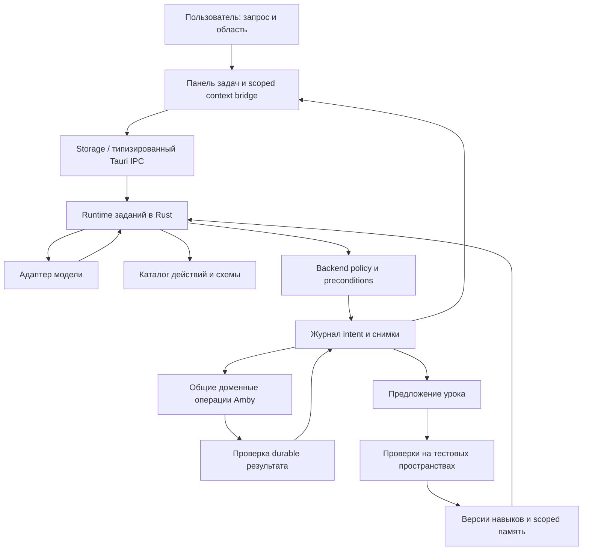

# ИИ-агент Amby: архитектура и полный план реализации

Статус: план, реализация не начата в рамках этого документа.  
Дата: 2026-09-30. Версия плана: 2. Первая редакция: 2026-09-24.

План подготовлен по текущему рабочему дереву, включая незакоммиченные изменения.
Наличие файла или существующего теста не означает, что соответствующая возможность
проверена для агентного использования. Перед реализацией выполняется пакет H-00.

Связанные документы:

- [Оркестрация: пакеты работ, зависимости и задания агентам](./ai-harness-orchestration.md).
- [Приёмка: сценарии, критерии и доказательства](./ai-harness-acceptance.md).
- [Подробный контракт harness: действия, права, runtime, навыки и плагины](../ai-harness.md).
- [Формат журнала, состояния и восстановления](../ai-state-format.md).
- [Начальный каталог действий с привязкой к текущим API](../ai-action-catalog.md).
- [Контракт файлов и сохранения](../vault-format.md).
- [Совместимость Markdown](../markdown-compatibility.md).
- [Нативная проверка storage](../native-storage-contract.md).
- [Базы: система](../database-system.md), [формат](../database-format.md), [runtime](../database-runtime.md).
- [Темы и локализация](../themes-and-localization.md).
- [План модульной архитектуры](./modular-architecture-0.1.5-plan.md).

Во второй редакции добавлены проекты конкретных контрактов и учтено рабочее
дерево на 2026-09-30. Они уточняют режимы выполнения, field-level permissions,
editor barriers, результаты частичной записи, crash recovery, обучение и
plugin lifecycle. H-00/H-01 остаются запланированными: перед реализацией нужны
актуальный baseline, полная UI-инвентаризация, schemas и исполняемые fixtures.
Действующие форматы данных имеют приоритет перед предлагаемыми агентными
adapters; найденные расхождения зафиксированы в каталоге для разрешения в H-00.

## 1. Цель и границы

ИИ выполняет содержательные действия пользователя через API приложения: работает
с заметками, папками, базами, представлениями, Canvas, Excalidraw, оформлением,
настройками и разрешёнными расширениями. Пользователь может попросить создать
плагин и последовательно дорабатывать его в приложении.

Каждое действие наблюдаемо. Каждое поддерживаемое изменение имеет описанный
способ восстановления. Агент работает только в выданной области пространства
и с разрешёнными ключами настроек. Обучение навыкам подчиняется тем же ограничениям.

Обязательные продуктовые требования:

1. Действия доступны без кликов по интерфейсу и без монтирования редактора.
2. UI и агент используют общую доменную логику, сохраняющую контракты Amby.
3. Журнал охватывает чтение, поиск, попытки изменений, отказы, ошибки,
   проверки, отмену, откат, работу с памятью, навыками и плагинами.
4. Откат отдельного действия и задания целиком сохраняет последующие правки
   пользователя. Конфликт показывается явно.
5. Задание переживает закрытие панели и восстанавливается после перезапуска
   приложения без повторного создания объектов.
6. Агент знает доступные возможности текущей версии и включённых модулей.
7. Навыки версионируются; улучшения проходят проверку и могут быть отменены.
8. Пользователь видит область доступа, ход работы, результат, историю,
   использованные навыки и может остановить выполнение.
9. Облачному провайдеру передаётся только разрешённый контекст. Локальное
   хранение Amby не означает автоматически локальную обработку моделью.
10. Расход модели и фонового обучения ограничен отдельными бюджетами.

Термин «все действия пользователя» означает покрытие инвентаризации H-00.
Каждое действие получает статус `implemented`, `requiresUserInteraction`,
`blockedByPolicy` или `missingImplementation` с причиной и пакетом-владельцем.
Неизвестные возможности и заглушки не считаются поддержкой. Все заявленные
в этом плане сценарии реализуются; намеренные границы отмечаются отдельно.

За пределами обычного агентного доступа: произвольный shell, изменение кода
самого приложения, чтение секретов, изменение политики безопасности и журнала,
самовольное расширение области, публикация наружу, обновление бинарника Amby.
Выбор системной папки и ввод секрета остаются действиями пользователя.
Плагин может расширять функциональность только через проверенный SDK и выданные
права; возможность писать плагин не выдаёт системные полномочия.

## 2. Исходное состояние

| Область    | Наблюдаемая основа                                                                                                                                | Что требуется                                                                               |
| ---------- | ------------------------------------------------------------------------------------------------------------------------------------------------- | ------------------------------------------------------------------------------------------- |
| ИИ         | `src/components/workspace/ai-panel.tsx`, `src/lib/ai.ts`, `src-tauri/src/ai.rs`: текстовый чат, streaming, отмена, несколько семейств провайдеров | Структурированные tool calls, долговечные задания, проверенный контекст, журнал             |
| Данные     | `src/lib/storage/port.ts`, `database-port.ts`, Rust `commands/`, `bundle/`, `database/`                                                           | Общий контракт операций с происхождением, scope, preconditions и receipt                    |
| Редакторы  | `use-doc-store.ts`, `autosave/autosave-coordinator.ts`, recovery, serialization lifecycle                                                         | Координация агентных изменений с открытыми буферами и несколькими окнами                    |
| Схемы      | `src/lib/canvas-format.ts`, `sketch-format.ts`, редакторы Canvas/Excalidraw                                                                       | Операции над элементами без UI, layout, сохранение неизвестных полей и проверка изображения |
| Настройки  | `app-config.ts`, `use-settings-store.ts`, `settings-repository.ts`, `src/themes/`                                                                 | Узкие типизированные операции, backend allowlist ключей, CAS и откат отдельных значений     |
| Расширения | `src/lib/modules/`, Rust `package_manager.rs`, `commands/modules.rs`                                                                              | Аудит реального исполнения, единая политика, изоляция SDK, мастерская                       |
| Проверки   | Vitest, Rust tests, native contract/UI runners                                                                                                    | Детерминированный fake provider с настоящими mutations, failure injection, eval corpus      |

`CommunityPluginSandbox` и Worker runtime существуют, но отсутствие DOM в Worker
само по себе не доказывает изоляцию сети, IPC и host API. H-70 проверяет обходы
реальным исполняемым кодом в production runtime. Прошлые аудиты и release notes
содержат сведения о разных состояниях дерева; H-00 проверяет актуальные факты.

Текущий `package.json` задаёт `verify -> verify:full`, включая форматирование,
Knip, Clippy, Rust tests и проверку bindings. Описание старого сокращённого
`verify` в документах не уменьшает этот gate. В `vitest.config.ts` сейчас
включены также `tests/**/*.test.{ts,tsx}`; существующие component tests учитывать,
но не принимать за доказательство поведения нативного приложения.

## 3. Архитектура



### 3.1 Размещение ответственности

- Rust владеет политикой, run lifecycle, журналом, очередью действий,
  credentials, inference transport, восстановлением и durable mutations.
- UI передаёт выбранные пользователем объекты/область и наблюдения редактора,
  отображает состояние, запрашивает действия через storage. Закрытие панели
  не является владельцем жизненного цикла задания.
- Открытые буферы остаются в существующих stores и autosave coordinator.
  Новый bridge согласует их с runtime, не создавая вторую модель документов.
- Каталог действий принадлежит приложению. Модель получает только разрешённые
  дескрипторы и не регистрирует новые привилегированные обработчики.
- Доменная операция не вызывает LLM и не зависит от открытой вкладки. Сетевой
  вызов модели никогда не выполняется под блокировкой записи vault.
- События выполнения имеют последовательные номера. UI восстанавливает
  пропущенные события из журнала, а не только слушает transient events.

Предлагаемые новые границы, окончательное разбиение фиксируется в H-01:

```text
src-tauri/src/app_actions/    # registry, policy, executor, receipts, domain adapters
src-tauri/src/agent/          # runtime, context, providers, journal, recovery,
                             # skills, learning, evaluation, plugin authoring
src-tauri/src/commands/agent.rs
src/lib/storage/agent-port.ts # через существующий StoragePort / adapters
src/lib/agent/               # чистые UI-facing модели и helpers
src/components/workspace/ai/ # tasks, scope, changes, history, skills, workbench
tests/fixtures/agent/        # только synthetic fixtures
```

Это целевые каталоги, а не свидетельство существующей реализации. Большие модули
разделять по ответственности; `lib.rs` и `workspace.tsx` остаются точками сборки.

### 3.2 Контракт действия

`ActionDescriptor` содержит стабильный `id`, версию, описание, схемы входа/выхода,
module dependency, effect class, требования к правам, доступность preview,
тип проверки результата, класс отмены и лимиты размеров.

`ActionRequest` содержит `runId`, `operationId`, параметры и preconditions.
Actor, действующая grant и проверенные resource references назначаются host,
а не доверяются полям, присланным моделью или плагином.

`ActionReceipt` содержит реальный исход, созданные IDs, before/after revisions,
перечень затронутых ресурсов, journal references, verification result,
состояние индекса и возможность отката. `succeeded` с cache status `pending`
отличается от `failedBeforePublish`; восстановление индекса не повторяет уже
выполненную запись. Точная таблица outcomes находится в подробном контракте.

Общие ошибки: `permissionDenied`, `scopeChanged`, `moduleUnavailable`,
`revisionConflict`, `dirtyBufferConflict`, `validationFailed`,
`journalUnavailable`, `quotaExceeded`, `cancelled`, `outcomeUnknown`,
`unsupportedCapability`, `idempotencyConflict`. Transport errors остаются
отдельно от domain errors.

Видимые изменения интерфейса, например открытие вкладки, могут иметь session-only
undo. Durable изменения должны иметь durable inverse. Внешние необратимые
эффекты не включаются в общий обещанный откат; по умолчанию они недоступны.

### 3.3 Каталог покрытия

H-00 расширяет следующую таблицу до каждой реальной пользовательской операции.
H-46 закрывает пробелы; ограничение модулем не превращает реализацию в `done`.

| Домен         | Минимальное покрытие                                                                                    | Основные пакеты  |
| ------------- | ------------------------------------------------------------------------------------------------------- | ---------------- |
| Заметки       | Поиск/чтение, создание, точечные правки body/source, заголовки, списки, таблицы, ссылки, колонки        | H-11, H-32, H-40 |
| Структура     | Папки, rename/move, bundles/layers, archive/trash/restore, согласованные backlinks                      | H-40             |
| Метаданные    | Теги, иконки, разрешённый frontmatter, custom properties, закрепления                                   | H-40, H-45       |
| Базы          | Attached/standalone, schema, options, rows/values, relation, formula, templates, assets, YAML sync      | H-41             |
| Представления | Поддерживаемые layout, фильтры, сортировка, группировка, видимость свойств, linked views                | H-41             |
| Canvas        | Карточки заметок/текста/локальных вложений, связи, группы, координаты и layout                          | H-42             |
| Excalidraw    | Наброски из редактируемых элементов, текст, стрелки, группы, изображения из разрешённых assets, заметки | H-43             |
| Внешний вид   | Валидные темы, отдельные токены, доступные шрифты/масштаб, preview и откат                              | H-44             |
| Настройки     | Зарегистрированные ключи workspace/global, панели, раскладка, доступные shortcuts                       | H-44, H-45       |
| Модули        | Список, состояние, разрешённое включение/выключение, зависимости и пресеты                              | H-45             |
| История       | Scoped просмотр своих действий, diff, отмена, восстановление после сбоя                                 | H-23, H-24, H-33 |
| Навыки/память | Просмотр, создание, изменение, version pinning, disable/revert/forget                                   | H-50—H-63        |
| Плагины       | Создание проекта, изменение кода, тест, preview, локальная установка, обновление, rollback              | H-70—H-74        |

Неподдерживаемые приложением типы представлений, произвольные системные шрифты,
новые форматы схем и незарегистрированные настройки не выдумываются агентом.
Расширение продукта проводится отдельным явным пакетом, если оно необходимо
для обязательного сценария. Генерация растровых изображений внешним сервисом
не требуется для редактируемых набросков Excalidraw.

## 4. Политика области доступа

Grant выдаётся backend после явного выбора в доверенном UI и содержит:

- persistent workspace identity, canonical root и текущую vault generation;
- отдельные read/write roots и при необходимости разрешённые object IDs;
- allowlist действий и ключей настроек с `workspace`/`global` scope;
- доступные namespace памяти, навыков, plugin project и журнала;
- выбранный provider profile, допустимость передачи контента этому provider;
- срок действия/ревизию grant, бюджеты и правила подтверждений.

По умолчанию задание принадлежит одному workspace. Работа только с глобальными
настройками возможна с отдельной grant. Смешанное задание «заметки + глобальная
тема» явно показывает обе области и применяет права к каждой операции.

Policy проверяется до чтения, до передачи контекста модели и непосредственно
перед публикацией изменений. Смена vault, отзыв прав, выключение модуля и
изменение policy revision останавливают дальнейшие действия. Старый receipt
или подтверждение не выдаёт право работать в новом контексте.

Обязательные пограничные случаи:

- Canonical containment, symlinks/junctions, drive/UNC, case-only rename,
  Unicode paths, несуществующий leaf с проверенным родителем, TOCTOU.
- Все затронутые ресурсы rename/move/refactor/batch входят в write scope.
  Backlink за пределами scope блокирует общий refactor до нового решения
  пользователя. Агент не получает текст или имя недоступной заметки.
- Relation, transclusion, preview, counts и aggregates не раскрывают данные
  соседнего раздела. Фильтрация scope выполняется до выдачи результатов и лимита.
- Схема базы может лежать за пределами разрешённой папки со строками: доступ
  к строкам не даёт автоматически право менять manifest всей базы.
- Scope ограничивает также историю, старые snapshots, embeddings, память,
  исходники навыков, вывод тестов и renderer previews. Контекст, накопленный до
  сужения прав, пересобирается; старые кеши и provider conversation IDs не
  переиспользуются для закрытых данных.
- Содержимое заметки/импортированного навыка является данными. Оно не становится
  системной инструкцией и не может изменять policy. Текущий chat prompt,
  вставляющий заметку в system text, заменить в H-32.
- API keys остаются в credential storage. Настройка внешнего вида не даёт права
  менять endpoint модели, сеть, credentials, sandbox или правила логирования.
- Внутренние операции с журналом разрешены host, но raw доступ к этим каталогам
  через файловые инструменты агента отсутствует.

## 5. Журнал, данные для отмены и crash recovery

### 5.1 Durable формат

Предлагаемый формат v1: приложение хранит AI state в выделенном подкаталоге
app data, `ai/v1/workspaces/<opaque-workspace-id>/`; глобальные задачи используют
отдельный `ai/v1/global/`. Путь не выдаётся модели как writable directory.
Workspace identity не основана только на basename папки и не меняет note IDs.
Перемещение/копирование vault требует явной проверки привязки журнала к root;
по совпадению имён старые grants не восстанавливаются.

Источник истины — версионированные immutable event/operation records и
content-addressed blobs исходных данных. SQLite-проекция для поиска по журналу
перестраивается из этих записей и не смешивается с `.amby/notes.db`.
Проект точного файлового контракта и схемы публикации описан в
[ai-state-format](../ai-state-format.md). H-01 закрепляет его schemas; H-21 доказывает
crash consistency. Новые версии формата имеют preflight, backup, migration
outcome и документированный rollback.

Запись содержит event sequence, timestamps, run/step/operation ID, actor,
scope reference, action/schema version, redacted parameters, resource IDs,
expected/actual revisions, outcome, verification и inverse references.
Learning proposals ссылаются на evidence events. История не хранит скрытые
рассуждения модели; пользователь получает краткое объяснение действия.

Отдельные события фиксируют запрос/завершение модели с разрешёнными references
контекста и usage, изменение плана, запрос/решение подтверждения, смену grant,
pause/resume, старт/результат фоновой проверки. Это позволяет восстановить
последовательность работы, даже если модель не вызвала ни одного инструмента.

Credentials, заголовки авторизации, секреты из transport errors не попадают
в журнал. Полный raw prompt не логируется по умолчанию. Текст заметок в снимках
для отмены защищён тем же scope и хранится локально; его не отправляют модели
целиком ради перечисления истории. Provider usage при отсутствии данных
помечается `unknown`, а не нулём.

### 5.2 Порядок изменения

1. Разрешить action, определить полный набор ресурсов, проверить grant,
   module state, редакторские буферы и expected revisions.
2. Взять существующий механизм serialization/locks в стабильном порядке;
   повторить preconditions на актуальном состоянии.
3. Надёжно сохранить необходимые before blobs, inverse plan и `prepared` intent.
   Неудача журнала/снимка запрещает mutation.
4. Выполнить доменную операцию через существующие atomic/no-replace helpers.
5. Перечитать результат, сохранить receipt/outcome и verification. Опубликовать
   события UI и обновить derived state без повторной записи источника.
6. При сбое между шагами recovery сопоставляет intent, before/after fingerprints
   и domain recovery records. Неоднозначность даёт `needsRecovery`, не blind retry.

JSON events публикуются атомарно со sync файла/каталога по возможностям платформы;
связанные blobs durable до публикации intent. Одновременное изменение файла и
журнала не объявляется единой filesystem-транзакцией. Окна сбоя между ними
покрываются reconciliation и failure injection.

`operationId` создаётся executor и сохраняется до первого side effect. Повтор
той же операции с тем же digest возвращает receipt; другие параметры с этим ID
отклоняются. Повтор пользовательского сообщения получает submission ID,
предотвращающий повторный запуск при transport retry.

### 5.3 Откат и сроки хранения

- Изменение текста восстанавливает bytes снимка при совпадении after revision.
  Для разрешённого field-level merge проверяются именно изменённые поля.
- Созданный объект можно убрать, только если его содержимое и новые зависимые
  объекты не изменены пользователем; undo перемещает его во внутренний архив
  Amby с manifest восстановления. Системная корзина имеет отдельный manual
  contract и не включается в обещанный автоматический откат.
- Rename/move восстанавливает контейнер, слои, пути и переписанные ссылки.
- Настройки откатываются по затронутым ключам; чужие изменения других ключей
  сохраняются. Изменение того же ключа вызывает конфликт.
- База восстанавливает durable metadata/values и затем перестраивает projection.
- Задача из нескольких шагов откатывается в обратном порядке зависимостей.
  Частичный откат имеет отдельный статус и перечень оставшихся эффектов.
- Ручной откат и автоматическая компенсация проходят policy и журналирование.
  Stop запрещает новые шаги, но не обещает мгновенно прервать atomic publication.
  Завершённые шаги остаются видимыми; Stop и Undo — разные операции.
- Каждое восстановление — новая запись. Агент не стирает аудит своего действия.
- Активные/неразрешённые задачи и обещанные пользователю точки отката защищены
  от pruning. Лимит диска приостанавливает новые изменения вместо удаления
  необходимых snapshots. Срок хранения и утрата возможности старого отката
  видны пользователю; очистка — отдельная пользовательская операция.
- Удаление заметки по обычной команде не равно полному удалению её исторических
  копий. Явное forget/purge учитывает snapshots, память, skills evidence и кеши;
  после очистки UI не обещает восстановление удалённых данных.

## 6. Runtime, контекст и редактирование

### 6.1 Жизненный цикл

Run: `queued → running → waitingForUser / pausedConflict / needsRecovery →
running → succeeded / failed / cancelled`. Отдельно хранятся завершённые
операции и `undoAvailable / partiallyUndone / undone`. Остановка процесса
оставляет interrupted run для recovery; завершение stream ответа не означает
завершение всей задачи.

Долгие задачи имеют checkpoints: цель, выполненные шаги, receipts, открытые
вопросы, текущий scope, версии модели/API/навыков. Продолжение повторно проверяет
права и revisions. После перезапуска новые writes не начинаются до reconciliation
и пользовательского продолжения задачи. Смена модели записывается в checkpoint.

Начальные инженерные лимиты для проверки в H-01: 40 model requests,
200 tool calls, 10 минут активного исполнения на один run; одна операция имеет
собственный timeout. Бюджет ожидания пользователя учитывается отдельно, при
ожидании нет polling модели. Фоновый разбор — не более одного предложения за
задание, 8 model requests и 2 минут. Значения конфигурируемы пользователем;
агент не увеличивает их сам. Повтор одинаковой ошибки после двух попыток
восстановления завершает шаг с диагностикой. Это проектные defaults, не
описание нынешних настроек приложения.

### 6.2 Провайдеры

Ввести общий stream protocol: text delta, tool-call begin/arguments/end,
tool result, usage, completion, error/cancel. Частичные JSON arguments не
исполняются. Проверять schema, размер и action availability перед вызовом.
Разные tools из одного ответа проходят собственные preconditions; конкурентное
чтение допустимо, конфликтующие writes сериализуются.

H-30 сначала доказывает один end-to-end provider adapter, затем реализует
контракт для текущих семейств Ollama/OpenAI-compatible/Anthropic/Azure.
Capability probe определяет поддержку инструментов конкретным endpoint/model.
Несовместимая модель остаётся доступной для обсуждения и получает понятный
статус отсутствия режима действий. Модель не обязана быть одной марки.
Structured tool calling не подменяется исполнением кода из текстового ответа.

### 6.3 Контекст и открытые буферы

Context содержит явные ссылки на выбранные объекты, scoped search results,
прочитанные fragments с revisions, доступные actions и нужные skills.
Truncation обозначается явно; агент может запросить следующий фрагмент.
Сводка длинного диалога хранит receipts и нерешённые ограничения, а не
используется как источник истинных revision/permissions.

На каждом окне bridge регистрирует владельца открытого документа и dirty state.
Перед mutation executor запрашивает сериализацию/flush затронутого буфера через
существующий lifecycle и autosave coordinator. Snapshot для агентного undo
берётся после успешного сохранения предшествующих пользовательских правок.
Если пользователь редактирует параллельно или flush не подтверждён, mutation
останавливается с конфликтом. Нельзя молча заменить in-memory buffer дисковой
версией. Потеря окна/lease требует recovery, а не предположения «документ чистый».
Закрытые документы обрабатываются тем же доменным API без editor instance.

## 7. Навыки и обучение

### 7.1 Разные виды долговременных данных

| Вид              | Содержание                                            | Правила изменения                                     |
| ---------------- | ----------------------------------------------------- | ----------------------------------------------------- |
| Контракты Amby   | Каталог действий, schemas, ограничения хранения       | Версионируются с приложением; агент не переписывает   |
| Предпочтения     | Явные пользовательские предпочтения в заданном scope  | Видимы, редактируемы, можно забыть/отключить          |
| Навыки           | Повторяемые процедуры и способы проверки              | Версии, evidence, тесты, disable/revert               |
| Журнал           | Факты действий и результатов                          | Пишет host; исторические события не редактирует агент |
| Рабочий контекст | План конкретного задания, receipts, выбранные ресурсы | Ограничен run и пересобирается при смене прав         |

Skill package: `SKILL.md`, references/templates и при необходимости resources.
Тело совместимо с форматом Agent Skills в пределах поддерживаемых полей;
собственные version/provenance/eval records хранятся рядом. Импортируемый
`scripts/` не становится разрешением на исполнение. Код проходит правила
плагинов H-70—H-74. Отсутствующие capabilities показываются до запуска навыка.

Skill revision содержит immutable hash, автора/источник, parent revision,
scope, required actions/modules и версии, evidence references, проверки,
статус `draft / proposed / verified / active / disabled / archived`.
Пользовательские и bundled навыки имеют владельцев; автономный curator
обрабатывает только явно выделенную ему коллекцию. Запущенная задача использует
фиксированный snapshot версий до checkpoint/restart.

### 7.2 Цикл обучения

1. Выбрать законченную задачу с надёжными receipts или явным исправлением.
2. Найти существующий навык и определить повторяемый урок. Разовая просьба,
   временный сбой и отсутствие проверки не становятся общей инструкцией.
3. Создать proposal с diff, evidence, scope, parent hash и заявленным улучшением.
4. Проверить schemas, ссылки, размеры, запрещённые возможности, отсутствие
   секретов/частных значений за пределами исходного scope.
5. Выполнить старую и новую версию на свежих fixtures с одинаковым model config;
   отдельный holdout corpus не передаётся автору proposal.
6. Сравнить correctness, scope violations, целостность данных, undo,
   interventions, tool calls, latency и tokens. LLM judge применим к оформлению,
   но не заменяет механическую проверку файлов, прав и revisions.
7. В начальном `propose` режиме показать пользователю результат. `autoVerified`
   включается отдельно и применим только к проверенным классам text-only
   изменений внутри agent-owned collection, без новых прав и executable code.
8. Активировать revision через журнал; ухудшения ведут к disable/revert с
   сохранением результатов. «Предложение создано» не означает «обучение успешно».

Learning jobs не имеют обычного write-доступа к vault. Eval запускается на
копиях synthetic fixtures через те же domain actions и изолированный test state.
Replay не повторяет реальные пользовательские mutations и внешние эффекты.
Урок из ограниченной папки остаётся ограниченным. Публикация в общий skill
namespace — отдельная операция с очисткой контента и явным пользовательским
выбором; сводка сама по себе не снимает исходный scope.

Curator объединяет дубликаты по содержанию и результатам, показывает diff,
сохраняет ссылки/support files и архивирует с возможностью восстановления.
Один лишь возраст или малое число запусков не доказывают бесполезность навыка.
Обновление API Amby помечает несовместимые навыки и запускает их проверки.

## 8. Мастерская плагинов

Результат этапа: пользователь просит сделать плагин, видит проект и preview,
просит доработку, получает новую проверенную версию и может локально установить
или откатить её внутри приложения.

- Plugin project хранится в отдельном разрешённом namespace, связанном с run.
- Агент получает узкие инструменты scaffold/read/patch/build/test/preview;
  сборка выполняется доверенным runner с фиксированным toolchain. Произвольные
  shell-команды и install scripts зависимостей не выдаются модели.
- Первая версия использует поддерживаемое SDK и разрешённые bundled dependencies.
  Добавление внешних зависимостей требует отдельного проверяемого механизма.
- Preview использует изолированные данные. Доступ к живому vault выдаётся
  отдельно. SDK использует тот же action executor и журнал, включая действия
  установленного AI-created плагина вне исходного диалога.
- Плагин работает с пересечением собственных разрешений, текущей grant и
  пользовательской policy. Callback, background task или новый skill не расширяют его.
- Worker без DOM не считается достаточным security boundary. Выбор runtime
  подтверждается escape/network/IPC/resource-limit тестами на desktop.
- Изменение прав между версиями показывается до установки. Локальный плагин
  помечается как локальный; ему не присваивается подпись официального издателя.
- Установка, активная версия, crash quarantine и rollback переживают restart.
  Uninstall сохраняет пользовательские данные. Data migration плагина имеет
  версию, preflight, backup и проверенный путь восстановления.

## 9. Этапы и готовность

| Этап                | Пакеты    | Результат и gate                                                 |
| ------------------- | --------- | ---------------------------------------------------------------- |
| Подготовка          | H-00—H-01 | Проверенная инвентаризация, baseline и замороженные контракты G0 |
| 1. Действия         | H-10—H-12 | Общий API, renderer bridge и truthful capability catalog G1      |
| 2. Защита и история | H-20—H-24 | Policy, журнал, recovery и конфликтобезопасный undo G2           |
| 3. Агент заметок    | H-30—H-34 | Настоящий tool loop, context, task UI, полный note scenario G3   |
| 4. Возможности Amby | H-40—H-46 | Заметка + база + схема + настройки, закрытая карта покрытия G4   |
| 5. Навыки           | H-50—H-52 | Проверенные навыки, версии, подбор и управление G5               |
| 6. Обучение         | H-60—H-63 | Предложения на evidence, eval, bounded curator, rollback G6      |
| 7. Плагины          | H-70—H-74 | Мастерская, реальная изоляция, установка и полная приёмка G7     |

Первые работающие вертикальные сценарии появляются на G3, полноценная работа
с контентом — на G4. G3 и G4 не означают завершение всего плана. Обучение и
создание плагинов закрываются только своими gates. Скорость выполнения этапов
оценивается после H-00; календарные обещания без baseline не требуются.

## 10. Заимствования и источники

Материалы просмотрены 2026-09-24. Это архитектурные ориентиры. До переноса кода
H-00 фиксирует конкретный upstream commit/tag, нужные файлы, лицензию и условия
атрибуции. Ссылка на `main` не является воспроизводимой зависимостью.

- [Hermes Skills](https://hermes-agent.nousresearch.com/docs/user-guide/features/skills):
  progressive disclosure, skill creation/update, процедуры отдельно от краткой памяти.
- [Hermes Curator](https://hermes-agent.nousresearch.com/docs/user-guide/features/curator)
  и [исходник](https://github.com/NousResearch/hermes-agent/blob/main/agent/curator.py):
  обслуживание коллекции, evidence, archive/restore, версии и per-mutation ledger.
  Документация допускает mutation при сбое ledger; Amby требует durable intent
  до изменения и не переносит эту best-effort семантику.
- [OpenClaw Skill Workshop](https://docs.openclaw.ai/tools/skill-workshop/how-it-works):
  staged proposal, target hash, stale detection, rollback metadata до apply.
- [OpenClaw Self-learning](https://docs.openclaw.ai/tools/self-learning):
  критерии полезного урока и режимы. Его direct-edit auto maintenance отличается
  от proposal path; для Amby все изменения обучения проходят общий журнал.
- [OpenClaw Agent loop](https://docs.openclaw.ai/concepts/agent-loop):
  session queues, lifecycle events, durable ownership и отмена.
- [Hermes Self-Evolution](https://github.com/NousResearch/hermes-agent-self-evolution):
  варианты навыков и сравнение на eval. В просмотренном README оптимизация
  skills реализована, более широкое самоизменение кода описано как будущее.

Первое внедрение использует управляемый proposal/eval процесс. DSPy/GEPA или
другой оптимизатор можно подключить позже через тот же интерфейс proposals,
не выдавая ему права изменять policy, gates и контрольные ожидания.

## 11. Как запускать реализацию

Точка входа для будущего исполнителя — этот план; предметные контракты находятся
в `docs/ai-harness.md`, `docs/ai-state-format.md` и `docs/ai-action-catalog.md`.
Новые планы [единой доски](../excalidraw-canvas-claude-plan.md),
[баз](../notion-database-parity-audit-2026-09-30.md) и
[творческого модуля](../creative-module-claude-plan.md) согласуются через общие
domain APIs. Их наличие не считается реализацией возможностей для агента.

Оркестратор начинает с [инструкции запуска](./ai-harness-orchestration.md#инструкция-для-оркестратора),
ведёт статусы пакетов и не перескакивает через gates. Проверки и evidence
определены в [документе приёмки](./ai-harness-acceptance.md).
Этот план разрешает описанные работы только после отдельной команды пользователя
начать реализацию; текущая задача — подготовка документов.

### Проверка документационной редакции от 2026-09-30

Добавлены три предметные спецификации, обновлены план/оркестрация/приёмка и
публичный changelog. Код приложения, зависимости и конфигурация в этой работе
не изменялись; исходное дерево уже содержало отдельные пользовательские изменения.

- Проверены существование относительных ссылок и ссылки на заголовки, уникальность
  34 H-пакетов, 70 Q-семейств и 16 дополнительных именованных вариантов.
- Форматирование изменённой документации и `git diff --check` прошли.
- `npm run build` прошёл; Vite сообщает о большом chunk и неэффективном dynamic
  import существующего `src/lib/debug/health.ts`.
- `npm run verify` прошёл: 892 frontend-теста, 401 Rust-тест, 2 Rust-теста
  проигнорированы согласно существующей конфигурации; проверка generated bindings
  прошла. ESLint сообщает одно предупреждение о зависимости React hook в
  `settings-modules.tsx`.
- Native packaging и интерактивные сценарии нового агента не запускались:
  агент ещё не реализован, desktop code/IPC/permissions в этой работе не менялись.

Это проверка состояния репозитория при подготовке документов. Она не является
PASS для G0–G7 или подтверждением будущего harness. H-00 повторяет baseline checks
при старте реализации; результаты от другого состояния дерева не наследуются.
