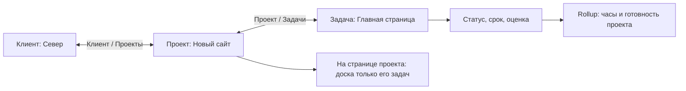

# Базы данных Amby: аудит и план достижения возможностей Notion

Дата: 30 сентября 2026 года. Статус: анализ текущего кода и предложение к реализации.

## 1. Главный вывод

Amby уже имеет подходящую основу для баз уровня Notion: запись является Markdown-страницей со стабильным ID, схема отделена от значений, SQLite служит проекцией, существуют представления, Relation, вычисления и редактор в боковой панели. Переписывать приложение или заменять SQLite другой СУБД для этой цели не требуется.

Основной разрыв находится между доменной моделью и законченными пользовательскими сценариями. Наличие типа Relation, файла GalleryView или вычислителя Rollup ещё не означает, что человек может удобно построить связанную систему проектов, задач, клиентов или персонажей.

Рекомендуемый порядок: надёжность операций → единая страница записи и свойства → полноценные Relation и Rollup → сохранённые настройки представлений → качественные Gallery/Board/List → встроенные базы и шаблоны → Calendar/Timeline → расширенный паритет.

Под «1 в 1» следует зафиксировать две проверяемые цели: одинаковые возможности в выбранных сценариях и сопоставимое качество взаимодействия. Точное визуальное совпадение требует отдельно закреплённых экранов, темы, размеров окна и состояний эталона. Этот аудит определяет функциональную и архитектурную часть; попиксельная сверка экранов не проводилась.

## 2. Основания и границы анализа

Проверены frontend баз, storage/IPC-типы, Rust-модули операций, истории, формул, проекции и запросов, интеграция с InfoPanel, документация формата и доступные тесты. Возможности Notion сверены с официальной справкой на дату аудита.

Анализ выполнен по рабочему дереву ветки `dev`, где до начала уже были незакоммиченные изменения, в том числе в формулах, проекции и frontmatter. Выводы относятся к этому состоянию, а не только к последнему коммиту. Старый аудит стабилизации использован как контекст; его прежние дефекты не объявляются актуальными без проверки кода.

Это статический аудит с проверкой сборки и существующих frontend-тестов модуля баз. Нативное окно, браузерные сценарии, аварийное завершение процесса и нагрузочные испытания в этой работе не запускались. Ниже отдельно обозначены факты из кода, последствия, требующие воспроизведения, и предлагаемый контракт.

## 3. Что означает актуальный эталон Notion

В Notion запись базы — страница с содержимым и свойствами. Одинаковые данные показываются через независимые представления. Современная модель также различает визуальный контейнер базы и источники данных; несколько источников можно подключить к одному контейнеру. Это не следует автоматически трактовать как SQL UNION разнородных схем. Источники: [страницы баз](https://www.notion.com/help/intro-to-databases), [представления](https://www.notion.com/help/views-filters-and-sorts), [источники данных](https://www.notion.com/help/data-sources-and-linked-databases).

Relation связывает страницы; возможны обратная сторона и ограничение одной страницей. В отображение связи можно включить свойства связанной страницы. Rollup получает и агрегирует значения по связи. Источник: [Relations & rollups](https://www.notion.com/help/relations-and-rollups).

Layout страницы задаёт размещение свойств, закреплённые поля, секции и панель подробностей. Он применяется к страницам базы, а не является отдельным табличным видом. Источник: [Layouts](https://www.notion.com/help/layouts).

Полный актуальный паритет шире привычных Table/Board/Gallery: в справке есть Calendar, Timeline, Chart, Feed и Map, формы, кнопки и расширенные свойства. Поэтому нельзя объявить полное соответствие после добавления только Relation и красивых карточек. Источники: [каталог представлений](https://www.notion.com/help/category/database-views/all), [свойства](https://www.notion.com/help/database-properties), [Forms](https://www.notion.com/help/forms), [Buttons](https://www.notion.com/help/database-buttons).

## 4. Матрица текущего состояния

«Есть» означает найденный реализованный путь, а не сертифицированный end-to-end сценарий. «Частично» — инфраструктура существует, но пользовательский путь или семантика неполны.

| Возможность                   | Amby сейчас                                                                          | Что требуется                                                                                 |
| ----------------------------- | ------------------------------------------------------------------------------------ | --------------------------------------------------------------------------------------------- |
| Запись как отдельная страница | Есть Markdown, стабильный ID, открытие редактора                                     | Общая композиция страницы: заголовок, иконка, обложка, свойства, связи, содержимое            |
| Table                         | Наиболее развитый вид: редактирование, ширины, скрытие, сортировка, загрузка страниц | Сохранение всех настроек вида, диапазоны выделения, полный paste/undo, расчёты внизу колонок  |
| Relation                      | Настройка целевой базы, one/two-way, 1/много, создание связанной страницы            | Полный поиск, единый редактор во всех местах, контекстные свойства, надёжная запись           |
| Rollup                        | Тип, валидация, вычислитель существуют                                               | Создание и настройка через UI/IPC, предпросмотр результата, ошибки и пересчёт                 |
| Formula                       | Парсер, арифметика/логика, ограниченный набор функций, зависимости                   | Редактор с подсказками, даты, списки/страницы, переход по Relation, совместимость функций     |
| Board                         | Колонки из загруженных строк, DnD, виртуализация карточек                            | Названия/цвета опций, пустые колонки, порядок групп, полные счётчики и загрузка по группам    |
| Gallery                       | Виртуализированная сетка                                                             | Реальные изображения, обложки, источники превью, размеры, выбранные свойства                  |
| List                          | Список записей с общими значениями                                                   | Компактные свойства по схеме, иконки, группировка и виртуализация                             |
| Chart                         | Горизонтальные полосы количества, максимум 12 групп                                  | Настройка типа, категории, меры, агрегации, единый фильтр и инвалидизация                     |
| Calendar / Timeline           | Не входят в переключатель реализованных видов                                        | Новые renderer и дата-ориентированные запросы/операции                                        |
| Feed / Map                    | В проверенном модуле не найдены                                                      | Поздний этап полного паритета; Map требует модели места и отдельного решения о сетевых картах |
| Сохранённые views             | CRUD и формат имеются                                                                | Подключить весь runtime UI к view document, убрать расхождение с локальным состоянием         |
| Фильтры/сортировки            | Backend AST и курсор; UI: AND-набор строк и одна сортировка                          | Вложенные AND/OR, типизированные значения, несколько сортировок, относительные даты           |
| Linked database               | Ссылка `databaseId/viewId`, загрузка записей                                         | Общие renderer, редактирование, локальные настройки, фильтр по текущей странице               |
| Шаблоны                       | Есть формат и выбор существующего шаблона при создании                               | Полный редактор, CRUD, default по виду, динамический контекст страницы, повторение позднее    |
| Sub-items                     | Иерархия записей связана с filesystem/bundle                                         | Завершённый UX и решение о логической иерархии, не зависящей от перемещения файлов            |
| Свойства страницы             | Есть интеграция с InfoPanel                                                          | Общий контракт редакторов с Table/Peek и сохранённый layout страницы                          |
| CSV / clipboard               | Парсеры/планирование и экспорт слоя есть                                             | Завершённый мастер импорта с preview, связями, ошибками и восстановлением                     |
| Forms / Button / automations  | Полный database-сценарий в проверенном модуле не найден                              | Отдельные этапы; локальные действия и облачные сценарии имеют разные требования               |
| Совместная работа/права       | Local-first архитектура                                                              | Отдельный продуктовый поток: идентичности, синхронизация, разрешение конфликтов, сервер       |

## 5. Подтверждённые пробелы и риски

### F1. Поиск Relation ограничен первыми 100 страницами — высокий приоритет

В [database-workspace.tsx](../src/components/workspace/database/database-workspace.tsx) эффект `relationTargets` запрашивает целевую базу с `page: { limit: 100 }`, сортируя по названию. Следующая страница не загружается. [RelationPickerPopover](../src/components/workspace/database/relation-picker-popover.tsx) фильтрует переданный массив на клиенте.

Следствие: существующая страница за пределами первой сотни не находится; название ранее выбранной связи тоже может оказаться неразрешённым. Пустой ответ поиска может предложить создать дубликат. Ошибка загрузки сейчас превращается в пустой массив.

Решение: поиск через backend по всей целевой базе, пагинация, отдельная пакетная загрузка выбранных ID, видимое состояние ошибки и защита от устаревшего ответа. Поиск и разрешение уже выбранных страниц — разные операции.

### F2. Relation использует более слабый протокол записи — блокер надёжности

[UpdateDatabaseRelationValueRequest](../src/lib/storage/database-types.ts) содержит generation, ID базы/страницы/свойства и полный массив целей. В нём нет `expectedRevision` и `operationId`, которые присутствуют в обычном batch-пути.

[update_database_relation_value](../src-tauri/src/database/mutations.rs) читает текущее содержимое и пишет несколько файлов последовательно. При ошибке пытается откатить уже записанное в памяти; отдельный durable-журнал этой операции не создаётся. Mutex на границе команды сериализует команды приложения, но не обнаруживает устаревшее намерение другого окна и не защищает от внешнего редактора.

Риски по коду: устаревший полный набор связей способен заменить более новый; завершение процесса между двумя записями способно оставить стороны несогласованными. Это не утверждение о воспроизведённой потере данных в текущем запуске.

Решение: единый протокол операций для обычных значений, Relation, изменения обратных свойств и undo; CAS/preflight для всех затронутых файлов, durable backup/journal, операция с устойчивым ID, восстановление после перезапуска. Где возможно, передавать намерение `add/remove/replace`, сохраняя проверку ревизии.

### F3. Удалённые цели связи не входят в явное обновление их проекции

В [команде update_database_relation_value](../src-tauri/src/commands/database.rs) целевая проекция обновляется по `request.target_note_ids`. При снятии последней связи этот массив пуст; прежние цели не входят в явный список обновления, хотя их файлы могли измениться.

Нужно возвращать фактический набор затронутых страниц, включая прежние цели, и обновлять проекцию по нему. Приёмочный тест должен проверить обе стороны сразу после unlink и после rebuild. Возможность того, что watcher позднее исправляет состояние, не заменяет явную согласованность результата команды.

### F4. Редакторы свойств расходятся по поведению

Таблица вызывает специальную relation-команду. В [InfoPanel](../src/components/workspace/panels/info-panel.tsx) `DatabasePropertyRow` передаёт `DatabaseCell` без relation options и callback открытия/создания страницы, а `commitDatabaseProperty` использует обычный batch.

Таким образом, один тип свойства подключён к разным путям чтения и записи. Нужен общий hook редактора свойства с одинаковым контрактом: схема, текущее значение, разрешение ссылок, CAS, очередь, ошибка, undo. Отдельные оболочки могут отличаться размером, но не семантикой.

### F5. Gallery пока не показывает выбранное изображение

В [gallery-view.tsx](../src/components/workspace/database/layouts/gallery-view.tsx) вызывается `resolveGalleryPreview`, но результат меняет класс фонового `span`. Изображение в карточке не отрисовывается. Вместо контентного превью видны заглушка, путь и `noteId`.

Нужен pipeline локального thumbnail: безопасное разрешение asset через storage/backend, уменьшение изображения, кэш, загрузка по видимости, осмысленный placeholder при отсутствии/ошибке. Источник превью выбирается в настройках вида.

### F6. Карточки и Board не получают полноценную схему отображения

[DatabaseValueCell](../src/components/workspace/database/database-value-cell.tsx) перебирает значения без schema: select/status выводятся как `optionId`; Relation использует ID при отсутствии `noteTitles`. Gallery и List не передают такой словарь. [Board](../src/components/workspace/database/layouts/board-view.tsx) подписывает обычную колонку её ключом; [board-model.ts](../src/components/workspace/database/layouts/board-model.ts) создаёт группы только по загруженным строкам.

Следствия: технические ID вместо читаемых названий, отсутствие пустых групп, зависимость состава колонок от пагинации. Это одновременно визуальная и логическая проблема.

Решение: общий форматтер значений с schema/options/references, конфигурация видимых свойств карточки, отдельный результат группировки с полными counts и курсорами групп. ID и filesystem-путь показывать в подробностях, когда пользователь их запрашивает.

### F7. Linked view является упрощённым списком

[linked-view.tsx](../src/components/workspace/database/linked-view.tsx) рисует `div` со строками title/path и кнопкой загрузки. Renderer выбранного вида, открытие строки, редактирование, toolbar отсутствуют в этом компоненте. Поля `filter` и `layout`, допустимые в [linked-reference.ts](../src/components/workspace/database/linked-reference.ts), компонентом не применяются.

Нужен единый `DatabaseViewHost` для вкладки, слоя и embedded-блока. Все используют одну модель данных; источник владеет схемой/значениями, embedding владеет своей конфигурацией представления либо явно ссылается на общий сохранённый вид.

### F8. Rollup существует в backend, но недоступен как завершённая функция

В [mutations.rs](../src-tauri/src/database/mutations.rs) создание `rollup` возвращает `Rollup requires a relation and target property`. В [диалоге свойства](../src/components/workspace/database/database-dialogs.tsx) Rollup не входит в список типов. Вычислитель в [formula.rs](../src-tauri/src/database/formula.rs) уже содержит ветки count/countUnique/sum/avg/min/max.

Решение: типизированные create/update-параметры, мастер «связь → поле → функция», проверка совместимости, пример результата и диагностика. Для progress добавить понятный процент выполнения, а не заставлять пользователя писать формулу с нуля.

### F9. Формат saved view богаче его фактического UI

В [format.rs](../src-tauri/src/database/format.rs) есть `openMode`, `fields`, `filter`, `sorts`, `group`, `layoutConfig`. В [TableView](../src/components/workspace/database/table-view.tsx) ширины, wrap и frozen column живут в локальном React-state. В workspace фильтры и одна сортировка также локальны; вызовы `updateDatabaseViewConfig` обслуживают смену layout, но не весь набор этих настроек.

Нужно хранить состояние представления под `(databaseId, viewId, hostId)` с явно выбранным владельцем сохранения. Перезапуск, два окна и переход Table → Gallery → Table не должны менять смысл вида. Временный search можно оставлять session-state; сохранённые фильтры и сортировки нужно отличать от него.

### F10. Chart имеет собственный урезанный путь запросов

[chart-view.tsx](../src/components/workspace/database/chart-view.tsx) всегда запрашивает `aggregation: "count"`, `limit: 12` и рисует полосы. Текущие search/filter overrides workspace в props не передаются; обновление не привязано к общему host invalidation.

Нужен общий query identity с остальными видами и полноценная настройка category/measure/aggregation/chart type. После изменения записи Chart должен пересчитываться без повторного открытия.

### F11. Batch recovery уже есть, но ошибки сохранения backup/journal игнорируются

В [apply_value_batch](../src-tauri/src/database/mutations.rs) присутствует журнал и startup recovery. Поэтому старое утверждение «batch вообще не имеет журнала» к текущему коду неприменимо. Однако результат записи backup, некоторых recovery-вызовов и финальной записи completed-журнала отбрасывается через `let _ = ...`; после этого backups удаляются.

Риск: штатный путь может продолжить запись без гарантированного recovery point; ошибка финализации способна оставить незавершённый журнал без нужных backups. Нужны fault-injection тесты и явные durable outcome, прежде чем переиспользовать этот код для Relation. Неуспешный backup должен останавливать mutation до изменения исходных файлов.

### F12. Контракты хранения в документации противоречат друг другу

[database-system.md](database-system.md) описывает значения в record shards, а [database-format.md](database-format.md), раздел 1.1, называет основным источником frontmatter. В том же format-документе остаются разделы о durable record values. Текущие `apply_value_batch` и Relation пишут Markdown frontmatter.

Перед изменениями нужно обновить единый контракт: что является актуальным source of truth, что legacy, что cache, каков переходный режим. Повторная смена хранилища «ради Notion» сейчас не обоснована. Исправить документ недостаточно: миграции, discovery, projection, шаблоны и экспорт должны пройти одну матрицу совместимости.

### F13. Rename свойства может переписывать Markdown — высокий приоритет

После изменения manifest функция `rename_database_property` в [mutations.rs](../src-tauri/src/database/mutations.rs) рекурсивно обходит Markdown-файлы контейнера, находит YAML-ключ по старому отображаемому имени и переносит значение в новый ключ. Результат атомарной записи при этом игнорируется. Этот цикл не оформлен как единая journaled-операция с CAS для всех заметок.

Следствие по коду: обещание «rename меняет только подпись» не соблюдается для заметок с совпавшим legacy-ключом; частичные ошибки и границы вложенных баз требуют отдельного воспроизведения. Нужны неизменный storage key для обычного rename и отдельная явная миграция legacy-ключей с preview, ограничением owning database, backup и отчётом о результате. Включить это в P0, до удобного массового редактирования схемы.

## 6. Как должна выглядеть целевая работа со страницами

Проверочный пример: базы «Клиенты», «Проекты», «Задачи».



Пользователь открывает проект из Table, видит ту же страницу в side peek, меняет статус, выбирает клиента и ниже управляет задачами. Созданная здесь задача сразу получает Relation к проекту. На странице клиента появляется этот проект. Завершение задачи обновляет прогресс проекта. Переходы не теряют несохранённый текст и положение исходного представления.

Предлагаемая композиция страницы:

```text
Проекты / Новый сайт                         Открыть во вкладке · Ещё
[локальная обложка, если задана]
🌐 Новый сайт
В работе       30 сентября — 20 октября       Готово 6 из 10

Клиент        ↗ Север              Ответственный   ↗ Анна
Бюджет        120 000 ₽            Приоритет       Высокий

Описание проекта — обычный Markdown

Задачи                       Таблица · Доска · Календарь      + Задача
[представление базы задач с фильтром «Проект = эта страница»]
```

Это концепция для Amby, не снимок существующего интерфейса и не заявление о точном воспроизведении Notion.

### 6.1. Общая страница записи

- Один компонент композиции для tab, side peek и center peek; тот же документ из `useDocStore` и существующая защита владения editor surface.
- Иконка через `IconValue`, локальная обложка, изменение отображаемого заголовка без обязательного rename файла.
- Закреплённые поля, секции «Основное», «Связи», «Дополнительно», hide-if-empty, настройка ширины.
- При изменении layout изменяется конфигурация базы, а Markdown-body остаётся прежним.
- Предыдущая/следующая запись, история переходов по Relation, открытие во вкладке, возврат к исходному scroll/focus.
- Source-only Markdown остаётся доступным в той же странице; наличие базы не обходит проверку round-trip.

### 6.2. Relation как полноценные связанные страницы

- В ячейке: иконка + название, несколько компактных ссылок и «ещё N»; открытие и unlink — разные действия.
- На странице: выбор compact/list/cards; показ нескольких выбранных свойств цели, например статуса и даты. Настройки принадлежат presentation, не значению связи.
- В picker: поиск по всей базе, selected section, загрузка следующей страницы, различение одноимённых страниц по breadcrumb и свойствам; Enter/стрелки/Escape, доступные checkbox/option semantics.
- Создание цели с выбором шаблона. Создать и связать — согласованная операция либо явный частичный результат с возможностью повторить связь без создания дубликата.
- Missing/trashed/out-of-database/loading/error — разные состояния ссылки; не выдавать ещё не загруженное название за удалённую страницу.
- Односторонняя связь, обратное поле, self-relation, ограничение 1/много, редактирование с любой стороны.
- При смене целевой базы, ограничении до одной страницы, выключении обратной связи или удалении свойства — preview влияния и определённый способ восстановления.
- Wiki-link, backlink и Relation сохраняют отдельные значения: упоминание в тексте не должно незаметно становиться структурным полем.

### 6.3. Rollup и формулы

Rollup UI должен позволять выбрать Relation, целевое поле и допустимый агрегат. Начальный набор: количество, уникальные, сумма, среднее, минимум/максимум, доля выполненных, ранняя/поздняя дата, показ исходных значений. Число без данных, ноль, ошибка и неполная связь не должны сливаться в одно пустое значение.

Для формул сначала нужен удобный редактор над существующим evaluator: autocomplete свойств, сигнатуры, подсветка, позиции ошибок и preview на выбранной записи. Затем — даты, списки, доступ к полям связанных страниц, операции map/filter и форматирование. Такой класс функций есть в [Notion Formula syntax](https://www.notion.com/help/formula-syntax); полную совместимость синтаксиса следует обещать только после отдельного корпуса проверок.

Внутренние ссылки на свойства должны разрешаться по ID. Переименование поля не должно ломать формулу. Пересчёт строится по графу зависимостей с ограничениями глубины/времени/размера результата и понятной диагностикой цикла. Выполнять JavaScript из пользовательских формул не нужно.

## 7. Красивые и функциональные представления

| Вид      | Целевой интерфейс                                                                                         | Обязательная логика                                                                                  |
| -------- | --------------------------------------------------------------------------------------------------------- | ---------------------------------------------------------------------------------------------------- |
| Table    | Тонкие разделители, читаемые ячейки, цветные status/select, компактный toolbar, фиксированный title       | Resize/reorder/freeze/wrap сохраняются; keyboard grid; multi-select; paste preview; aggregate footer |
| Board    | Настроенные колонки с цветом и счётчиком, короткие карточки, выбранные свойства, кнопка создания в группе | Пустые группы, порядок опций, group-level pagination, undo после DnD, создание с правильным статусом |
| Gallery  | Реальные обложки, 3 размера карточек, fit/crop, 2–4 выбранных поля                                        | Локальные thumbnails, lazy loading, стабильная высота/виртуализация, отсутствие лишних raw ID        |
| List     | Иконка/название слева, несколько свойств справа, группировка, умеренные отступы                           | Общие property renderers, keyboard navigation, виртуализация                                         |
| Calendar | Месяц/неделя, цветные компактные события, панель записей без даты                                         | Перенос меняет дату, диапазоны, часовые пояса/DST, отмена и создание на выбранную дату               |
| Timeline | Шкала времени, группы, полосы интервалов, связанные задачи                                                | Resize/drag диапазона, зависимости без циклов, preview сдвига дат, пакетная безопасная запись        |
| Chart    | Столбцы/линия/кольцо, легенда, выбор показателя                                                           | Полный filtered dataset, category/measure, точные decimal aggregates, drill-down                     |

Визуальная спецификация должна фиксировать состояния normal/hover/focus/selected/editing/pending/error/empty, светлую и тёмную темы, плотность, длинные русские названия и узкое окно. Цвет всегда сопровождается текстом или символом.

Сейчас часть database-компонентов использует конкретные `slate`/`amber` оттенки. Новая система должна использовать theme tokens; постоянные визуальные определения — в `src/themes/`, все строки — в `src/locales/resources.ts`. Общие компоненты `PropertyValue`, `StatusBadge`, `RelationChip`, `RecordCard` должны предотвращать расхождение Table, Gallery, Board и страницы записи.

## 8. Представления, вложенные базы и шаблоны

### Сохранённые настройки

Развести три уровня: schema источника, конфигурация вида, временное состояние окна. В view сохранять видимость/порядок/ширины полей, фильтры, несколько сортировок, группировку, вид карточек, способ открытия записи и условные цвета. Search, текущий focus и выделение — session-state.

Редактор фильтров должен работать с типами: option IDs для select/status, диапазон дат, relative date, Relation contains/empty, decimal comparisons. Пользователь не должен вводить операторы в строке вроде `>100` для обычного сценария. Один registry поддерживаемых операторов следует использовать для UI и backend contract tests.

### Linked view и текущая страница

Встроенная база должна использовать тот же renderer, что полная вкладка. Для проекта нужен параметр контекста `currentPageId`, подставляемый backend в валидированный фильтр. Это не строковая подстановка в SQL.

Новая задача внутри вида «Проект = эта страница» получает этот Relation автоматически. Если фильтр OR или отрицательный и не задаёт однозначные defaults, система не угадывает значения: показывает, почему новая запись может не попасть в вид.

Локальная настройка linked view не должна менять чужой dashboard. Следует явно различать «ссылка на общий сохранённый view» и «собственная конфигурация на том же источнике». Versioned reference сохраняет неизвестные поля и исходные байты при несвязанных изменениях Markdown.

### Шаблоны

Нужны создание/редактирование/дублирование/удаление, значения по умолчанию, Markdown-body и контекстные linked views. Фиксированная Relation в шаблоне и ссылка на создаваемую страницу должны иметь разные типы данных. В Notion шаблон может содержать свойства и содержимое, а также повторяться по расписанию: [Database templates](https://www.notion.com/help/database-templates).

Повторение в local-first приложении требует политики: пропущенные запуски, закрытое приложение, timezone и идемпотентность. Не обещать фоновый облачный режим без соответствующей службы.

### Sub-items и зависимости

Текущая filesystem-иерархия полезна для переносимости. Однако логическая подзадача и положение файла — разные понятия. Для точного workflow-паритета следует отдельно решить, нужна ли typed parent-relation без физического move. Если да, ввести её версионированно, исключить два конкурирующих владельца parent и сохранить возможность отображать filesystem-иерархию отдельно. Зависимости задач — другой направленный граф, не parent-child. Эталон: [Sub-items & dependencies](https://www.notion.com/help/tasks-and-dependencies).

## 9. Архитектура, которую стоит развивать

### 9.1. Сохранить существующие границы

```text
Tab / Layer / Embedded / Peek / InfoPanel
            ↓
DatabaseViewHost + RecordPage + PropertyEditors
            ↓
Zustand + focused hooks + query/mutation controllers
            ↓
storage.ts / DatabasePort / generated IPC
            ↓
Rust: schema, queries, relations, transactions, history
            ↓
Markdown/frontmatter + manifest/views/templates/assets
            ↓ rebuild / incremental projection
SQLite: membership, typed values, relation edges, search
```

Не создавать вторую таблицу всех записей в React-state и не читать filesystem из frontend. Не переносить пользовательские данные исключительно в SQLite. Не сохранять вычисленные rollup/formula как конкурирующие исходные значения.

### 9.2. Разделить источник и визуальный контейнер

На первом этапе существующий `databaseId` остаётся ID источника; файловая принадлежность записей не меняется. Presentation host ссылается на источник и view. Позднее контейнер сможет содержать вкладки нескольких источников без копирования Markdown и без одновременного владения заметкой несколькими схемами.

Такое расширение покрывает современный сценарий data sources, сохраняя переносимость. Общий UNION разнородных источников, если он понадобится, — отдельная спецификация согласования типов, title и writes.

### 9.3. Новые контракты — предложения, не существующие API

| Контракт                        | Назначение                                                                                |
| ------------------------------- | ----------------------------------------------------------------------------------------- |
| `searchRelationCandidates`      | Поиск по target source с cursor, limit, search и requested preview fields                 |
| `resolveRecordReferences`       | Пакетно получить title/icon/state для выбранных ID вне текущей страницы поиска            |
| `mutateRelation`                | Operation ID, ревизии, add/remove/replace; вернуть все affected records и durable outcome |
| `createRollup` / `updateRollup` | Relation property ID, target property ID, aggregation, result type                        |
| `get/updateRecordPageLayout`    | Версионированная схема размещения свойств для страниц источника                           |
| `queryGroups`                   | Опции групп, полные counts, cursor каждой группы                                          |
| `createRecordWithContext`       | Шаблон + однозначные defaults вида + обратная связь без повторного создания               |

Уточнить существующие типы вместо размножения `configJson: string` на новых границах. Новые Tauri-команды снабжать Specta и генерировать bindings через Rust-тест; не править `bindings.ts` вручную.

### 9.4. Рефакторинг по мере внедрения

`database-workspace.tsx` содержит около 2455 строк, `table-view.tsx` — 1490 в проверенном дереве. Workspace одновременно управляет схемой, views, relation lookup, очередью mutations, диалогами и toolbar.

Выделять из него `useRelationCandidates`, `usePropertyMutation`, `useSavedView`, `useRecordNavigation`, `DatabaseToolbar`, `RecordPage` в ходе соответствующих этапов. Backend relation orchestration вынести из большого `mutations.rs` за общую transaction boundary. Массовый косметический рефакторинг до закрытия рисков сохранения не нужен.

### 9.5. Формат и миграции

Сначала документировать фактический frontmatter-контракт и legacy record shards. Зафиксировать неизменность property ID, storage key и option ID отдельно от display name. Rename не должен требовать неконтролируемой перезаписи тысяч Markdown-файлов.

Новый page layout должен быть versioned presentation data в переносимом контейнере. Изменения обязательной семантики требуют версии и проверки совместимости; неизвестные поля не теряются. Миграция включает read-only preflight, backup, journal, idempotent resume, outcome и rollback. Обложки и previews проходят существующие vault guards и storage boundary.

## 10. Производительность

Уже есть типизированные SQLite-таблицы, relation edges, индексы, FTS-таблица, keyset cursor и инкрементальное обновление значений. Это нужно использовать; переход на другую СУБД не устраняет текущие UX-пробелы.

Точки проверки и улучшения:

- Relation summaries загружать пачкой, а не отдельным IPC для каждой карточки; кэш ключевать vault generation + source + record + projection revision.
- `query.rs::compile_search` использует `LIKE` с шаблоном поиска, в том числе по FTS-таблице. Наличие FTS-таблицы само по себе не означает использование `MATCH`. Сравнить планы запросов и пользовательскую семантику prefix/token/substring до оптимизации.
- В [index/schema.rs](../src-tauri/src/index/schema.rs) обратный индекс Relation начинается с property ID; зависимый пересчёт ищет по `target_note_id`. Проверить `EXPLAIN QUERY PLAN`; добавлять индекс по target после измерения, не наугад.
- Инвалидировать затронутые источники/views/зависимости. Сейчас controller вызывает общую инвалидизацию hosts, а изменение схемы часто ведёт к rebuild.
- Board должен иметь полные группы и постраничные данные внутри них; List не должен бесконечно наращивать DOM.
- Thumbnails генерировать вне основного UI-потока, ограничивать decode size и кэш. Ошибка изображения не ломает карточку.
- Rollup/formula вычислять по dependency graph с batching, исключая N+1 запросы и каскад полного rebuild на каждую ячейку.

Предлагаемые цели измерений, не текущие результаты: на зафиксированном reference desktop первая тёплая страница из 10 000 записей p95 ≤ 200 мс, поиск Relation p95 ≤ 150 мс без debounce, подтверждение обычной правки p95 ≤ 150 мс без тяжёлого каскада. Отдельно измерять cold rebuild и операции с тысячами обратных связей. Для 50k/100k фиксировать память, p95 и долгие задачи UI; не требовать тех же чисел без базового замера.

## 11. Этапы реализации и критерии завершения

S/M/L/XL ниже — относительная сложность, не обещание календарного срока.

| Этап                               | Содержание                                                                               | Сложность | Проверяемый результат                                                                                                  |
| ---------------------------------- | ---------------------------------------------------------------------------------------- | --------- | ---------------------------------------------------------------------------------------------------------------------- |
| P0. Контракт и сохранность         | F2/F3/F4/F11/F12/F13, единая mutation boundary, CAS, восстановление, affected records    | L–XL      | Конфликт не перезаписывает новые данные; crash/restart даёт согласованную пару связей; rebuild воспроизводит состояние |
| P1. Страницы и Relation            | Общая RecordPage/PropertyEditor, полный picker, названия/иконки, link navigation         | L         | Проект связан с клиентом и задачами из Table/Peek/InfoPanel одинаково; страница №101 находится                         |
| P2. Views и визуальное качество    | Saved view model, общие value/card renderers, thumbnails, Board groups, List             | L         | Настройки переживают restart; карточки показывают нужные свойства; пустой статус доступен для DnD                      |
| P3. Связанные рабочие пространства | Rollup UI, embedded view, current-page context, template CRUD                            | L–XL      | Проект создаётся из шаблона с собственной доской; новая задача связана с ним; готовность пересчитывается               |
| P4. Планирование                   | Calendar, Timeline, date ranges, dependencies                                            | XL        | Drag/resize даты безопасен; timezone/DST и undo проверены; нет циклов зависимостей                                     |
| P5. Расширенные вычисления и обмен | Формулы со списками/датами, Chart, импорт, remap ID, conditional color                   | XL        | Рабочие сценарии CRM/проектов переносятся без неявной потери связей и значений                                         |
| P6. Полный расширенный паритет     | Feed, Map/Place, Buttons, Forms, recurring templates; затем cloud/collaboration отдельно | XL+       | Каждая возможность имеет отдельный контракт, offline-поведение и acceptance suite                                      |

После P0 можно независимо проектировать визуальные компоненты P1/P2, но редактирование связей должно опираться на готовый надёжный протокол. P3 зависит от общего host/config и от Relation; Timeline зависит от модели дат и безопасных batch-операций.

Первый полезный вертикальный выпуск: «Проекты ↔ Задачи», полная страница проекта, Relation picker без ограничения первой сотней, обратные связи, Rollup готовности, реальные Gallery covers и встроенная доска задач проекта. Такой выпуск уже создаёт заметный пользовательский результат; завершение всех P0–P6 для него не требуется.

## 12. Приёмочная матрица

| Сценарий                                       | Критерий                                                                                    |
| ---------------------------------------------- | ------------------------------------------------------------------------------------------- |
| Связать запись №101 из 10k                     | Находится через server search; после открытия picker уже выбранная страница видна           |
| Две страницы с одинаковым названием            | Можно различить и выбрать по контексту; связь хранит ID                                     |
| Изменить связь с любой стороны                 | Обе страницы и их rollup сразу согласованы                                                  |
| Удалить последнюю связь                        | Старая цель исчезает из inverse и проекции без ручного rebuild                              |
| Два окна меняют один Relation                  | CAS-конфликт или определённое безопасное объединение, без last-write-wins                   |
| Авария после каждой записи relation/batch      | После запуска завершённая либо восстановленная операция; не остаётся односторонняя половина |
| Нет места для backup / ошибка финализации      | Исходники сохранны; ошибка и recovery state видимы; backup не удалён преждевременно         |
| Rename/move целевой страницы                   | ID-связь сохранена, title/path обновлены                                                    |
| Удаление/восстановление цели                   | Явное missing/trashed состояние, восстановление ссылки после возврата                       |
| Rename свойства/варианта                       | Значения, фильтры, формулы и цвета не теряются после restart/rebuild                        |
| Markdown BOM/CRLF/unknown YAML                 | Изменяется только нужное поле; body и неизвестные конструкции сохраняются                   |
| Source-only заметка в Peek                     | Открывается безопасно, не попадает в lossy Live Preview                                     |
| Gallery cover отсутствует/повреждён            | Читаемая карточка, контролируемая ошибка, нет выхода за vault                               |
| Board: пустая группа и частичная загрузка      | Колонка существует, count корректен; drag не зависит от загруженных строк                   |
| Saved view после перезапуска                   | Layout, поля, ширины, фильтры, сортировки и способ открытия сохранены                       |
| Два linked view одной базы                     | Значения общие; локальная настройка одного не меняет другой                                 |
| Шаблон проекта использован дважды              | Задачи и контекстные виды относятся к своему проекту                                        |
| Chart при изменении фильтра/данных             | Совпадает с тем же запросом таблицы, без устаревшего результата                             |
| Пересборка SQLite                              | Схема, связи, значения, виды и вычисления воспроизводятся из durable данных                 |
| Copy/import базы со связями                    | Явное remap ID; внутренние и внешние ссылки обработаны раздельно                            |
| Узкое окно, keyboard-only, светлая/тёмная тема | Нет потери действий, клавиатурных ловушек и нечитаемых значений                             |

Для каждого функционального этапа: focused Vitest на store/query/value formatting; Rust на success/failure/collision/recovery; `npm run verify` и `npm run build`. При Rust/IPC — `npm run rust:test` и bindings, при существенном backend — strict Clippy. Storage/IPC/desktop изменения проверять в browser dev и Tauri dev; native packaging — при изменениях соответствующих desktop-контрактов.

## 13. Полный паритет: дополнительные решения

- Person/Created by/Edited by предполагают модель участников. В одиночном vault можно предложить Relation на базу людей, но нельзя называть это полным эквивалентом аккаунтов и прав Notion.
- Email/Phone/ID/Place требуют типизации, форматирования, операторов и безопасных действий, а не только иконки в меню.
- Buttons сначала выполнять разрешённые локальные операции через тот же mutation engine; webhooks, внешние сообщения и сторонние интеграции проектировать отдельно.
- Forms могут быть локальным интерфейсом создания записи. Публичная форма с ответами извне требует сетевого сервиса и модели доступа.
- Импорт Notion/CSV не должен угадывать Relations по названиям. Нужен mapping исходных ID, двухпроходный импорт, preview и отчёт о неподдержанных формулах/вложениях/связях. CSV не является полным форматом резервной копии.
- Если требуется попиксельный вид, зафиксировать эталонный набор экранов: Table, property editor, Relation picker, full page, side peek, Gallery, Board, view settings. Сравнивать также фокус, ошибки, пустые состояния и длинные названия, а не только красивый happy path.

## 14. Результат этой работы и проверка

Подготовлены этот аудит и запись в unreleased changelog. Функциональность приложения, формат данных и версия в рамках анализа не менялись.

Проверки 30 сентября 2026 года:

- `npm run build` — успешно: TypeScript и production bundle. Сборщик сообщил предупреждения о крупном chunk и смешанном static/dynamic import `src/lib/debug/health.ts`; к изменениям документации они не относятся.
- `npm run test -- src/components/workspace/database src/lib/storage/database-port.test.ts` — успешно, 14 файлов / 33 теста.
- Prettier применён к этому документу и `updates/upd_next.md`.

Полный `npm run verify`, Rust suite, native smoke, performance benchmark и fault injection в этой работе не запускались. Успешные существующие тесты не подтверждают отсутствие описанных пробелов; для них нужны сценарии из приёмочной матрицы при реализации этапов.

## 15. Ход внедрения — 1 октября 2026 года

Первый пакет P0 закрывает опасную запись из F13: rename свойства меняет только
manifest и сохраняет устойчивый YAML storage key. Для legacy-поля без привязки
прежнее название фиксируется в `yamlBinding`; существующая привязка и её
неизвестные поля сохраняются. Заметки не переписываются, включая BOM, CRLF,
комментарии, неизвестный YAML и содержимое вложенных баз.

Preflight проверяет фактически разрешённые значения только в owning database.
Если legacy fallback перестанет читаться, возникнет неоднозначность ключей или
сломается существующая ссылка формулы по имени, rename отклоняется до записи.
Formula/Rollup не получают YAML binding. Контракт описан в
[database-format.md](database-format.md#yaml-binding).

Этот пакет не закрывает остальной P0: единая координация мутаций, CAS и восстановление
двусторонних Relation, диагностика stale computed values и history. Следующий
пакет должен расширять надёжность Relation; после неё — общая страница записи и
picker из P1. Миграция legacy YAML-ключей и автоматическое обновление выражений
формул при rename требуют самостоятельных контрактов и проверок.

Проверки первого пакета: `npm run verify` — успешно, 892 frontend tests и
408 Rust tests, 2 существующих ignored; strict Clippy, форматирование, карты и
bindings check прошли. Добавлены семь регрессионных сценариев rename, включая
сохранность исходных байтов, repeated rename/edit, computed fields, legacy
fallback, зависимости формул и коллизии YAML-ключей/ID. Независимый reviewer
после исправлений не нашёл блокирующих проблем.

Native smoke выполнен в отдельном synthetic profile: через UI `Priority`
переименовано в `Importance`, storage key остался `Priority`, значение `7`
видно на странице заметки, Markdown побайтно совпадает с исходным. Нативная
сборка выполнена с `native-contract,tauri/custom-protocol`. Browser UI rename
не проверялся: web adapter отклоняет эту операцию как требующую desktop runtime.
Нативный сценарий и полный frontend suite не означают поддержки rename в браузере.

Второй пакет P0 закрывает F3: успешная Relation-мутация возвращает `affectedNotes`
из выполненного плана записи. Команда обновляет проекцию всех этих страниц,
включая удалённые inverse-цели, дедуплицирует self-relation и публикует последнюю
успешную ревизию. Ошибки каждой группы возвращаются в предупреждениях; обновление
остальных групп продолжается. Новый список не заменяет `targetNoteIds`, который
по-прежнему описывает текущее значение связи.

Регрессионные сценарии проверяют cross-database replacement/unlink, inverse
Rollup сразу после операции, self-relation, равенство с rebuild и сохранность
Markdown при обновлении проекции. Отдельный native IPC contract выполняет
link/unlink/replacement через DesktopAdapter. Это исправление derived state;
устаревшие запросы, crash recovery Relation и многоуровневые цепочки Rollup этим
пакетом не закрываются. F2 и остальные части P0 нужно продолжать отдельно.

Проверки второго пакета: `npm run verify` — успешно, 892 frontend tests,
411 Rust tests, 2 существующих ignored; strict Clippy, Specta bindings и native
TypeScript check прошли. Реальный native IPC сценарий Relation прошёл.
Общий `npm run test:storage:live` — exit 1: из 15 сценариев прошли 13,
не прошли два уже известных теста корзины (`history and recycle restore preserve
the native note` и `native delete failure preserves note bytes and index visibility`).
Они ожидают прежнюю vault-local recycle semantics, тогда как текущий desktop
путь использует системную корзину; в этом пакете тесты и удаление не менялись.
Нативная сборка с `native-contract,tauri/custom-protocol` выполнена успешно.
Browser Relation-сценарий не выполнен: web adapter требует desktop runtime для
этой мутации. Локальные логи сохраняются в `.release-evidence/database-p0-relation/`.

Третий пакет P0 начинает F2: Relation требует `expectedRevision` источника,
отклоняет устаревший или пустой токен до планирования обратных записей и возвращает
raw-byte `revisions` всех записанных страниц. UI передаёт новую ревизию следующему
изменению в существующей очереди. Быстрые последовательные правки не зависят от
успевшего обновиться query.

Перед публикацией перепроверяются все запланированные notes и прочитанные схемы;
перед каждой записью — её файл, путь и схемы. Если операция прерывается, откат
восстанавливает только файлы, всё ещё содержащие её собственные опубликованные
байты. Внешние правки сохраняются, неполный откат явно диагностируется. Ошибки
чтения прежней inverse-цели и неоднозначные IDs больше не пропускаются молча;
действительно отсутствующая цель допускает unlink с предупреждением.

F2 остаётся открытым: durable журнал, operation ID, идемпотентность, аварийное
восстановление и единая координация схемы/значений ещё не внедрены. Проверка bytes
не блокирует внешние процессы между чтением и rename и не гарантирует crash
atomicity. Не объявлять этот пакет завершением P0. Следующий пакет должен
проектировать журнал и безопасное восстановление двусторонних Relation.

Проверки третьего пакета: полный `npm run verify` — успешно, 892 frontend tests,
424 Rust tests, 2 существующих ignored; strict Clippy, форматирование, карты и
Specta bindings прошли. `npm run build` и native TypeScript check — успешно.
Добавлены тринадцать регрессий: stale/empty revision, возвращённые raw revisions,
изменения source/target manifest и target note, условный и неполный откат,
нечитаемая/отсутствующая inverse-цель, дубликаты старых целей и сохранность
неподдерживаемого YAML в обратном значении, невалидные сохранённые/входные IDs и
поддерживаемая нормализация wiki links.

Реальный native IPC сценарий Relation прошёл: stale replay сохраняет байты всех
страниц и проекцию, последовательные unlink/relink/replacement используют
возвращённую ревизию без ожидания query, SHA-256 результатов соответствует
сохранённым байтам. Нативная сборка выполнена с
`native-contract,tauri/custom-protocol`. Общий `test:storage:live` остаётся exit 1:
13 из 15 сценариев прошли, два известных теста корзины по-прежнему ожидают
vault-local recycle, а реализация использует системную корзину. Browser Relation
не проверялся: web adapter требует desktop runtime для этой операции. Логи и
результаты находятся в `.release-evidence/database-p0-relation-cas/`.

Четвёртый пакет P0 продолжает F2: изменения Relation получают обязательный
`operationId` и durable version-1 журнал в
`.amby/recovery/database_relations/`. No-replace raw backups обеих сторон и
исходный запрос записываются до первой заметки. Завершённый результат сохраняется
до session history и watcher confirmation; тот же ID/payload возвращает этот
исторический outcome без повторной записи, включая новую vault generation.
Другой payload и повторное использование `rolledBack` ID отклоняются.

При vault activation после read-only ID migration preflight и до индекса все
pending Relation journals проходят общую проверку путей, целостности raw backups,
идентичности страниц и current pre/post revisions. Только затем восстанавливаются
точные pre bytes. Повреждённая копия, внешний edit, missing file или unsafe path
останавливают activation без начала restore и сохраняют данные для разрешения
конфликта. Повторное восстановление и crash между restore/progress безопасно
распознаются по bytes. Ошибки journal publication и completion больше не скрываются.
Editor recovery cleanup и SQLite rebuild не удаляют Relation journals/backups.

Оставшаяся часть F2: единый протокол двустороннего создания свойств и изменения
схемы, пользовательский recovery UI/resume, журнал остальных multi-file операций
и ограничение роста durable history. Проверки pathname/revision не устраняют
межпроцессное окно read/rename; не объявлять весь P0 завершённым. Следующий пакет
должен закрыть сохранность reciprocal property creation и recovery диагностику.

Проверки четвёртого пакета: `npm run verify` — успешно, 892 frontend tests,
441 Rust tests, 2 существующих ignored; strict Clippy, карты, форматирование и
сгенерированные Specta bindings прошли. `npm run build` и native TypeScript check
успешны. Добавлены 17 Rust-регрессий: прерывание после source/all writes,
побайтное восстановление BOM/CRLF, повторное recovery, replay и payload mismatch,
защита history от повторной записи, backup corruption/missing, поздние внешние
правки, unsafe/symlink/duplicate paths, сохранение unknown metadata и CAS журнала,
проверка recovery через реальную `VaultContext::prepare_activation`.

Native IPC сценарий проверил completed replay до/после vault reactivation,
отклонение другого payload с тем же ID и восстановление controlled crash window
после первого publish с последующей проверкой source/inverse queries. Это
подготовленное interrupted state на настоящих files/IPC, без kill процесса или
симуляции отключения питания. Нативная сборка выполнена с
`native-contract,tauri/custom-protocol`. Общий `test:storage:live` — exit 1:
13/15 прошли, два уже известных теста корзины по-прежнему расходятся с системным
Trash. Browser Relation не выполнен: web adapter требует desktop runtime.
Логи и результаты: `.release-evidence/database-p0-relation-journal/`.

Независимое review четвёртого пакета не нашло блокирующих дефектов. Уточнено
различие history: pre-write raw snapshots могут появиться до подготовки journal,
а session undo entry добавляется только после durable completion.

Пятый пакет P0 защищает создание двустороннего Relation. Раньше target manifest
мог получить обратное свойство до проверки source insertion point или source
revision. Теперь оба manifests готовятся и проверяются до первой записи.
Запрос требует operation ID, source revision и target revision для другой базы;
self-pair создаёт два свойства одним изменением manifest. Проверяются locked и
read-only schemas, конфликты имён, implicit/explicit YAML-ключей и системных
ключей. Неизвестные поля JSON сохраняются существующим format boundary.

Отдельный version-1 журнал `.amby/recovery/database_relation_schemas/` сохраняет
raw backups, запрос, progress и завершённый результат. Replay возвращает прежние
forward/inverse IDs до CAS без повторного создания. При ошибке conditional
rollback сохраняет поздние внешние edits; при activation recovery валидирует
pending schema и value journals до первого restore и загрузки SQLite.
Обычное однофайловое создание свойства и version-1 value journal не меняют
своего формата. Создание схемы не получает пользовательский session undo.

F2 пока не завершён: настройка существующего Relation и конверсия типа ещё
используют прежние multi-file paths. Нужны их durable protocol, recovery UI,
политика хранения completed journals и межпроцессные блокировки. Проверка bytes
по-прежнему оставляет внешнее окно между read и rename. Следующая небольшая
партия должна защитить изменение конфигурации связи и создание обратного свойства
при конверсии существующего поля.

Проверки пятого пакета: полный `npm run verify` — успешно, 892 frontend tests,
460 Rust tests, 2 прежних ignored. Добавлены 19 Rust-регрессий: отказ source
insertion/лимита до inverse write, stale/missing target revision, inverse
name/YAML collision, BOM/read-only target, self-pair и replay; частичная запись,
условный/неполный rollback, metadata CAS, external edits, corrupt backup,
missing manifest, traversal/symlink/duplicate paths, unknown metadata и activation
preflight обоих recovery namespaces. Strict Clippy, карты, форматирование,
сгенерированные Specta bindings, frontend build и native TypeScript прошли.

Native IPC подтвердил raw manifest revisions, создание/replay пары, отказ
другого payload и stale target без записи, controlled schema crash window,
побайтный rollback и обновление обеих schema projections при activation.
Self-pair покрыт Rust-тестом; UI mouse smoke и Windows/Linux проверки в этом
пакете не выполнялись. Browser creation не выполнялся: web adapter требует
desktop runtime. Controlled interruption — подготовленное состояние настоящих
файлов/журнала, без kill процесса или отключения питания во время записи.

Нативная сборка с `native-contract,tauri/custom-protocol` прошла. Первый запуск
WebView внутри sandbox завис до старта сценариев; остановлен только созданный
тестовый процесс, повтор вне sandbox прошёл сценарий Relation. Общий
`test:storage:live` — exit 1: 13/15 прошли, два уже известных теста корзины
по-прежнему ожидают vault-local recycle вместо системного Trash.
Логи и acceptance: `.release-evidence/database-p0-relation-schema/`.

Независимое review не оставило блокирующих замечаний. Generation guard IPC
сохраняется: replay после reactivation требует текущий `expectedGeneration`,
который исключён из fingerprint. Native сценарий проверяет этот replay и
отклонение старого generation без изменения manifests. Отдельное ограничение:
отказ подготовки до публикации journal может оставить backup directory без
журнала; same-ID retry тогда требует новый ID. Raw копии сохраняются, manifests
не изменяются. Resume/cleanup этого окна остаются частью recovery работы.

Шестой пакет P0 распространяет durable schema protocol на настройку существующего
Relation и конверсию в/из Relation. Version-2 schema journal различает запрос
`changePropertyType` и хранит его результат; version-1 создания остаётся
читаемым. Перед записью готовятся source, прежняя inverse-база и новая
inverse-база — до трёх manifests, с объединением совпадающих баз. Требуются ID
операции, source revision и raw revisions прочитанных связанных схем.

Включение двустороннего режима теперь создаёт обратное поле и при конверсии,
и внутри одной базы. Отключение пары, retarget и конверсия из Relation снимают
reciprocal pointers на обеих сторонах, сохраняя старое обратное поле как
одностороннее. Неизвестные property/config/manifest metadata сохраняются.
Неверная reciprocal-пара, конфликты имён, зависимости формул по ID или имени,
locked/read-only schemas и stale revisions отклоняются до публикации.

Изменения топологии и лимита пока требуют пустых значений исходного и обратного
полей. Пустые YAML `[]`/`null` допускаются; populated значения, malformed YAML,
ошибки чтения и неоднозначные legacy aliases не обходятся. Проверка использует
ownership discovery: вложенные базы исключаются, а их attached main note
остаётся строкой внешней базы. Legacy records/templates проверяются отдельно.
YAML binding сохраняется при настройке Relation; конверсия типа требует снять
binding. Никакой backfill заполненных связей или переписывание Markdown этим
пакетом не выполняются.

Завершённый v2 запрос replay возвращает исходные IDs/revisions без повторной
записи. Recovery использует прежний общий conditional rollback manifests.
Неизменяемые связанные схемы перепроверяются перед каждым publish и completion;
внешняя правка такой схемы вызывает откат source, сохраняя внешние bytes.
Запрос без изменения схемы не создаёт journal и возвращает `operationId: null`.
Быстрая смена целевой базы сохраняет лимит страниц и двусторонний режим;
явное `relationMaxItems: 0` снимает лимит только в настройках связи.

Проверки шестого пакета: полный `npm run verify` — успешно, 892 frontend tests,
480 Rust tests, 2 прежних ignored; добавлены 20 Rust-регрессий. Проверены
cross/self conversion, enable/disable/retarget, пустые и заполненные значения,
legacy aliases и вложенные базы, related CAS, unknown metadata, зависимости,
no-op, replay и partial recovery одного/трёх manifests. Strict Clippy, карты,
форматирование, Specta bindings, frontend build и native TypeScript прошли.
Первичные failures компиляции, canonical `/tmp` path, зависимости по имени,
неверные fixtures и Clippy сохранены в evidence, а не скрыты.

Native IPC подтверждает conversion cross/self, stale related revision и другой
payload без записи, сохранение inverse при отключении, свежий generation replay,
retarget с сохранением одностраничного лимита и двустороннего режима.
Нативная сборка с `native-contract,tauri/custom-protocol` прошла. Общий
`test:storage:live` — exit 1: 13/15 прошли, два прежних trash-contract failures
по-прежнему ожидают vault-local recycle вместо системного Trash.
Нативный interrupted-state fixture остаётся version-1; version-2 partial
recovery проверен Rust-файловыми fixtures. Это не power-loss или kill процесса
во время записи. UI mouse smoke и Windows/Linux проверки не выполнялись;
browser adapter не поддерживает эти native mutations.

Независимое review нашло сброс лимита при быстрой смене базы Relation.
Исправлены overrides лимита и двустороннего режима; Rust/native regression
проверяет сохранение обоих настроек. Логи и итоговая приёмка:
`.release-evidence/database-p0-relation-config/`.

F2 и весь P0 ещё не завершены: заполненные связи требуют отдельной миграции
schema/values с preview и единым durable outcome. Это следующий небольшой этап;
также остаются recovery UI, schema undo/resume, политика хранения completed
journals, восстановление orphan backups и межпроцессные блокировки.
