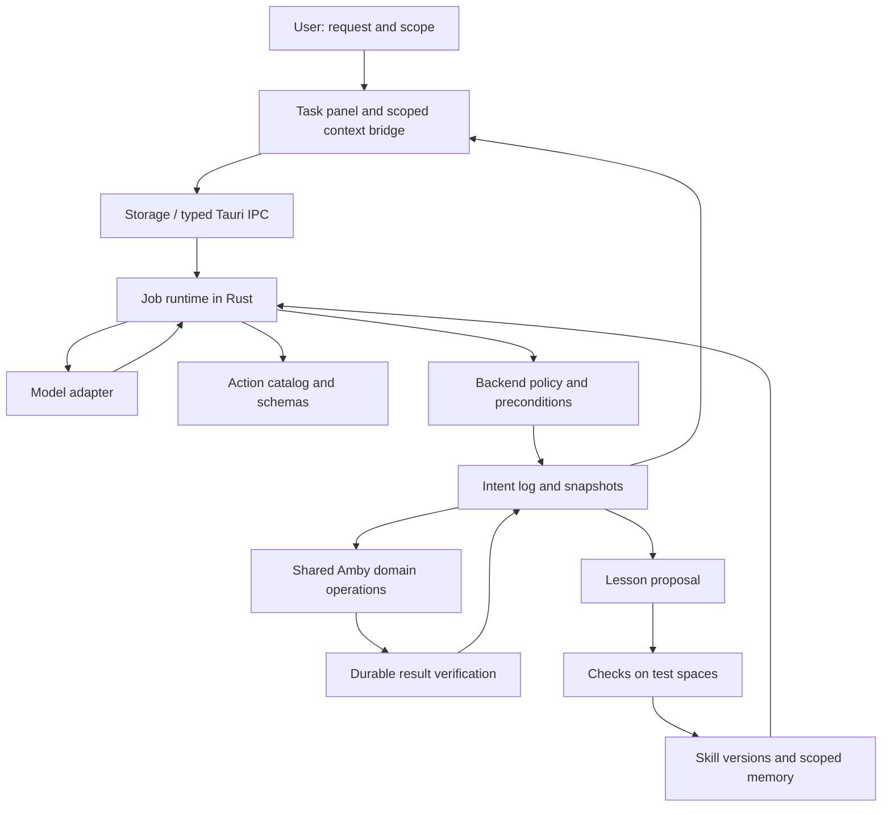

# AI: plans

Status as of 2026-11-03 (checked against the code). AI agent contracts: [ai-harness](../ai-harness.md), [state and log](../ai-state-format.md), [action catalog](../ai-action-catalog.md), [Codex](../ai-codex-provider.md). Deferred: [target/ai.md](target/ai.md). External AI agents and the vault through `amby mcp`: [cli.md](cli.md).

| Part                    | What                                                            | Status                                                             |
| ----------------------- | --------------------------------------------------------------- | ------------------------------------------------------------------ |
| 1. Stage 1              | AI panel, AI only reads the vault                               | done                                                               |
| 2. Provider connections | API, Codex, Claude Code CLI, settings migration, model catalogs | stages 1–5 done; the owner will verify Claude Code sign-in (OAuth) |
| 3. Agent plan           | Action registry, log, permissions, rollback (H packages)        | not started                                                        |
| 4. Orchestration        | Agents executing the H packages                                 | not started                                                        |
| 5. Acceptance           | Scenarios and evidence for the agent                            | specification, no results                                          |

---

## Part 1. AI, stage 1: the new panel and an AI that only reads

_Formerly the file `ai-stage-1-plan.md`, merged 2026-11-03._

> **Status as of 2026-11-02:** in progress (AI core: `src-tauri/src/ai.rs`, `src/lib/ai.ts`). Provider connections — [ai-provider-connections-plan](ai.md).

Status: implementation in progress. Date: 2026-10-30. Version: 1.

Owner's decisions (2026-10-30):

- The first step is the new panel shell and an AI that **only reads** the vault.
  At this stage the AI cannot change notes, settings, or files.
- There is a single entry point — the AI side panel. The menu over a selection, `/ai`, and the palette are later stages.
- Context: the current note by default + `@` mentions of notes and folders + the AI's own
  search over the existing full-text index. There is no vector index.
- Conversations are stored in the vault's `.amby/ai/` and survive a restart.

Stage 1 is a subset of the big agent plan ([ai-harness-plan.md](ai.md)):
it delivers the early read-only parts of H-30 (provider protocol with tool calls), H-31
(execution loop in Rust), and H-33 (panel). The action registry, log,
write permissions, and rollback (H-10…H-24) are not touched or replaced by stage 1. Everything that
writes to disk on the AI's behalf waits for those packages.

### 1. Requirements

Identifiers `AI1-*` are used in tests (`// AI1-R3`).

#### Conversation and interface

- **AI1-U1** Panel: a header with the conversation title, buttons «Список бесед» (Conversation list), «Новая беседа» (New conversation), «Модели» (Models).
- **AI1-U2** The answer is shown as Markdown (markdown-it, `html: false`, links only
  `http(s)` and internal). Streaming is preserved. Code and lists are readable in a narrow panel.
- **AI1-U3** The AI's steps are visible during execution and are saved in the conversation: «Искал «…» · N заметок» (Searched "…" · N notes),
  «Прочитал X, Y» (Read X, Y). A step can be expanded to see which notes were found.
- **AI1-U4** Sources: the AI refers to the notes it read as `[n]`. Under the answer there are
  source chips; clicking one opens the note. A link to a deleted or renamed
  note does not break the display.
- **AI1-U5** Actions on an answer: copy, retry, «Сохранить как заметку» (Save as note) (creating
  a new note is a user action through the ordinary creation path, not the AI's).
- **AI1-U6** Empty conversation: example prompts; if there are no models — a clear path to setup.
- **AI1-U7** Model choice inside the input field; a "local"/"cloud" label by the provider's
  address (loopback/LAN → "local").
- **AI1-U8** Stopping at any moment, including between tool steps. Errors
  are shown by a safe code, without the provider's response text.
- **AI1-U9** All visible strings are in `src/locales/resources.ts` with all translations.

#### Context

- **AI1-C1** The current note is added as a chip automatically when a conversation is created and when
  the note is switched, until the user removes it manually. The text is taken from the open
  buffer (unsaved edits too), as it is now.
- **AI1-C2** `@` in the input field opens a picker of notes and folders (through the existing search);
  the chosen item becomes a chip. A chip can be removed.
- **AI1-C3** A folder chip gives the AI the list of its notes and permission to read them, not all the text at once.
- **AI1-C4** A per-conversation "Search the vault" toggle. When off, the AI sees only the chips.
- **AI1-C5** Context budget: a total character limit on attached texts; overflow
  is truncated with an explicit mark in the chip («обрезано» (truncated)), not silently.

#### Reading the vault (tools)

- **AI1-R1** Read-only tools, executed in Rust over the **active** vault:
  `search_notes(query, limit)`, `read_note(id, offset?, maxChars?)`, `list_folder(path)`,
  `get_links(id)` (outgoing links and backlinks).
- **AI1-R2** No tool writes to disk or changes the index. A test checks that
  after a full cycle with tools the vault files and `.amby/` are byte-for-byte unchanged
  (except the conversation file).
- **AI1-R3** Paths are canonicalized; `..`, absolute paths, symlinks pointing outside, `.amby/`, and
  folders excluded from the index are inaccessible. A tool's refusal response is an ordinary
  result for the model, not a crash of the loop.
- **AI1-R4** Limits: ≤ 8 tool calls per answer, ≤ 20,000 characters per read,
  ≤ 60,000 characters of tool results per answer, ≤ 10 search results.
  Exhausting a limit means a final request to the model without tools.
- **AI1-R5** When "Search the vault" is off, `search_notes`/`list_folder` are not offered to the
  model, and `read_note` is allowed only for notes from the chips. The check is in Rust, against the
  list that came with the request, not against the model's words.
- **AI1-R6** If the vault changed during an answer, the answer is aborted and nothing from the
  new vault is read.
- **AI1-R7** Reading takes the version from disk. For an open note with unsaved edits
  this may lag behind by the autosave interval; the current note from AI1-C1 is not affected.

#### Providers

- **AI1-P1** Tool calls for all four families: OpenAI-compatible (`tools`/
  `tool_calls`), Azure, Anthropic (`tool_use`/`tool_result`), Ollama (`tools`). Streaming
  of text and of tool calls.
- **AI1-P2** A model has a "supports tools" flag (by default yes for cloud, no for
  local; changeable in the model settings). Without tools only chips work
  (AI1-C1…C3), search is unavailable, and the AI1-C4 toggle shows why.
- **AI1-P3** A "model does not support tools" error from the provider gives a clear message
  and a suggestion to turn the flag off, not a generic failure.
- **AI1-P4** A test provider (fake) in Rust with pre-recorded response scenarios is
  the basis of all loop tests. The network is not used in tests.

#### Privacy

- **AI1-S1** The first request with a cloud model and search enabled in this vault
  shows one clear confirmation: «ИИ сможет искать и читать заметки этого
  хранилища и отправлять найденный текст провайдеру X» (The AI will be able to search and read notes in this vault and send the text it finds to provider X). The answer is remembered per vault
  and provider; a refusal = conversations of this vault with this provider run without search.
- **AI1-S2** Logs and debug output contain no note text, queries, or answers — only codes,
  sizes, and ids. Provider keys remain only via credentials, as before.

#### Conversation storage

- **AI1-H1** A conversation is a file `.amby/ai/chats/<ULID>.json`, format version `1`: id, title,
  createdAt, updatedAt, modelId, search on/off, context chips (id/path, not text),
  messages, tool steps (the query, ids of notes found — without the text of the results).
- **AI1-H2** The write is atomic through the existing Rust functions; it is saved after every
  completed answer and on stop. A corrupted file is neither deleted nor overwritten:
  the conversation is marked unavailable in the list, and the file stays as it is.
- **AI1-H3** Unknown fields and future format versions are preserved/opened
  read-only and are not lost on rewrite.
- **AI1-H4** Deleting a conversation moves the file to `.amby/trash/` (recoverable), with no permanent deletion.
- **AI1-H5** `.amby/ai/` is **not synced** (like everything not named). Add a row to the
  table in `docs/vault-format.md` and check that the sync-rules conformance test passes.
- **AI1-H6** The conversation title is the first words of the first question; manual rename.
  List: groups "Today/Yesterday/Earlier", search by titles.
- **AI1-H7** The old behavior (a conversation in memory) goes away without migration — there is no saved data.

### 2. Architecture

```text
UI (src/components/workspace/ai/)
  ai-panel.tsx          shell, switching "conversation / list / models"
  chat-view.tsx         messages, steps, sources
  composer.tsx          field, @-picker, chips, model, button
  chat-list.tsx         conversation list
  use-ai-chat-store.ts  Zustand: active conversation, streaming, chips
src/lib/ai.ts           client: aiRunTurn, events, errors
src/lib/storage/…       ai-chat-repository (list/load/save/trash conversations) per the storage rules
Rust
  ai.rs → ai/           mod.rs (as now), providers/*.rs (+tools), fake.rs
  ai/tools.rs           read-only tools over VaultContext
  ai/turn.rs            loop: model → tools → model, limits, cancellation
  ai/chats.rs           conversation storage in .amby/ai/chats/
```

- A new command `ai_run_turn(request)`: model config, messages, attached context
  (texts of note chips from buffers + ids of permitted notes/folders), the search flag, streamId.
  `ai:event` events with a sequence number: `token`, `toolStart`, `toolEnd`, `done`, `error`.
  The existing `ai_chat` stays until all calls are migrated, then is deleted.
- The loop is in Rust, not in the UI: the model gets no access to IPC, and the limits and chip checks
  (AI1-R5) cannot be bypassed from the webview. The index lock is taken only for the duration of
  a specific tool; the network request to the model runs without locks.
- Types and commands go through Specta; `bindings.ts` is regenerated by `npm run rust:test`.
- The `amby.ai` module: manifest permissions are narrowed to `ui-panel`, `read-notes`
  (currently it has `write-notes`, although writing is not used).

### 3. Packages and order

The "tests first" process (as in sync-plan §6): interface stubs → tests per this
plan in a separate session, each linked to an `AI1-*` → red run → test review →
separate test commit → implementation by another session, tests frozen.

| Package | What                                                                | Requirements | Model / effort |
| ------- | ------------------------------------------------------------------- | ------------ | -------------- |
| T       | Stubs + all Rust and Vitest tests, red run                          | all          | Sonnet medium  |
| A       | Rust: tools protocol for 4 families + fake provider                 | P1–P4        | Sonnet medium  |
| B       | Rust: read-only tools, canonicalization, limits                     | R1–R7, S2    | Sonnet medium  |
| C       | Rust: `ai_run_turn`, events, cancellation, vault change             | R4–R6, U8    | Sonnet medium  |
| D       | Rust + storage: conversations in `.amby/ai/`, trash, vault-format   | H1–H7        | Sonnet medium  |
| E       | UI: panel, Markdown, steps, sources, conversation list, locales     | U1–U9, H6    | Sonnet low     |
| F       | UI: chips, `@`-picker, context budget, privacy confirmation         | C1–C5, S1    | Sonnet low     |
| G       | MAP files, `upd_next.md`, native check with real Ollama and a cloud | —            | Haiku          |

A → C; B → C; C and D → E → F → G. A, B, D can be done in parallel.

Review: strict — B, C, D (reading the vault and writing conversations to disk); selective — E, F.

### 4. Acceptance

- `npm run verify`, `npm run rust:test`, strict Clippy, `npm run docs:check`.
- Native: Ollama (a local model without tools and with tools), one cloud provider;
  scenarios: a question about the current note, about an `@` note, about a folder, vault search,
  stopping during a search, restart with a saved conversation, vault change during an answer,
  refusing the privacy confirmation.
- Checking AI1-R2: the vault hash snapshot before and after the scenarios matches (except `.amby/ai/`).

### 5. Next stages (not part of stage 1)

1. The menu over a selection and `/ai`: the result as a preview, the user inserts it.
2. Vector search (optional, local embeddings).
3. Writing via the agent plan H: action registry, log, rollback — then "Prepare/Execute".

---

## Part 2. AI connections: providers, API, and CLI

_Formerly the file `ai-provider-connections-plan.md`, merged 2026-11-03._

Status as of 2026-11-03: stages 1–5 implemented (connection model, migration with a backup,
API catalogs, Codex and Claude Code CLI, the providers screen; connections live in a separate
`ai-connections.json`). Not verified: Claude Code sign-in (OAuth) and a real account — verification is up to the
owner; stage 6 (chat and release) to be confirmed against the log below.

### Result for the user

In settings the user adds a provider connection, chooses a method
"API" or a supported "CLI", connects an account, and enables the needed models
from the received catalog. Only enabled models appear in the chat.
Adding models manually is available only for local providers.

Example: «Добавить провайдера → OpenAI → API → ключ → список моделей» (Add provider → OpenAI → API → key → model list) or
«Добавить провайдера → OpenAI → Codex CLI → проверка установки → вход →
список моделей» (Add provider → OpenAI → Codex CLI → installation check → sign-in → model list). Two connections can exist at the same time.

The CLI is first installed by the user: the screen shows instructions,
the official link, a command to copy, and a re-check button.
Installation commands are not run when settings are opened. Installation and sign-in
are different states. Installing the CLI does not guarantee access to models.

### What exists now — confirmed by the code

- `app-config.ts`: `AiSettings` stores `models` and `activeModelId`;
  the address, provider, and `credentialId` are repeated in every model.
- `models-manager.tsx`: adding/editing a single model, including an
  arbitrary cloud model name. There is no shared connection card.
- `ai-panel.tsx`: the model is looked up by `chat.modelId` and `activeModelId`;
  the chat list is built from all `ai.models`.
- `src/lib/ai.ts` and `src-tauri/src/ai.rs`: requests go through Rust;
  there are no commands for fetching a model catalog yet.
- `ai/codex/launch.rs`: already has Codex CLI discovery, version check,
  sign-in, sign-out, sign-in cancellation, and app-server launch.
- Codex runs in Amby's isolated environment. We cannot promise
  automatic use of a sign-in from the user's `~/.codex`.
- Keys are in the system store. The new format keeps referring to
  `credentialId`; moving keys into JSON is not required.

### Structural decisions

#### Provider, connection, and model

Split three entities:

- **Provider** — a static definition: ID, name, local/cloud,
  supported connection methods, and catalog/request adapters.
- **Connection** — a stable ID, provider, API/CLI method, name,
  endpoint/API version or CLI type, a reference to the key, and connection settings.
  Several connections of one provider are allowed.
- **Model** — a stable internal ID, `connectionId`, the provider's ID,
  name, an enabled flag, and origin: catalog/local user-defined.
  References from old chats keep using internal IDs.

The catalog and connection state are separate from the user's model selection.
Refreshing the catalog must not enable all models or reset the toggles.
New models are initially off. On the first connection the user picks the models
themselves; existing migrated models keep their enabled state.

The active model is a separate choice for new conversations. If the model of the current conversation
is disabled or removed, the history can be read, but sending requires an explicit choice of an
available model. Text must never be sent automatically to another provider.
A request that is already running finishes with the configuration captured at its start.

#### Connection method matrix

| Provider                          | API / local HTTP                                                        | CLI                                                                  |
| --------------------------------- | ----------------------------------------------------------------------- | -------------------------------------------------------------------- |
| OpenAI                            | existing API, add a catalog                                             | Codex, existing transport; add a catalog                             |
| Anthropic                         | existing API, add a catalog                                             | Claude Code CLI (`claude-cli`), a separate adapter `ai/claude_code/` |
| OpenRouter, Groq, Mistral         | existing compatible API, catalog per adapter                            | show only when an implemented adapter exists                         |
| Azure OpenAI                      | existing API; separately verify how available deployments are retrieved | there is no separate adapter at the moment                           |
| Ollama, LM Studio, MLX, llama.cpp | local endpoint, catalog and manual entry                                | do not treat a local server as a CLI chat transport                  |

Choosing a CLI is not an arbitrary shell command. Every CLI needs an adapter
with a verified protocol, authorization, catalog, cancellation, and access boundaries.
The first vertical scenario is API + Codex. The next CLI is Claude Code:
releasing the adapter depends on verifying that access can be kept limited to
the permitted notes. Adding Gemini and other new providers is a separate
registry extension after the main stages.

Cloud models are not entered manually. For Azure, before release we need to find out
which permissions/parameters are required to list deployments: a catalog of general models
does not replace the list of the account's deployments. If the list is unavailable, the interface
explains the limitation, keeps the previous connection, and does not offer an incorrect
universal `/models` as a working solution.

#### Catalog and capabilities

Rust fetches the catalog using the same connection settings and key that are used
for sending. Support pagination, deduplication, a response size limit,
a timeout, safe errors, and cancellation/ignoring of a stale result.
The endpoint goes through the existing validation; keys and responses containing secrets do not end up
in the log or error text. The browser CSP is not widened.

Not all models from the catalog are suitable for text chat or the current transport.
Account separately for transport and model capabilities: text chat, tools,
the required API. Do not show an embedding/image/audio model as suitable for chat.
Do not carry the cloud rule `supportsTools=true` over to the entire catalog.
If there is no reliable metadata, apply an explicitly described adapter policy and
show the limitation; do not check access with a paid request without a user action.

A refresh error keeps the last catalog and selection. A model that disappeared
is marked unavailable, and its entry and history are kept. The catalog cache has
a refresh time; user toggles are not a cache.
For a CLI, the catalog also does not mean the account is confirmed to be entitled to every model.

### Implementation stages and acceptance

#### 1. Domain model and read compatibility

Extract the connection types and pure operations from `app-config.ts` into a focused
module. Add an adapter registry and selectors of available models.
Design a versioned AI section, preserving the other settings.
Do not wire the new write into app startup yet.

Done when tests cover several connections of one provider, local
custom models, enabling/disabling, stable IDs, and reading the old shape.
The existing screen and chat keep working.

#### 2. Migration of saved settings

Before writing: a read-only preflight, an immutable backup of the original
`settings.json`, a migration version, result verification, atomic publication,
outcome recording, and detection of completion on a repeated start. Do not merge
connections with different keys, addresses, API versions, or incompatible settings.
Old model IDs, labels, and key references are preserved.

The migration does not delete keys and cloud models, even if they are not in the catalog yet.
Rollback restores the backup before new editing; after changes,
a separate export of the current version is needed so that rollback does not erase new connections.
An unknown future version blocks overwriting the AI section.

Done when empty/old/corrupted settings, a write error,
interruption at publication boundaries, a repeated run, and restoring from the copy are tested.
The migration does not touch note and chat files.

#### 3. API and local server catalogs

Add typed catalog commands, adapters for the existing API families
and local servers; generate Specta bindings with the standard test.
Separate the network response, catalog normalization, and user toggles.
Check Azure and the path differences of OpenAI-compatible services separately.

Done when integration tests with a local mock server check authorization,
pagination, URLs, 401/403/429, timeout, an invalid/too large response, and safe
errors. There are no requests to paid services in automated tests.

#### 4. CLI connections

Extend the existing Codex adapter by fetching the catalog through the app-server.
Use the existing version check, isolated environment, and process
lifecycle management. After sign-in/sign-out, refresh the state and the catalog.
Add an install and re-check screen with instructions for the current OS.

Then investigate and implement Claude Code as a separate adapter: confirm
the machine protocol of the catalog and chat, the stream, cancellation, sign-in, and disabling arbitrary
tools. Record the protocol verification result before wiring the UI.
If the CLI does not provide a catalog, do not substitute it with manual entry of a cloud model.

Done when fake-CLI tests check a missing/unsupported version,
no sign-in, a corrupted response, cancellation, timeout, and termination of the child
process. A real native smoke separately checks the installed Codex.
The CLI does not get shell access to the vault in place of the existing read-only tools.

#### 5. Providers screen

Replace the list of editable models with connection cards. Adding:
provider → method → parameters/CLI check → connection → model selection.
Inside a card: state, connect/sign out, a catalog with search and toggles,
list refresh. The key is edited once per connection.
Adding a custom model is visible only for a local provider per the registry,
and not just for an arbitrary URL that happens to be local.

Saving is serialized, errors are visible, late responses do not change another
connection. Deleting a connection explicitly describes the deletion of the setting and the key;
a shared `credentialId` cannot be deleted while another connection references it.
Deletion does not erase history. All strings are RU/EN in `resources.ts`.

Done when component and browser scenarios pass connecting an API,
a missing CLI, sign-in, an empty catalog, search, toggles, a local model,
a save failure, and reopening the screen. Check a narrow window and the keyboard.

#### 6. Chat and release

Wire a single model/connection resolver into sending, tools, consent
to read notes, and model selection. In the menu, account for several connections
of one provider. Updating the key/address/account invalidates the corresponding
consent and catalog under the existing consent contract.
Disabled models are excluded from both the menu and the programmatic send path.
The absence of active models opens a clear transition to settings.

Done when old conversations, disabling the current model, changing
settings during a stream, cancellation, vault change, and switching API/CLI are tested.
`npm run build`, `npm run verify`, a browser smoke, a native smoke,
and a native build for IPC/desktop changes are mandatory. In the stage log, record the commands actually
run, limitations, and results. Do not bump the version without a release.

### Working order

Stages 1 → 2 → 3 → 4 → 5 → 6, in separate verifiable batches.
The new screen is enabled only after the migration is ready and the working vertical
scenario API + Codex CLI. Before each next stage, check the plan against the actual
diff, preserve other people's working changes, and mark completion only based on checks.

### Log

- 2026-10-31: checked the current owners of settings, UI, requests, keys,
  model selection, and Codex launch. Stages and criteria drawn up. The product
  implementation of connections is not started yet.
- Checks of the planning batch: `npm run build` and `docs:check` passed.
  `npm run verify` passed the frontend, formatting, and Clippy, but ended
  at the Rust tests: 1079 passed, 149 failed, 10 skipped. The report contains environment
  prohibitions on local ports and access to the system trash/Finder;
  the full gate is not considered passed. `bindings:check` was not run in the chain.
  Native smoke/build were not run for documentation changes.

- 2026-10-31: preparation of stage 1 started: added an isolated model
  of connections, in-memory conversion of the old list, selection of available models,
  and catalog reconciliation. Saving, migration, and the interface are not switched over;
  stages 1–6 remain unfinished.
- Checks of the preparatory batch: targeted tests passed (35), `build` and
  `docs:check` passed. A repeated `verify` passed 3041 frontend tests,
  formatting, knip, and Clippy, but the Rust tests ended with
  1079 passed, 149 failed, 10 skipped; among the errors are prohibitions on local
  ports and the system trash. `bindings:check` was not reached. The full gate
  did not pass; browser and native smoke for the new feature were not run,
  since the new feature is not enabled yet.

- Migration development started: an isolated Rust prototype saves an exact
  backup, distinguishes prepared from completed publication,
  recovers after interruption, and refuses rollback when there are changes.
  There is a locker shared with ordinary writes and protection against writing a stale
  version. The prototype is not yet wired in at startup: stage 2 is not complete.
  Targeted checks: 4 migration tests, a version-protection test, 5 domain tests,
  and 9 tests of the previous screen passed.

- Prepared, but not wired to the interface, the Codex `model/list` request:
  [response schema](https://github.com/openai/codex/blob/main/codex-rs/app-server-protocol/schema/json/v2/ModelListResponse.json),
  [parameters](https://github.com/openai/codex/blob/main/codex-rs/app-server-protocol/schema/json/v2/ModelListParams.json);
  the list does not confirm account entitlements. Protocol tests checked
  pages, cursor repetition, deduplication, and filtering; the fake CLI — termination
  of the child process. Surfacing in the interface and IPC are not implemented yet.
- Azure check: [official list of deployments](https://learn.microsoft.com/en-us/rest/api/aifoundry/accountmanagement/deployments/list?view=rest-aifoundry-accountmanagement-2025-06-01) belongs to the management API and requires a subscription ID, resource group, account name, and management authorization. The existing endpoint and inference API key are not enough for this route; the universal `/models` is not introduced, existing settings are preserved.
- Preparation of the API catalogs remains test-only: targeted mock HTTP tests of authorization, pages, 401, an invalid and too large response passed outside the sandbox; the initial bind inside the sandbox got `EPERM`.
- Current slice: on the first opening of the AI screen in desktop, migration v1 with
  backup and verifiable rollback is enabled. Implemented: API catalogs and Codex model/list,
  connection cards, saving the selection, local custom models,
  a model availability check on send in the frontend and Rust. WebKit smoke and
  the isolated native IPC contract passed on the previous state of the batch;
  after the latest changes the mandatory checks are being repeated. Claude Code
  is not yet presented in the interface: the protocol and access boundary are still being verified.
- Claude Code 2.1.312: in a separate `CLAUDE_CONFIG_DIR`, the machine initialize
  of the [Agent SDK](https://code.claude.com/docs/en/agent-sdk/typescript) returned
  five models without sending a prompt, the sign-in status was signed out. Documented
  are `--safe-mode`, `--restricted`, `--tools ""` and the MCP prohibition in the
  [CLI reference](https://code.claude.com/docs/en/cli-reference); sign-in,
  process termination, the chat stream, and the resilience of this boundary to attacker
  responses are not yet verified. The method is not offered until these checks.
- Catalog policy: for the official OpenAI endpoint, the Chat Completions families
  `gpt-3.5-turbo`, `gpt-4`, `gpt-5`, `chatgpt-4`, `o1`,
  `o3`, `o4` are shown, except known Responses-only Codex/Pro and deep-research;
  other compatible APIs and local servers are filtered by markers
  of non-text families and available modality metadata. Unknown tool
  support is not enabled automatically. For GPT-5 and the o-series,
  `max_completion_tokens` is used.

- 2026-10-31, batch result: `npm run verify` passed in full (Rust: 1243 passed,
  0 failed, 10 skipped; `bindings:check`, knip, Clippy), `npm run build` and
  `docs:check` passed. The native contract `npm run test:storage:live` passed in full,
  including "AI catalog and reversible migration use real IPC" and the ban on sending
  through a disabled model. The early 149 Rust test failures were sandbox restrictions
  (local ports, trash) and do not reproduce outside it.
  Not verified: a real Claude sign-in (OAuth) — the sandbox forbade a local listener;
  Claude Code stays disabled in the interface until the owner verifies it.

- 2026-10-31, Claude Code CLI (stage 4, second part). Adapter: `src-tauri/src/ai/claude_code.rs`,
  `claude_code/launch.rs`, `claude_code/home.rs`; in the interface — the `claude-cli` method for Anthropic,
  the `claude-code` provider on the wire, a shared CLI card in `connections-manager.tsx`.
  Checked manually on Claude Code 2.1.312 in a separate `CLAUDE_CONFIG_DIR` (without signing in):
  - `claude auth status --json` → `{"loggedIn":false,…}`, exit code 1; `claude auth login
--claudeai` prints "Opening browser…" and a link, opens the browser itself and listens on a
    `localhost` port (the `open` call was intercepted by a substitute in `PATH`); `auth logout` exists.
    The sign-in was **not completed**: the owner will check OAuth.
  - Catalog: `-p --input-format stream-json --output-format stream-json` + the request
    `{"type":"control_request","request_id":…,"request":{"subtype":"initialize"}}` returns
    `models[]` (`value`, `displayName`) without a prompt and without signing in; the process exits on stdin EOF.
  - Access boundary: `--safe-mode` also disables an explicit `--mcp-config` (checked via
    `mcp_status`: the list is empty), so the Amby bridge works with `--restricted
--strict-mcp-config --disable-slash-commands --tools "" --permission-mode dontAsk
--permission-prompts none --no-session-persistence` and `--allowedTools` only with
    `mcp__amby__*`. The bridge token is passed via the `AMBY_MCP_TOKEN` variable (`--mcp-config` holds
    `${AMBY_MCP_TOKEN}`, expansion confirmed); it is not in argv. The `init` line of the real
    stream (`tools`, `mcp_servers`, `skills`) is checked by the guard: any tool that is not from the
    bridge, a foreign MCP server or skill, like a `tool_use` outside the list, stops the response
    (`agentBoundary`) and kills the process. The environment is cleared (`env_clear`, without `ANTHROPIC_API_KEY`
    and tokens), the working folder is empty, `DISABLE_AUTOUPDATER`/`DISABLE_TELEMETRY` are on.
  - Without signing in, the real stream gives an `assistant` with `error:"authentication_failed"` and a `result`
    with `is_error:true` ("Please run /login") — this is `missingCredential`.
    Not verified on a real account: the `stream_event`/`tool_use` shapes after signing in (parsed from the
    Agent SDK documentation and covered by a fake CLI), the bridge working with a real Claude MCP request,
    the boundary's resistance to hostile note text, and also `auth login` in the sandbox (the local
    OAuth listener is forbidden there; outside the sandbox the sign-in was not started, by the task's terms).
    Tests (written together with the code, not before it): Rust `ai::claude_code` — 52 tests: stream
    parsing, guard, argv, environment, fake CLI (absence, unsupported version, not signed in,
    broken response, cancellation, idle and overall timeout, child process termination, sign-in/sign-out,
    catalog); `consent` — separate consent; vitest — `connections-claude.test.ts`,
    `connections-manager-claude.test.tsx`, `ai-panel-claude.test.tsx`; native IPC —
    `tests/native/ai-contract.ts` (status, refusal without consent, turn and catalog with sign-in completed).

---

## Part 3. The Amby AI agent: architecture and full implementation plan

_Formerly the file `ai-harness-plan.md`, merged 2026-11-03._

> **Status as of 2026-11-02:** a plan, not implemented. Only stage 1 has been started (the panel and an AI that only reads — [ai-stage-1-plan](ai.md)); the action registry, the log, write permissions and undo (H-10…H-24) have not been started.

Status: a plan; implementation has not started within the scope of this document.
Date: 2026-09-30. Plan version: 2. First edition: 2026-09-24.

The plan was prepared from the current working tree, including uncommitted changes.
The presence of a file or an existing test does not mean that the corresponding capability
has been verified for agent use. Before implementation, package H-00 is carried out.

Related documents:

- [Orchestration: work packages, dependencies and assignments to agents](ai.md).
- [Acceptance: scenarios, criteria and evidence](ai.md).
- [Detailed harness contract: actions, permissions, runtime, skills and plugins](../ai-harness.md).
- [Log, state and recovery format](../ai-state-format.md).
- [Initial action catalog tied to the current APIs](../ai-action-catalog.md).
- [File and save contract](../vault-format.md).
- [Markdown compatibility](../markdown-compatibility.md).
- [Native storage check](../native-storage-contract.md).
- [Databases: system](../database-system.md), [format](../database-format.md), [runtime](../database-runtime.md).
- [Themes and localization](../themes-and-localization.md).
- [Modular architecture plan](modules.md).

The second edition adds drafts of concrete contracts and accounts for the working
tree as of 2026-09-30. They refine execution modes, field-level permissions,
editor barriers, partial-write results, crash recovery, learning and
plugin lifecycle. H-00/H-01 remain planned: before implementation we need
a current baseline, a full UI inventory, schemas and executable fixtures.
The existing data formats take priority over the proposed agent
adapters; discrepancies found are recorded in the catalog to be resolved in H-00.

### 1. Goal and boundaries

The AI performs the user's substantive actions through the application API: it works
with notes, folders, databases, views, Canvas, Excalidraw, appearance,
settings and permitted extensions. The user can ask it to create a
plugin and iterate on it step by step inside the application.

Every action is observable. Every supported change has a described
way of being restored. The agent works only within the granted area of the space
and with permitted settings keys. Skill learning is subject to the same restrictions.

Mandatory product requirements:

1. Actions are available without clicking through the interface and without mounting an editor.
2. The UI and the agent share domain logic that preserves the Amby contracts.
3. The log covers reading, search, change attempts, refusals, errors,
   checks, cancellation, undo, and work with memory, skills and plugins.
4. Undoing a single action and a whole job preserves the user's later edits.
   A conflict is shown explicitly.
5. A job survives closing the panel and is restored after an application restart
   without re-creating objects.
6. The agent knows the available capabilities of the current version and of enabled modules.
7. Skills are versioned; improvements pass verification and can be undone.
8. The user sees the access scope, progress, result, history and
   the skills used, and can stop execution.
9. Only permitted context is passed to a cloud provider. Amby's local
   storage does not automatically mean local processing by the model.
10. Spending on the model and on background learning is limited by separate budgets.

The term "all user actions" means coverage of the H-00 inventory.
Each action gets a status of `implemented`, `requiresUserInteraction`,
`blockedByPolicy` or `missingImplementation` with a reason and an owning package.
Unknown capabilities and stubs do not count as support. All scenarios declared
in this plan are implemented; intentional boundaries are marked separately.

Outside ordinary agent access: arbitrary shell, changing the code
of the application itself, reading secrets, changing the security policy and the log,
unilateral expansion of the scope, publishing outward, updating the Amby binary.
Choosing a system folder and entering a secret remain user actions.
A plugin may extend functionality only through the verified SDK and granted
permissions; the ability to write a plugin does not grant system privileges.

### 2. Starting state

| Area       | Observed basis                                                                                                                                 | What is required                                                                        |
| ---------- | ---------------------------------------------------------------------------------------------------------------------------------------------- | --------------------------------------------------------------------------------------- |
| AI         | `src/components/workspace/ai-panel.tsx`, `src/lib/ai.ts`, `src-tauri/src/ai.rs`: text chat, streaming, cancellation, several provider families | Structured tool calls, durable jobs, verified context, log                              |
| Data       | `src/lib/storage/port.ts`, `database-port.ts`, Rust `commands/`, `bundle/`, `database/`                                                        | A shared operation contract with provenance, scope, preconditions and receipt           |
| Editors    | `use-doc-store.ts`, `autosave/autosave-coordinator.ts`, recovery, serialization lifecycle                                                      | Coordinating agent changes with open buffers and multiple windows                       |
| Schemas    | `src/lib/canvas-format.ts`, `sketch-format.ts`, Canvas/Excalidraw editors                                                                      | Element operations without UI, layout, preserving unknown fields and image verification |
| Settings   | `app-config.ts`, `use-settings-store.ts`, `settings-repository.ts`, `src/themes/`                                                              | Narrow typed operations, a backend allowlist of keys, CAS and undo of individual values |
| Extensions | `src/lib/modules/`, Rust `package_manager.rs`, `commands/modules.rs`                                                                           | Audit of real execution, a single policy, SDK isolation, a workshop                     |
| Checks     | Vitest, Rust tests, native contract/UI runners                                                                                                 | A deterministic fake provider with real mutations, failure injection, an eval corpus    |

`CommunityPluginSandbox` and the Worker runtime exist, but the absence of a DOM in the Worker
does not by itself prove isolation of the network, IPC and the host API. H-70 checks for bypasses
with real executable code in the production runtime. Past audits and release notes
contain information about different states of the tree; H-00 verifies the current facts.

The current `package.json` sets `verify -> verify:full`, including formatting,
Knip, Clippy, Rust tests and the bindings check. A description of the old shortened
`verify` in documents does not reduce this gate. `vitest.config.ts` now
also includes `tests/**/*.test.{ts,tsx}`; take existing component tests into account,
but do not treat them as proof of native application behavior.

### 3. Architecture



#### 3.1 Allocation of responsibility

- Rust owns policy, run lifecycle, the log, the action queue,
  credentials, inference transport, recovery and durable mutations.
- The UI passes the objects/scope selected by the user and editor observations,
  displays state, and requests actions through storage. Closing the panel
  does not own the job lifecycle.
- Open buffers stay in the existing stores and the autosave coordinator.
  The new bridge reconciles them with the runtime without creating a second document model.
- The action catalog belongs to the application. The model receives only permitted
  descriptors and does not register new privileged handlers.
- A domain operation does not call an LLM and does not depend on an open tab. A network
  call to the model is never made under the vault write lock.
- Execution events have sequence numbers. The UI restores
  missed events from the log, not only by listening to transient events.

Proposed new boundaries; the final split is fixed in H-01:

```text
src-tauri/src/app_actions/    # registry, policy, executor, receipts, domain adapters
src-tauri/src/agent/          # runtime, context, providers, journal, recovery,
                             # skills, learning, evaluation, plugin authoring
src-tauri/src/commands/agent.rs
src/lib/storage/agent-port.ts # via the existing StoragePort / adapters
src/lib/agent/               # pure UI-facing models and helpers
src/components/workspace/ai/ # tasks, scope, changes, history, skills, workbench
tests/fixtures/agent/        # synthetic fixtures only
```

These are target directories, not evidence of an existing implementation. Split large modules
by responsibility; `lib.rs` and `workspace.tsx` remain assembly points.

#### 3.2 Action contract

`ActionDescriptor` contains a stable `id`, a version, a description, input/output schemas,
module dependency, effect class, permission requirements, preview availability,
result verification type, undo class and size limits.

`ActionRequest` contains `runId`, `operationId`, parameters and preconditions.
The actor, the effective grant and verified resource references are assigned by the host,
and are not trusted from fields sent by the model or a plugin.

`ActionReceipt` contains the real outcome, created IDs, before/after revisions,
the list of affected resources, journal references, the verification result,
the index state and undo availability. `succeeded` with cache status `pending`
differs from `failedBeforePublish`; index recovery does not repeat a write
that has already been performed. The exact outcomes table is in the detailed contract.

Common errors: `permissionDenied`, `scopeChanged`, `moduleUnavailable`,
`revisionConflict`, `dirtyBufferConflict`, `validationFailed`,
`journalUnavailable`, `quotaExceeded`, `cancelled`, `outcomeUnknown`,
`unsupportedCapability`, `idempotencyConflict`. Transport errors stay
separate from domain errors.

Visible interface changes, for example opening a tab, may have session-only
undo. Durable changes must have a durable inverse. External irreversible
effects are not included in the general promised undo; by default they are unavailable.

#### 3.3 Coverage catalog

H-00 extends the following table to every real user operation.
H-46 closes the gaps; restricting to a module does not turn an implementation into `done`.

| Domain        | Minimum coverage                                                                                   | Main packages    |
| ------------- | -------------------------------------------------------------------------------------------------- | ---------------- |
| Notes         | Search/read, create, targeted body/source edits, headings, lists, tables, links, columns           | H-11, H-32, H-40 |
| Structure     | Folders, rename/move, bundles/layers, archive/trash/restore, consistent backlinks                  | H-40             |
| Metadata      | Tags, icons, permitted frontmatter, custom properties, pins                                        | H-40, H-45       |
| Databases     | Attached/standalone, schema, options, rows/values, relation, formula, templates, assets, YAML sync | H-41             |
| Views         | Supported layouts, filters, sorting, grouping, property visibility, linked views                   | H-41             |
| Canvas        | Cards for notes/text/local attachments, links, groups, coordinates and layout                      | H-42             |
| Excalidraw    | Sketches from editable elements, text, arrows, groups, images from permitted assets, notes         | H-43             |
| Appearance    | Valid themes, individual tokens, available fonts/scale, preview and undo                           | H-44             |
| Settings      | Registered workspace/global keys, panels, layout, available shortcuts                              | H-44, H-45       |
| Modules       | List, state, permitted enabling/disabling, dependencies and presets                                | H-45             |
| History       | Scoped view of its own actions, diff, undo, recovery after a failure                               | H-23, H-24, H-33 |
| Skills/memory | Viewing, creating, changing, version pinning, disable/revert/forget                                | H-50—H-63        |
| Plugins       | Project creation, code changes, test, preview, local install, update, rollback                     | H-70—H-74        |

View types unsupported by the application, arbitrary system fonts,
new schema formats and unregistered settings are not invented by the agent.
Extending the product is done through a separate explicit package if it is needed
for a mandatory scenario. Generating raster images through an external service
is not required for editable Excalidraw sketches.

### 4. Access scope policy

A grant is issued by the backend after an explicit choice in the trusted UI and contains:

- a persistent workspace identity, the canonical root and the current vault generation;
- separate read/write roots and, if needed, permitted object IDs;
- an allowlist of actions and settings keys with `workspace`/`global` scope;
- the available namespaces for memory, skills, plugin project and log;
- the selected provider profile and whether content may be sent to this provider;
- the grant's expiry/revision, budgets and confirmation rules.

By default a job belongs to a single workspace. Work on global settings alone
is possible with a separate grant. A mixed job, "notes + global theme", explicitly
shows both scopes and applies permissions to each operation.

Policy is checked before reading, before passing context to the model, and immediately
before publishing changes. Switching the vault, revoking permissions, disabling a module and
a change of policy revision stop further actions. An old receipt
or confirmation does not grant the right to work in a new context.

Mandatory edge cases:

- Canonical containment, symlinks/junctions, drive/UNC, case-only rename,
  Unicode paths, a non-existent leaf with a verified parent, TOCTOU.
- All resources affected by a rename/move/refactor/batch fall within the write scope.
  A backlink outside the scope blocks the general refactor until a new decision
  by the user. The agent does not receive the text or name of an inaccessible note.
- Relation, transclusion, preview, counts and aggregates do not reveal data
  from an adjacent section. Scope filtering is applied before results are returned and before the limit.
- A database schema may live outside the permitted folder holding its rows: access
  to the rows does not automatically grant the right to change the manifest of the whole database.
- Scope also constrains history, old snapshots, embeddings, memory,
  skill sources, test output and renderer previews. Context accumulated before
  rights were narrowed is rebuilt; old caches and provider conversation IDs are not
  reused for closed data.
- The content of a note/an imported skill is data. It does not become
  a system instruction and cannot change policy. The current chat prompt,
  which inserts a note into the system text, is to be replaced in H-32.
- API keys stay in credential storage. An appearance setting does not grant the right
  to change the model endpoint, network, credentials, sandbox or logging rules.
- Internal operations on the log are permitted to the host, but raw access to these directories
  through the agent's file tools is absent.

### 5. Log, undo data and crash recovery

#### 5.1 Durable format

Proposed format v1: the application stores AI state in a dedicated subdirectory of
app data, `ai/v1/workspaces/<opaque-workspace-id>/`; global tasks use
a separate `ai/v1/global/`. The path is not given to the model as a writable directory.
Workspace identity is not based on the folder basename alone and does not change note IDs.
Moving/copying a vault requires an explicit check of the log's binding to the root;
old grants are not restored on a name match.

The source of truth is versioned immutable event/operation records and
content-addressed blobs of the original data. The SQLite projection for searching the log
is rebuilt from these records and is not mixed with `.amby/notes.db`.
A draft of the exact file contract and the publication schema is described in
[ai-state-format](../ai-state-format.md). H-01 fixes its schemas; H-21 proves
crash consistency. New format versions have a preflight, backup, migration
outcome and a documented rollback.

A record contains an event sequence, timestamps, run/step/operation ID, actor,
scope reference, action/schema version, redacted parameters, resource IDs,
expected/actual revisions, outcome, verification and inverse references.
Learning proposals reference evidence events. The history does not store the model's hidden
reasoning; the user gets a short explanation of the action.

Separate events record the model request/completion with permitted context
references and usage, plan changes, confirmation request/decision, grant changes,
pause/resume, start/result of a background check. This makes it possible to reconstruct the
sequence of work even if the model never called a tool.

Credentials, authorization headers and secrets from transport errors do not enter
the log. The full raw prompt is not logged by default. Note text in undo
snapshots is protected by the same scope and stored locally; it is not sent to the model
in full just to enumerate the history. Provider usage, when data is absent,
is marked `unknown`, not zero.

#### 5.2 Order of a change

1. Resolve the action, determine the full set of resources, check the grant,
   module state, editor buffers and expected revisions.
2. Take the existing serialization/locks mechanism in a stable order;
   repeat the preconditions on the current state.
3. Reliably save the necessary before blobs, the inverse plan and a `prepared` intent.
   A log/snapshot failure forbids the mutation.
4. Perform the domain operation through the existing atomic/no-replace helpers.
5. Re-read the result, save the receipt/outcome and verification. Publish
   UI events and update derived state without rewriting the source.
6. On a failure between steps, recovery matches the intent, before/after fingerprints
   and domain recovery records. Ambiguity yields `needsRecovery`, not a blind retry.

JSON events are published atomically with a file/directory sync, as far as the platform allows;
related blobs are durable before the intent is published. A simultaneous change of a file and
the log is not declared a single filesystem transaction. The failure windows between them
are covered by reconciliation and failure injection.

`operationId` is created by the executor and saved before the first side effect. A repeat
of the same operation with the same digest returns the receipt; other parameters with that ID
are rejected. A repeat of a user message gets a submission ID
that prevents a second launch on transport retry.

#### 5.3 Undo and retention periods

- A text change restores the snapshot bytes if the after revision matches.
  For a permitted field-level merge, exactly the changed fields are checked.
- A created object can be removed only if its content and new dependent
  objects have not been changed by the user; undo moves it to Amby's internal
  archive with a restore manifest. The system trash has a separate manual
  contract and is not included in the promised automatic undo.
- Rename/move restores the container, layers, paths and rewritten links.
- Settings are undone by the affected keys; other changes to other keys
  are preserved. A change to the same key causes a conflict.
- A database restores durable metadata/values and then rebuilds the projection.
- A multi-step task is undone in reverse dependency order.
  A partial undo has a separate status and a list of the remaining effects.
- Manual undo and automatic compensation go through policy and logging.
  Stop forbids new steps but does not promise to instantly interrupt an atomic publication.
  Completed steps stay visible; Stop and Undo are different operations.
- Every restore is a new record. The agent does not erase the audit of its own action.
- Active/unresolved tasks and undo points promised to the user are protected
  from pruning. A disk limit pauses new changes instead of deleting
  needed snapshots. The retention period and the loss of the ability to undo old changes
  are visible to the user; cleanup is a separate user operation.
- Deleting a note by the ordinary command does not equal full deletion of its historical
  copies. An explicit forget/purge accounts for snapshots, memory, skills evidence and caches;
  after cleanup the UI does not promise recovery of the deleted data.

### 6. Runtime, context and editing

#### 6.1 Lifecycle

Run: `queued → running → waitingForUser / pausedConflict / needsRecovery →
running → succeeded / failed / cancelled`. Completed operations and
`undoAvailable / partiallyUndone / undone` are stored separately. A process stop
leaves an interrupted run for recovery; the end of a response stream does not mean
the end of the whole task.

Long tasks have checkpoints: the goal, completed steps, receipts, open
questions, the current scope, model/API/skill versions. Resuming re-checks
permissions and revisions. After a restart, new writes do not begin until reconciliation
and the user's resumption of the task. A model change is recorded in the checkpoint.

Initial engineering limits to verify in H-01: 40 model requests,
200 tool calls, 10 minutes of active execution per run; a single operation has
its own timeout. The budget for waiting on the user is counted separately, and while
waiting there is no model polling. Background analysis — at most one proposal per
job, 8 model requests and 2 minutes. The values are configurable by the user;
the agent does not raise them itself. Repeating the same error after two recovery
attempts ends the step with a diagnostic. These are design defaults, not
a description of the application's current settings.

#### 6.2 Providers

Introduce a common stream protocol: text delta, tool-call begin/arguments/end,
tool result, usage, completion, error/cancel. Partial JSON arguments are not
executed. Check the schema, size and action availability before the call.
Different tools from one response go through their own preconditions; concurrent
reads are permitted, conflicting writes are serialized.

H-30 first proves one end-to-end provider adapter, then implements the
contract for the current Ollama/OpenAI-compatible/Anthropic/Azure families.
A capability probe determines tool support for a specific endpoint/model.
An incompatible model stays available for discussion and gets a clear
status that action mode is absent. The model need not be of one brand.
Structured tool calling is not replaced by executing code from a text response.

#### 6.3 Context and open buffers

Context contains explicit references to the selected objects, scoped search results,
read fragments with revisions, available actions and the needed skills.
Truncation is marked explicitly; the agent may request the next fragment.
A summary of a long dialogue keeps receipts and unresolved constraints, and is not
used as a source of true revisions/permissions.

In each window the bridge registers the owner of the open document and its dirty state.
Before a mutation the executor requests serialization/flush of the affected buffer through the
existing lifecycle and autosave coordinator. The snapshot for agent undo
is taken after the preceding user edits are saved successfully.
If the user edits in parallel or the flush is not confirmed, the mutation
stops with a conflict. The in-memory buffer must never be silently replaced by the on-disk
version. Loss of a window/lease requires recovery, not an assumption that "the document is clean".
Closed documents are handled by the same domain API without an editor instance.

### 7. Skills and learning

#### 7.1 Different kinds of long-term data

| Kind            | Contents                                                 | Rules for change                                                |
| --------------- | -------------------------------------------------------- | --------------------------------------------------------------- |
| Amby contracts  | Action catalog, schemas, storage constraints             | Versioned with the application; the agent does not rewrite them |
| Preferences     | Explicit user preferences in a given scope               | Visible, editable, can be forgotten/disabled                    |
| Skills          | Repeatable procedures and ways of verification           | Versions, evidence, tests, disable/revert                       |
| Log             | Facts of actions and results                             | Written by the host; the agent does not edit historical events  |
| Working context | The plan of a specific job, receipts, selected resources | Limited to the run and rebuilt when permissions change          |

Skill package: `SKILL.md`, references/templates and, if needed, resources.
The body is compatible with the Agent Skills format within the supported fields;
own version/provenance/eval records are stored alongside. An imported
`scripts/` does not become permission to execute. Code goes through the rules of
plugins H-70—H-74. Missing capabilities are shown before a skill is run.

A skill revision contains an immutable hash, author/source, parent revision,
scope, required actions/modules and versions, evidence references, checks,
status `draft / proposed / verified / active / disabled / archived`.
User and bundled skills have owners; the autonomous curator
processes only the collection explicitly allocated to it. A running job uses
a fixed snapshot of versions until a checkpoint/restart.

#### 7.2 The learning cycle

1. Select a finished task with reliable receipts or an explicit correction.
2. Find an existing skill and identify a repeatable lesson. A one-off request,
   a temporary failure and the lack of verification do not become a general instruction.
3. Create a proposal with a diff, evidence, scope, parent hash and the claimed improvement.
4. Check schemas, links, sizes, forbidden capabilities, and the absence of
   secrets/private values outside the original scope.
5. Run the old and new version on fresh fixtures with the same model config;
   a separate holdout corpus is not passed to the proposal's author.
6. Compare correctness, scope violations, data integrity, undo,
   interventions, tool calls, latency and tokens. An LLM judge is applicable to presentation,
   but does not replace mechanical verification of files, permissions and revisions.
7. In the initial `propose` mode, show the user the result. `autoVerified`
   is enabled separately and applies only to verified classes of text-only
   changes inside an agent-owned collection, without new permissions and executable code.
8. Activate the revision through the log; regressions lead to disable/revert with
   the results preserved. "Proposal created" does not mean "learning succeeded".

Learning jobs have no ordinary write access to the vault. Eval runs on
copies of synthetic fixtures through the same domain actions and an isolated test state.
Replay does not repeat real user mutations and external effects.
A lesson from a restricted folder stays restricted. Publishing to the shared skill
namespace is a separate operation with content cleanup and an explicit user
choice; a summary by itself does not lift the original scope.

The curator merges duplicates by content and results, shows a diff,
preserves links/support files and archives with the possibility of restoring.
Age alone or a small number of runs does not prove a skill is useless.
An update to the Amby API marks incompatible skills and runs their checks.

### 8. Plugin workshop

Result of the stage: the user asks for a plugin to be made, sees the project and preview,
asks for refinements, gets a new verified version and can install it locally
or roll it back inside the application.

- The plugin project is stored in a separate permitted namespace tied to the run.
- The agent gets narrow scaffold/read/patch/build/test/preview tools;
  the build is performed by a trusted runner with a fixed toolchain. Arbitrary
  shell commands and dependency install scripts are not given to the model.
- The first version uses the supported SDK and permitted bundled dependencies.
  Adding external dependencies requires a separate verifiable mechanism.
- Preview uses isolated data. Access to the live vault is granted
  separately. The SDK uses the same action executor and log, including the actions
  of an installed AI-created plugin outside the original dialogue.
- A plugin works with the intersection of its own permissions, the current grant and
  the user's policy. A callback, background task or new skill does not expand them.
- A Worker without a DOM is not considered a sufficient security boundary. The runtime choice
  is confirmed by escape/network/IPC/resource-limit tests on desktop.
- A change of permissions between versions is shown before installation. A local plugin
  is marked as local; it is not assigned the signature of an official publisher.
- Installation, the active version, crash quarantine and rollback survive a restart.
  Uninstall preserves user data. A plugin's data migration has
  a version, a preflight, a backup and a verified recovery path.

### 9. Stages and readiness

| Stage                     | Packages  | Result and gate                                                |
| ------------------------- | --------- | -------------------------------------------------------------- |
| Preparation               | H-00—H-01 | Verified inventory, baseline and frozen G0 contracts           |
| 1. Actions                | H-10—H-12 | Shared API, renderer bridge and truthful capability catalog G1 |
| 2. Protection and history | H-20—H-24 | Policy, journal, recovery and conflict-safe undo G2            |
| 3. Notes agent            | H-30—H-34 | Real tool loop, context, task UI, full note scenario G3        |
| 4. Amby capabilities      | H-40—H-46 | Note + database + schema + settings, closed coverage map G4    |
| 5. Skills                 | H-50—H-52 | Verified skills, versions, selection and management G5         |
| 6. Learning               | H-60—H-63 | Evidence-based proposals, eval, bounded curator, rollback G6   |
| 7. Plugins                | H-70—H-74 | Workshop, real isolation, installation and full acceptance G7  |

The first working vertical scenarios appear at G3, full-fledged work
with content at G4. G3 and G4 do not mean the whole plan is complete. Learning and
plugin creation are closed only by their own gates. The speed of the stages
is estimated after H-00; calendar promises without a baseline are not required.

### 10. Borrowings and sources

The materials were reviewed on 2026-09-24. They are architectural references. Before any code is
carried over, H-00 records the specific upstream commit/tag, the files needed, the license and the
attribution terms. A link to `main` is not a reproducible dependency.

- [Hermes Skills](https://hermes-agent.nousresearch.com/docs/user-guide/features/skills):
  progressive disclosure, skill creation/update, procedures kept separate from short-term memory.
- [Hermes Curator](https://hermes-agent.nousresearch.com/docs/user-guide/features/curator)
  and [source](https://github.com/NousResearch/hermes-agent/blob/main/agent/curator.py):
  collection maintenance, evidence, archive/restore, versions and a per-mutation ledger.
  The documentation allows a mutation when the ledger fails; Amby requires a durable intent
  before the change and does not carry over this best-effort semantics.
- [OpenClaw Skill Workshop](https://docs.openclaw.ai/tools/skill-workshop/how-it-works):
  staged proposal, target hash, stale detection, rollback metadata before apply.
- [OpenClaw Self-learning](https://docs.openclaw.ai/tools/self-learning):
  criteria for a useful lesson and the modes. Its direct-edit auto maintenance differs
  from the proposal path; for Amby, all learning changes go through the shared journal.
- [OpenClaw Agent loop](https://docs.openclaw.ai/concepts/agent-loop):
  session queues, lifecycle events, durable ownership and cancellation.
- [Hermes Self-Evolution](https://github.com/NousResearch/hermes-agent-self-evolution):
  skill variants and comparison on eval. In the README as reviewed, skill optimization
  is implemented, while broader code self-modification is described as future work.

The first rollout uses a managed proposal/eval process. DSPy/GEPA or
another optimizer can be plugged in later through the same proposals interface,
without giving it the right to change policy, gates and control expectations.

### 11. How to start the implementation

The entry point for a future executor is this plan; the subject contracts are in
`docs/ai-harness.md`, `docs/ai-state-format.md` and `docs/ai-action-catalog.md`.
The new plans for [the unified board](boards.md),
[databases](../archive/README.md) and the
[creative module](../archive/README.md) are aligned through shared
domain APIs. Their existence is not counted as implementing the capabilities for the agent.

The orchestrator starts with the [launch instructions](ai.md#orchestrator-instructions),
tracks package statuses and does not skip gates. Checks and evidence
are defined in the [acceptance document](ai.md).
This plan permits the described work only after a separate user command
to start the implementation; the current task is preparing documents.

#### Documentation revision check of 2026-09-30

Three subject specifications were added, and the plan/orchestration/acceptance and
the public changelog were updated. Application code, dependencies and configuration were not
changed in this work; the source tree already contained separate user changes.

- Checked: relative links and heading links exist, and 34 H-packages,
  70 Q-families and 16 additional named variants are unique.
- Formatting of the changed documentation and `git diff --check` passed.
- `npm run build` passed; Vite reports a large chunk and an ineffective dynamic
  import of the existing `src/lib/debug/health.ts`.
- `npm run verify` passed: 892 frontend tests, 401 Rust tests, 2 Rust tests
  ignored per the existing configuration; the generated bindings check
  passed. ESLint reports one warning about a React hook dependency in
  `settings-modules.tsx`.
- Native packaging and interactive scenarios of the new agent were not run:
  the agent is not implemented yet, and desktop code/IPC/permissions were not changed in this work.

This is a check of the repository state while preparing the documents. It is not a
PASS for G0–G7 or a confirmation of the future harness. H-00 repeats the baseline checks
when implementation starts; results from a different tree state are not inherited.

---

## Part 4. The Amby AI agent: execution through orchestration

_Formerly the file `ai-harness-orchestration.md`, merged on 2026-11-03._

> **Status as of 2026-11-02:** plan, not implemented. Only stage 1 has been started (the panel and an AI that only reads — [ai-stage-1-plan](ai.md)); the action registry, journal, write permissions and rollback (H-10…H-24) are not started.

Status: all packages are planned. Date: 2026-09-30. Version: 2.

Contract: [architectural plan](ai.md).
Checks: [acceptance](ai.md).

Drafts of the [contract](../ai-harness.md),
[state format](../ai-state-format.md) and [action catalog](../ai-action-catalog.md) have been prepared.
Executors refine them in H-00/H-01 against the actual baseline.
These documents do not close the packages: schemas, fixtures and implementation evidence
have not been created yet. The current stage of work is limited to documentation.

### Coordination rules

One orchestrator is responsible for the overall result, contracts, integration and gates.
Work can be done sequentially or by independent agents after an
explicit user command to implement with orchestration. With four available
slots, use at most three executors plus the orchestrator. Do not create new
user tasks in the sidebar for technical subtasks.

Each package has one owner. An independent reviewer receives the diff,
the contract and the acceptance scenarios, not only the executor's final message.
The reviewer can be a separate agent after the author finishes; a permanently
free slot for them is not required. The number of agents is not a quality criterion.

Working tree rules:

1. In H-00, record HEAD, the current branch and the list of already changed files. Right now the
   tree contains substantial user changes in modules, data,
   settings and documentation. They are not the work of this plan.
2. Continue from `dev` or a state agreed with the user; name new branches
   `codex/...`. Do not switch or reset other people's changes.
3. A git worktree does not carry over uncommitted files. Isolated execution
   is acceptable only from a baseline that contains the needed state. If there is no
   such baseline, work in the shared checkout with exclusive file ownership;
   do not make a hidden commit/stash just to launch agents.
4. In the shared checkout, assign owners for overlapping files before editing.
   Parallel agents do not run formatting of the whole repository,
   git clean/reset or bulk generators.
5. Shared generated bindings and full checks are run by the integrator sequentially.
   When the baseline changes, all affected contracts are re-verified.
6. Real vaults, API keys and user settings do not become fixtures.

The orchestrator alone integrates changes to `src-tauri/src/lib.rs`,
`src-tauri/src/commands/mod.rs`, shared storage ports/adapters,
`src/lib/bindings.ts`, `src/locales/resources.ts`, `package.json`,
Tauri capabilities/config and `updates/upd_next.md`. An executor hands over an exact
integration patch or separately agreed ownership. Bindings are generated
through Specta and are not edited by hand. Other shared files are assigned in H-00.

### States and reporting

Allowed package states: `planned`, `ready`, `running`, `needsIntegration`,
`needsReview`, `blocked`, `done`. The `blocked` reason includes the specific missing
dependency, the evidence and the next possible step. A gate has the state
`notRun`, `failed`, `passed`; "code written" does not equal `passed`.

When implementation starts, create `docs/road/ai-harness-progress.md` with the table:

```text
package | owner | status | baseline | touched files | checks | evidence | blockers
```

Executor report:

```text
Package:
Baseline / branch:
What changed and why:
Files:
Contract / migrations / generated bindings:
Checks: command, exit code, path to synthetic evidence:
Not checked and why:
Integration patch for shared files:
Remaining risks / next dependencies:
```

`done` is set by the orchestrator after integration and review. An unavailable native
runner, provider credentials or target OS are recorded as `notRun/blocked`,
not as a conditional PASS. Independent packages can continue, but the
corresponding product gate cannot be declared complete.

Each completed integration batch updates the Russian changelog and passes
`npm run build` and the applicable checks from the acceptance document. Do not bump the
app version until a separate commit-and-push request. Tags, GitHub Release and
promotion dev → beta → main require a separate command.

### Waves and dependencies

A wave sets the maximum possible parallelism, not a requirement to edit
all listed files at the same time. The real `Depends` are mandatory.

| Wave | Packages               | Start condition / gate                                        |
| ---- | ---------------------- | ------------------------------------------------------------- |
| W0   | H-00 → H-01            | Inventory, baseline, contract freeze; G0                      |
| W1   | H-10; then H-11 + H-12 | Shared action types; G1                                       |
| W2   | H-20 + H-21            | G1 frozen; independent policy and journal                     |
| W3   | H-22 → H-23 → H-24     | Execution with journal, recovery, read API; G2                |
| W4   | H-30 + H-32; then H-31 | G2; runtime depends on provider/context                       |
| W5   | H-33 → H-34            | Runtime integrated; G3                                        |
| W6   | H-40 + H-41 + H-44     | G3; separate domain adapters                                  |
| W7   | H-42 + H-43 + H-45     | H-40; H-45 also requires H-44                                 |
| W8   | H-46                   | All stage 4 adapters; G4                                      |
| W9   | H-50 → H-51 → H-52     | Real domain workflows; G5                                     |
| W10  | H-60 + H-61            | G5; extraction and evaluator share a frozen proposal contract |
| W11  | H-62 → H-63            | H-60/H-61; G6                                                 |
| W12  | H-70 → H-71            | G4/G5; may run in parallel with W10/W11 if slots are free     |
| W13  | H-72 + H-73            | H-71, frozen workbench API                                    |
| W14  | H-74                   | G6 and H-70—H-73; G7                                          |

Critical path graph: G0 → G1 → G2 → G3 → G4 → G5 → G6 → G7.
The workshop can be partially developed after G5, but final acceptance requires
completing learning and verifying the shared policy. If two packages need the same
store/adapter, the integrator serializes the changes regardless of wave number.

### Preparation

#### H-00. Inventory and actual baseline

- **Depends:** none. **Owner:** integrator/architect.
- **Read:** AGENTS.md, package scripts, storage ports, commands, all UI actions,
  stores, native runners, the module plan/audit, current database format/mutations.
- **Do:** a catalog of all user actions with input/output, owner,
  UI-only dependencies, source-of-truth, current undo and tests. Check the
  module runtime, data paths and differences between documentation and code. Record the
  initial checks; separate unrelated errors from blocking dependencies.
  Record versions/licenses of upstream materials for the planned borrowings.
- **Artifact:** `docs/ai-action-catalog.md`, progress baseline and integration ownership.
- **Second-revision clarification:** the catalog already contains starter API references,
  but not full UI coverage. Resolve the system trash/internal archive discrepancy,
  check the boundaries of shared sidecars, the available database layouts and the dependencies
  on the unified board / creative module plans; keep honest M/U/B statuses.
- **Done:** every group from the plan's catalog has real code references;
  `missingImplementation` rows have an owner; existing storage and plugin
  isolation problems are not hidden by release notes. Checks Q01.

#### H-01. Contracts and acceptance scaffolding

- **Depends:** H-00. **Owner:** architect, reviewed by a data-safety reviewer.
- **Do:** fix the Action/Receipt/Grant/Run/Event/Skill/Proposal schemas,
  revisions, operation IDs, lock ordering and storage layout v1. Describe the undo
  model, atomicity boundaries, quotas, scope over derived data and vault binding.
  Prepare synthetic fixtures and a shared test driver interface with no LLM dependency.
- **Artifact:** `docs/ai-harness.md`, `docs/ai-state-format.md`, schemas and an initial
  `tests/fixtures/agent/` with expected invariants. Separately decide the transport/context
  for open documents and a safe typed settings patch.
- **Second-revision clarification:** take the prepared drafts as the initial
  contract; fix the canonical request digest, resource/effect closure,
  mixed workspace/global journal ownership, lock order, orphan receipt recovery,
  privacy purge and the named variants of the Q scenarios. Do not treat a Markdown schema
  as a substitute for an executable validator or a crash fixture.
- **Done:** the policy, persistence and UI owners can implement the contracts without
  incompatible assumptions; Q01, Q02; G0. Later contract changes require
  review by all downstream owners and updating the fixtures.

### Stage 1. Shared actions

#### H-10. Registry and typed boundary

- **Depends:** G0. **Owner:** backend actions.
- **Main files:** new `src-tauri/src/app_actions/`, generated types via the integrator.
- **Do:** descriptors, schema validation, executor interface, availability,
  stable errors, preview/verify/undo interfaces. The host issues the actor/grant.
  Tool names are an adapter to the registry, not a separate set of mutations.
- **Done:** invalid/unknown/version-mismatched actions are rejected before side
  effects; UI/AI adapters use the same domain semantics; Q02.
  Public agent writes are not enabled yet.

#### H-11. Vertical note operation and editor bridge

- **Depends:** H-10. **Owner:** notes/editor integration.
- **Main files:** notes/mutations services, `use-doc-store.ts`, autosave coordinator,
  serialization lifecycle, a new focused bridge hook.
- **Do:** create/read/patch note through the shared services; flush/lease protocol
  for open buffers, stale draft rejection, events for all windows. A snapshot after the
  preceding user save; a closed document does not require a mount.
  The UI and agent adapters do not call Tauri commands through each other.
- **Done:** real versions/IDs go through the whole path; BOM/YAML/Source-only
  are preserved; the current note is not overwritten by a stale AI response; Q04, Q08, Q11.
  Fault/undo are connected to this adapter in H-22/H-23.

#### H-12. Catalog of available capabilities

- **Depends:** H-10. **Owner:** module/context integration.
- **Main files:** registry, module host/registries, storage API.
- **Do:** a machine-readable catalog and compact descriptions; filtering by
  module state/API version; enable/disable events. Set aside a server policy
  checking point for H-20; do not treat hiding a tool as sufficient protection.
- **Done:** a disabled/missing module is not advertised as available;
  a stale cached tool yields `moduleUnavailable`; Q02, Q12; G1 after H-11.

### Stage 2. Permissions, journal and recovery

#### H-20. Backend grants and scoped reads

- **Depends:** G1. **Owner:** security/backend.
- **Main files:** policy, `paths.rs`, vault context integration, scoped query adapters.
- **Do:** read/write roots, object IDs, settings keys, provider consent,
  revocation, generation check; filtering of search/aggregates before data is returned.
  Check indirect reads and all resources of multi-file operations. Grant issuance
  is available only to a trusted user action, not to tool arguments.
- **Done:** reads/changes/metadata leakage beyond the scope are blocked, including
  symlink and vault switch; Q03—Q07. Negative tests call the executor directly.

#### H-21. Durable journal and snapshots

- **Depends:** G1. **Owner:** persistence.
- **Main files:** new agent journal/storage, `app_data.rs` integration.
- **Do:** versioned event records, sequence, immutable before blobs,
  reconstruction index, atomic publication, redaction, quotas, retention/pinning,
  migration/backup/recovery. Journaling of all tool attempts and refusals.
- **Done:** a crash in any write phase does not create a fake success; deleting the
  derived index restores the journal; no secrets; snapshots do not disappear
  through background pruning; Q09, Q10, Q19, Q20.

#### H-22. Executor with idempotency and recovery

- **Depends:** H-20, H-21, H-11. **Owner:** backend integration.
- **Main files:** action executor, notes adapter, agent recovery.
- **Do:** connect policy → preconditions → durable intent → domain mutation
  → receipt → verification; lock ordering, idempotency, commit/index separation.
  Add failure-injection seams and startup reconciliation. An unavailable journal
  blocks new side effects; a step that has already been executed but not confirmed stays
  uncertain until recovery.
- **Done:** retries do not duplicate notes; crashes before/after publication and receipt
  are verified with real files; Q09, Q13, Q14, Q16, Q17.

#### H-23. Rollback of actions and groups

- **Depends:** H-22. **Owner:** recovery/undo.
- **Do:** inverse registry, dependency graph, group preview, revision checks,
  compensation receipts, partiallyUndone and repeated rollback. Undo availability
  accounts for current permissions, snapshots and dependent user changes.
  Note actions first; new adapters must connect their own inverse contract.
- **Done:** full/partial rollback, a new user edit and concurrent undo
  are verified; the audit is not rewritten; Q15, Q16, Q18, Q19.

#### H-24. History and scope management API

- **Depends:** H-20, H-21, H-23. **Owner:** integration/storage.
- **Do:** scoped list/get/diff/undo-preview/undo, cursor pagination,
  event catch-up, a safe grant selection API and an access log. Tools receive
  only permitted events/fragments. A synthetic browser adapter supports
  contract tests; native-only capabilities honestly report unavailable.
- **Done:** the journal of another folder / of an old grant is not readable indirectly; a
  typed UI boundary is prepared; Q06, Q18, Q20; G2 after the native executor smoke.

### Stage 3. Runtime and the first agent

#### H-30. Provider protocol and contract fixtures

- **Depends:** G2. **Owner:** inference/backend.
- **Main files:** `ai.rs`, new provider adapters and fixtures.
- **Do:** normalize streaming text/tool calls/results, cancel, usage,
  capability detection and limits. First one live provider, then all current
  transport families under a single contract. URL/credentials protections are preserved.
  A fake provider deterministically emits tools/errors scenarios for the whole acceptance.
- **Done:** partial JSON, malformed calls, multiple calls, truncation, retry,
  rate limit, disconnect and cancellation are verified; Q21, Q22, Q28.

#### H-31. Durable execution loop

- **Depends:** H-30, H-32, H-22, H-24. **Owner:** runtime/backend.
- **Do:** state machine, task queue, checkpoints, bounded retries, budgets,
  Stop, user-wait, resume and sequence events. The host executes tools only after
  schema/policy checks. The end of a model message is not treated as task success
  until the required verifications are done.
- **Done:** a double submit does not create a second run; the panel can be closed;
  restart/vault/provider change do not repeat effects; Q13, Q23—Q26, Q28.

#### H-32. Context and scoped sessions

- **Depends:** H-20, H-24, H-11, H-12. **Owner:** context/retrieval.
- **Do:** active selection references, chunked reads, scoped search,
  revision-bound context, clear truncation, persistent conversation/checkpoint.
  Separate content from notes/tool outputs from policy instructions. Compaction
  preserves unresolved requirements and receipts. Scope revocation removes inaccessible
  content from further model requests and invalidates provider caches.
- **Done:** "here" is bound to a specific object; an ambiguous target is clarified;
  injection and cross-scope retrieval do not widen access; Q04—Q08, Q27, Q29.

#### H-33. Task panel and transparent execution

- **Depends:** H-31, H-24. **Owner:** frontend.
- **Main files:** `ai-panel.tsx`, `workspace/ai/`, a focused Zustand store;
  localization and theme tokens are integrated by the assigned owner.
- **Do:** discussion/preparation/execution modes, scope picker, plan/progress,
  change previews, exact pending approvals, Stop/Resume/Undo, history/filter/diff,
  budget indicators. Discussion is technically stripped of mutating tools. A preview approval
  is bound to a specific plan hash and revisions; a stale preview is applied again
  only after a refresh. An existing permission is not asked for at every step.
- **Done:** a readable keyboard-accessible RU/EN flow, reconnect restores
  the state; a pending dialog does not authorize another version of the action; Q18, Q26, Q29, Q30.

#### H-34. First agent acceptance

- **Depends:** H-30—H-33. **Owner:** integrator + independent reviewer.
- **Do:** the notes vertical workflow in the browser harness and in real Tauri,
  fresh/reopened vault, editor dirty state, multi-window, cancel/restart,
  network/provider failures. Check the production build with the AI module disabled.
- **Done:** Q01—Q30 are applicable and pass; one live model performs the note scenario,
  the fake provider passes all fault cases; G3. No claims about the completeness
  of the other domains at this stage.

### Stage 4. Full coverage of applied scenarios

#### H-40. Notes, structure, properties and layers

- **Depends:** G3. **Owner:** note domain.
- **Do:** close the catalog of notes/folders/tags/properties/icons and source edits;
  rename/move with backlinks, bundle/layer lifecycle, trash/restore, attachments.
  Preview lists all effects; outgoing links and shared assets are accounted for by
  policy. Stable IDs and opaque YAML are not rewritten automatically.
  Internal archive, system trash and the archive of an individual layer have different actions.
  Automatic undo does not call the current `deleteItem`/`deleteLayer`, which send
  data to the OS trash; manual exceptions stay visible in coverage.
- **Done:** Q04, Q08, Q11, Q15—Q17, Q31, Q32; operations are available without an open
  editor and are undone through the shared journal.

#### H-41. Databases and views

- **Depends:** G3. **Owner:** database domain.
- **Do:** registry adapters for all supported database operations,
  including schema/options/values/relations, layouts/filters/grouping/linked views,
  templates/assets and YAML sync. For the gaps found in H-00, implement the required shared
  domain API as separate internal subtasks; do not expose direct JSON/SQL writes
  to the model. Combine domain history and agent inverse through a single receipt.
- **Done:** a project with an attached database and several views works after restart,
  locked schema and scope boundaries are verified, undo does not delete user
  values; Q33—Q36. Formulas are computed after saving, errors are visible.

#### H-42. Canvas without UI automation

- **Depends:** H-40. **Owner:** Canvas.
- **Do:** create/read/patch scene, note/text/image cards, edges/groups,
  reusable layout, bounds validation, stable IDs and preservation of unknown fields.
  Extract editor-independent scene transformations; persist only through the executor.
  Align the shared `board` command service with H-43 and the unified board plan:
  one owner of shared contracts, separate format adapters, without two document
  models and competing history stacks.
- **Done:** cards open real notes, external links do not enrich
  the scope, round-trip and undo preserve unknown data; Q37, Q39.

#### H-43. Excalidraw: sketches and diagrams

- **Depends:** H-40. **Owner:** Sketch.
- **Do:** a semantic scene builder for text/shapes/arrows/groups/embeddables,
  deterministic layout and patch by IDs; renderer preview as a verification result.
  Use the existing format/serializer and compatible Excalidraw helpers;
  do not store editor runtime fields in the document.
  Use the `board` contract aligned with H-42; do not enable Excalidraw-only capabilities
  for `.canvas`. Pin shared files before parallel work.
- **Done:** notes are embedded and clickable, editing one element
  preserves the rest, portability/visual/undo checks pass; Q38, Q39.

#### H-44. Themes and typography

- **Depends:** G3. **Owner:** appearance/settings.
- **Do:** a typed backend allowlist, validated theme creation/patch/select,
  preview, existing font choices/scale and a field-level settings inverse. Align
  with the queue of user settings patches so that two writers do not lose keys.
  A new theme gets its own ID and does not replace a built-in one.
- **Done:** visible effect and restart persistence, a ban on remote/CSS/JS payloads,
  a conflict on the same key and preservation of neighboring keys; Q40—Q42.

#### H-45. Workspace, other settings and modules

- **Depends:** H-40, H-44, H-12. **Owner:** workspace/modules.
- **Do:** close the remaining settings/action catalog: tabs, panels/layout,
  favorites/view-state, shortcuts, presets, enable/disable modules. For transient
  operations, designate session undo; for durable ones, a versioned inverse. A missing
  package is not downloaded silently; installation goes through a dedicated permitted flow.
- **Done:** the runtime is truthful after module changes, global settings are explicitly
  separated from the workspace, policy/credentials are inaccessible, Q12, Q41, Q42, Q44.

#### H-46. Composite tasks and closing the coverage map

- **Depends:** H-40—H-45. **Owner:** integrator + reviewer.
- **Do:** the scenario "note + database + views + Excalidraw + theme", task DAG,
  verification of all artifacts, group undo and recovery at every step. Complete the
  catalog with all actions from the UI. Close each missingImplementation with an owner patch
  or escalate it to an explicit product decision; do not mark it as done.
- **Done:** Q31—Q44, G4; all required catalog actions are implemented,
  intentional exceptions are justified and visible to the user.

### Stage 5. Skills

#### H-50. Skill versions and storage

- **Depends:** G4, H-21, H-24. **Owner:** skills/backend.
- **Do:** package parser, immutable revisions, manifests, owned namespaces,
  required capabilities, source attribution, install/disable/archive/revert and
  a frozen run snapshot. All skill writes go through the journal/executor.
- **Done:** broken imports/paths/duplicate names/version conflicts are handled,
  an active run does not switch revision in the middle of a step, Q45, Q46, Q48, Q49.

#### H-51. Selection and the initial library

- **Depends:** H-50, H-32. **Owner:** skills/context + workflow author.
- **Do:** a compact catalog, loading of the needed instructions/resources,
  explicit invocation and conservative automatic matching. Prepare skills
  for project/database/diagram/theme on top of working actions with verification steps.
  Give each skill positive/negative triggers and tests for spurious activation.
- **Done:** a skill saves re-searching for a procedure, does not duplicate the schema;
  hidden scope/disabled module are filtered before the catalog; Q45—Q47.

#### H-52. Skills UI and explicit teaching

- **Depends:** H-50, H-51. **Owner:** frontend/skills.
- **Do:** list, text, versions/diff/evidence, enable/disable/revert,
  the "remember this way" command and proposal preview. Import of a local source
  is subject to scope; external skill scripts remain non-executable until H-70.
- **Done:** the user understands what the agent has been taught and which version is used;
  replay does not activate skills covertly; Q48—Q50; G5.

### Stage 6. Learning, eval and memory

#### H-60. Lesson extraction and proposals

- **Depends:** G5. **Owner:** learning/runtime.
- **Do:** a bounded post-run job with a separated context, positive/negative
  evidence, prior-skill lookup, candidate diff and parent hash. Run statuses and
  receipts separate verified success from the model's claim. `off/propose`
  work without background writes to the vault; explicit corrections have a source.
- **Done:** one procedure is not multiplied on every run; temporary failures,
  unknown outcome and private data do not turn into global skills; Q51, Q52, Q55.

#### H-61. Evaluator and applying verified versions

- **Depends:** G5, H-50. **Owner:** evaluation/backend, independent of the lesson author.
- **Do:** evaluator interface, isolated fixture runner, baseline/candidate
  comparison, holdout suite, statistical repeat protocol, policy/data-integrity
  gates, budgets. The proposal contract is aligned with H-60 before parallel work.
  Promotion applies the exact tested revision; drift requires reevaluation.
- **Done:** a harmful/useless improvement is rejected; the evaluator does not change the criteria;
  no replay of real mutations; Q53, Q54, Q56, Q57.

#### H-62. Scoped memory and library maintenance

- **Depends:** H-60, H-61. **Owner:** memory/curator.
- **Do:** explicitly managed preferences/facts, provenance and scope propagation,
  deduplication, expiry, forget and dependent caches/proposals. The curator proposes
  consolidation/archival only for the agent-owned collection, preserves support
  files and does not repeat endlessly. Rare skills are not deleted merely because of age.
- **Done:** another namespace is not changed, the user's pin is honored,
  forget stops retrieval of the deleted lesson, Q55, Q58, Q59.

#### H-63. Learning management and acceptance

- **Depends:** H-60—H-62. **Owner:** frontend + reviewer.
- **Do:** a proposals screen, evidence/diff/eval, accept/reject/revert,
  off/propose/autoVerified, a separate budget and a kill switch. Switching the mode
  does not retroactively approve old proposals. Revoking permissions stops pending jobs.
- **Done:** the user sees the actual skill change, the cost and
  the grounds; Q51—Q59, G6. AutoVerified is not a mandatory default.

### Stage 7. Plugins inside the app

#### H-70. SDK and real isolation

- **Depends:** G4, G5. **Owner:** security/modules.
- **Do:** test the current Worker with hostile plugin fixtures: globals,
  network, direct IPC, filesystem, resource exhaustion, callback lifetime.
  Choose/improve the runtime based on the result; all available host methods go through
  schemas, grant intersection, revocation and the executor. Limit UI contributions.
- **Done:** production native tests prove the scope and the absence of bypasses;
  Q60—Q62. Without this, installation of generated code packages is blocked.

#### H-71. Plugin project and trusted build runner

- **Depends:** H-70, H-50. **Owner:** plugin toolchain.
- **Do:** a versioned plugin project, SDK templates/examples, source patch,
  compile diagnostics, test/preview manifests. Provide a trusted compiler runtime
  and available dependencies; run without a shared shell/host filesystem. All sources,
  artifacts and logs have quotas, ownership and revisions.
- **Done:** a simple plugin builds on the supported desktop platforms,
  fixing a compiler error through the agent is reproducible; Q63, Q64.

#### H-72. Workshop interface and iterations

- **Depends:** H-71. **Owner:** frontend/workbench.
- **Do:** source/project view, diff, diagnostics, isolated preview,
  a conversation bound to the project revision, test results and version restore.
  A simple plugin UI uses the SDK contribution model and does not get the app's DOM.
- **Done:** the user asks for a new feature, sees the changes and a working
  preview; manual code edits are not overwritten by a stale generation; Q63—Q65.

#### H-73. Installation, provenance and lifecycle

- **Depends:** H-71, H-45. **Owner:** package-manager integration.
- **Do:** installation of the exact tested artifact hash, permission diff,
  local-generated provenance, staged activation, old version rollback,
  persistent quarantine and restart recovery. Plugin migrations have their own
  preflight/backup/outcome and are not mixed with replacing package files.
- **Done:** a grant is not widened on update, the previous version survives a crash,
  uninstall preserves data; Q62, Q65—Q67.

#### H-74. Full acceptance and release readiness

- **Depends:** G6, H-70—H-73. **Owner:** integrator + independent reviewer.
- **Do:** pass the entire Q01—Q70 matrix on the final diff; fresh/existing state,
  migration rollback, module off, fake/live providers, packaged desktop, three OSes.
  Close the action catalog, docs, RU/EN and changelog. Repeat only the affected
  checks after fixes; run the entire required gate on the final state.
- **Done:** G7 with evidence and no hidden NOT RUN. Prepare the final handoff:
  what works, limitations, checks, native packaging evidence. Commit/push,
  patch release and publication are done only on a separate user command.

### Executor task template

```text
Execute package H-XX from docs/road/ai-harness-orchestration.md.
Read AGENTS.md, the architectural contract, the package and the related Q scenarios.
Baseline: <HEAD + working tree information>.
Dependencies already accepted: <IDs and evidence>.
Your exclusive ownership: <files/directories>.
Shared integration files are edited by <owner>; hand them an integration patch.

Implement the full contract of the package, including failure/rollback paths and the applicable
checks. Preserve user changes. Do not change the app version.
Do not declare a mocked test as proof of native behavior. If a dependency
is not implemented, report the specific blocker and continue the independent part.
Do not widen scope and do not execute adjacent packages without orchestrator assignment.
Finish with a report in the established form with commands, exit codes and evidence.
```

### Independent review template

```text
Review package H-XX on baseline <...> against the architectural contract and the Q scenarios.
First read the final diff and the real call sites, then targeted tests.
Check policy bypasses, failure windows, stale revisions, scopes, undo, module
lifecycle, headless execution and preservation of source data, as applicable.
Separate confirmed defects from unverified hypotheses. For each defect give
a reproduction, the affected contract and a minimal way to fix it.
Separately list missing evidence and claimed but absent paths.
Do not fix unrelated code. Do not give PASS if a required check was not run.
```

### Orchestrator instructions

The following text is intended for a future implementation launch:

```text
Implement the full Amby AI agent plan from:
- docs/road/ai-harness-plan.md;
- docs/road/ai-harness-orchestration.md;
- docs/road/ai-harness-acceptance.md.

Use agent orchestration for independent packages. Start with H-00 and H-01,
preserve the current user working tree and create a progress ledger.
Do not treat the existence of a prototype or an old changelog entry as proof of
readiness. Assign file owners, check dependencies and integration.
Track the statuses H-00—H-74 listed in the document and gates G0—G7.

Advance to full implementation of all required stages. After each
batch run the build and the applicable checks; before review run npm run verify.
Update generated bindings only through Rust/Specta. For backend/IPC/
permissions changes run native checks and the corresponding build.
Use a synthetic vault and test profiles; do not touch personal data and credentials.

Ensure actual execution through shared actions, server-side policy,
a durable journal before the write, recovery and conflict-safe undo. Skills,
memory, learning and plugins are subject to the same scope. Data from notes
cannot change permissions or system instructions. Confirm every claim of success
with receipts, checks and re-opening the result.

Do not shrink the plan to a chat-only MVP, a single provider, mocked undo or a UI
demo. G3 is an intermediate result, the full result is G7.
Do not change the version, commit, push, or create tags and releases without a separate
request. On an objective blocker, state the reason and continue the available packages.
The final report must honestly separate what was done from blocked/notRun.
```

---

## Part 5. The Amby AI agent: acceptance and evidence

_Formerly the file `ai-harness-acceptance.md`, merged on 2026-11-03._

> **Status as of 2026-11-02:** plan, not implemented. Only stage 1 has been started (the panel and an AI that only reads — [ai-stage-1-plan](ai.md)); the action registry, journal, write permissions and rollback (H-10…H-24) are not started.

Status: specification of checks; implementation results have not been obtained yet.
Date: 2026-09-30. Version: 2.

[Architecture](ai.md) · [Packages and orchestration](ai.md)

Detailed grounds for the checks: [contract](../ai-harness.md),
[state format](../ai-state-format.md), [catalog](../ai-action-catalog.md).
The statuses of all new scenarios are `notRun`; documentation is not PASS evidence.

### 1. Verification levels

- **U — unit/contract:** pure logic, schemas, policy, transforms, state machine.
- **I — integration:** a real executor/domain services, temporary filesystem,
  journal and recovery; a fake provider is acceptable, mocked mutations are not.
- **N — native:** production IPC, StoragePort/DesktopAdapter, Tauri runtime,
  real events/files/restart and, as applicable, multiple windows.
- **V — visual/manual:** native UI, scenes and settings, keyboard, RU/EN.
- **L — live provider:** a real model and transport; separate synthetic data,
  an explicit budget and a configured test credential profile.

A unit PASS does not replace I/N/V/L where that level is specified. The browser localStorage
fallback confirms its own contract, but not native grants, credentials or
file atomicity. A screenshot confirms display; saving is verified by
re-reading and opening in a new process.

### 2. Environment and evidence

All scenarios use separate temporary vault and app-data profiles, not
the user's settings. The corpus needs `Allowed/`, `Restricted/`, nested
folders, links between areas, existing user edits, BOM/CRLF/opaque Markdown,
bundles, attached/standalone databases, Canvas and Excalidraw with unknown fields.

The test driver can preset model tool calls, delays, malformed
responses, connection loss, exact crash points, fs write errors and quota exhaustion.
A process failure is verified by terminating the process/restarting where
durability is being verified; an exception inside a mock function is not equivalent to a crash.

The artifact of each run contains:

```text
scenarioId / packageId / baseline / build mode / OS
fixture version / provider+model mode / seed or run configuration
commands / exit codes / startedAt / finishedAt
expected invariants / observed receipts / before-after fingerprints
journal event references / screenshot or native report when applicable
status: PASS | FAIL | NOT RUN | BLOCKED
reason / retained synthetic reproduction path
```

During implementation, keep local reports in the existing ignored evidence
directory or a temporary directory; do not commit large logs and vaults. The progress
document keeps compact results and links. Credentials and content of real
user vaults are not permitted in evidence.

### 3. Contracts, permissions and data safety

| ID  | Scenario and verifiable result                                                                                                                                                                               | Level     |
| --- | ------------------------------------------------------------------------------------------------------------------------------------------------------------------------------------------------------------ | --------- |
| Q01 | The inventory is mapped to the production UI/commands; the baseline contains the list of preceding changes and the real results of required checks. No required action is lost from the catalog.             | U, review |
| Q02 | An unknown action, a wrong schema/version and a forged actor/grant are rejected before the domain call. The UI and agent paths produce the same source-data result.                                          | U, I      |
| Q03 | Reading/writing a neighbouring root, traversal, an absolute/UNC path and object ID substitution are blocked through a direct executor call. No file changes remain after a refusal.                          | U, I, N   |
| Q04 | Symlink/junction, case-only path, Unicode and parent substitution between preview/write do not take the action outside the canonical root. Rename affects the whole bundle consistently.                     | I, N      |
| Q05 | Vault A → B and A → A with a new generation during an LLM/tool await do not let the old write complete. Revoking a grant applies to calls that are already scheduled.                                        | I, N      |
| Q06 | Search snippets, counts, aggregates, graph/backlinks, history and diff do not reveal a neighbouring scope; restrictions are applied before ranking/limit.                                                    | U, I, N   |
| Q07 | A note/skill/tool output with an instruction to expand permissions, read credentials or disable the log does not change policy and does not get the result of a forbidden call.                              | I, L      |
| Q08 | A dirty editor, a selection of a stale revision and a second editor do not lose user edits. The bridge flush is confirmed; a conflict is visible instead of a silent overwrite.                              | I, N, V   |
| Q09 | A snapshot/intent publication error blocks the mutation. A crash after a durable file write but before the receipt leaves a recoverable uncertain operation, not a fictitious success/absence of the action. | I, N      |
| Q10 | A new empty journal, a migration from an old version, an unknown future version and a corrupted record have a safe outcome. Rebuilding the derived journal index does not change records and blobs.          | I         |
| Q11 | BOM, CRLF, unknown YAML/HTML, source-only Markdown, `amby:columns` markers and empty blocks are preserved under the existing contract; Live Preview admissibility is not extended without fixtures.          | U, I, N   |
| Q12 | Module disable/uninstall between plan and execute revokes the capability. Re-enabling in another vault does not use the old context/grant.                                                                   | U, I, N   |
| Q13 | A repeated submission/operation after a transport retry returns the same result without a duplicate note/row. The same operation ID with different arguments is rejected.                                    | I, N      |
| Q14 | A durable save with a SQLite projection error remains a single save; an index rebuild fixes only derived state. The UI sees the save and, separately, the index problem.                                     | I, N      |
| Q15 | Undo of a single operation restores the original bytes/keys/IDs. Repeating Undo introduces no new changes. Changes to other resources are untouched.                                                         | I, N      |
| Q16 | Multi-step task: a failure at each step, reverse dependency undo and partial rollback preserve the exact list of effects. There is no claim of "fully undone" when there is a conflict.                      | I, N      |
| Q17 | Rename/move with a backlink outside the write scope and a database schema outside the row scope stop before the first write; hidden names/content are not disclosed in diagnostics.                          | I, N      |
| Q18 | List/get/diff/undo work through the scoped journal. Deleting/forging an event by the agent is not possible; undo creates a new event with an actor and source operation.                                     | I, N, V   |
| Q19 | Quota and retention do not delete the snapshots needed for an active/promised undo. New writes are suspended when space runs out. After a user purge, the old undo is marked unavailable.                    | I, N      |
| Q20 | Secrets in auth/header/provider errors and module config are redacted before logging/disclosure. History export preserves scope. Reconnect receives events without gaps/double effects.                      | U, I, N   |

In Q11, `amby:columns` means the exact existing HTML column markers;
the fixture must check their real bytes, widths, order and empty blocks.

### 4. Runtime and interaction

| ID  | Scenario and verifiable result                                                                                                                                                                                     | Level   |
| --- | ------------------------------------------------------------------------------------------------------------------------------------------------------------------------------------------------------------------ | ------- |
| Q21 | Each provider adapter parses text/tool/result/usage/completion fixtures; broken/partial JSON, a large response and an unknown tool do not start a mutation.                                                        | U, I    |
| Q22 | A real capability probe and a live tool call for each declared compatible configuration. A model without tools explicitly remains discussion-only. An unverified configuration is not marked certified.            | I, L    |
| Q23 | Stop before a tool, inside an atomic publication and after publication halts subsequent steps; a completed effect has a receipt and undo. A late stream does not revive a cancelled run.                           | I, N    |
| Q24 | Closing the panel, reloading the window and restarting the app preserve the run/checkpoint. Resume checks grants/revisions and does not repeat completed effects.                                                  | I, N, V |
| Q25 | Two runs change the same document or setting: the expected revision and the queue prevent a lost update. Independent reads are not blocked by waiting on the provider.                                             | I, N    |
| Q26 | Budgets and the loop detector stop infinite model/tool retries. User wait does not consume model calls. Extending the budget is up to the user; a stale approval does not confirm a new plan.                      | U, I, N |
| Q27 | A large note and a long dialogue: truncation is visible, chunks have revisions, compaction preserves unresolved requirements and receipts. Revoking a scope removes the former content from new provider requests. | U, I, L |
| Q28 | Disconnect, rate limit, timeout, credential failure and model fallback do not repeat effects and do not leak secrets. Missing usage is marked unknown. An unknown execution outcome goes through reconcile.        | U, I, L |
| Q29 | Discussion has no mutating tools; Prepare creates only a preview in the service state. Execution applies the exact reviewed plan; a change of target/revision requires a new preview.                              | I, N, V |
| Q30 | Note scenario: search → create → edit → verification → restart → undo. Checked: RU/EN, keyboard focus, progress/error/recovery UI and a production build with AI turned off.                                       | N, V, L |

### 5. Domain capabilities

| ID  | Scenario and verifiable result                                                                                                                                                                              | Level      |
| --- | ----------------------------------------------------------------------------------------------------------------------------------------------------------------------------------------------------------- | ---------- |
| Q31 | Notes/folders are created, renamed, moved, archived, deleted and restored through the standard semantics; identity conflicts are not bypassed by the agent.                                                 | I, N       |
| Q32 | Note properties/tags/icons/layers/attachments are changed with format checking and undo. The UI is in sync; the user's unknown fields and shared assets are not deleted.                                    | U, I, N    |
| Q33 | Attached and standalone database: schema, typed values, options/status and all supported layouts are saved and re-read. An empty database is correct.                                                       | I, N, V    |
| Q34 | Filters/sorts/groups/visible fields/default/linked views give the expected rows. Counters do not include inaccessible data. Formula/relation errors are diagnosed without losing the source values.         | U, I, N    |
| Q35 | Schema lock, YAML sync conflict, invalid values and concurrency are rejected before a dangerous write; relation targets are validated within the permitted area.                                            | I, N       |
| Q36 | Undo of a database batch restores durable data, templates/assets and the projection. A new user row or a changed cell raises the corresponding conflict.                                                    | I, N       |
| Q37 | The Canvas builder creates editable cards/edges/groups that open real notes. A patch of a single element preserves unknown JSON and the other elements.                                                     | U, I, N, V |
| Q38 | An Excalidraw sketch contains editable figures/text/arrows/note embeds, correct bindings and IDs. Restart and opening outside Amby verify the portability of the supported JSON.                            | U, I, N, V |
| Q39 | Scene verification checks bounds, finite coordinates, missing targets, overlap and label legibility. Visual feedback does not imply permission to read hidden note embeds.                                  | U, I, V    |
| Q40 | Creating and changing a theme passes the token validator. A JS/CSS/remote resource payload is rejected. A built-in theme is not overwritten; the chosen font/scale is supported by the app.                 | U, I, N, V |
| Q41 | Global and workspace settings scopes are distinguished. Undo of a single key preserves neighbouring user changes; a conflict on the same key is not overwritten.                                            | I, N       |
| Q42 | The settings policy forbids credentials/provider endpoints/security/logging settings without a separate, designed user flow. An imported preset does not increase a grant.                                  | U, I, N    |
| Q43 | A composite project creates a note + database + two views + Excalidraw + a permitted setting; all IDs are linked, the result survives restart, task undo takes dependencies into account.                   | I, N, V, L |
| Q44 | The final action coverage matrix is mapped to the real UI. There are no required missingImplementation entries, hidden stubs or "successful" no-op operations. Transient actions have an honest undo class. | review, N  |

### 6. Skills and learning

| ID  | Scenario and verifiable result                                                                                                                                                                     | Level   |
| --- | -------------------------------------------------------------------------------------------------------------------------------------------------------------------------------------------------- | ------- |
| Q45 | The skill package parser checks the manifest, support paths, required actions/API/modules, size and scope. Unknown executable resources are not executed on read.                                  | U, I    |
| Q46 | A run uses pinned skill revisions. Changing/disabling a collection does not replace instructions that have already been verified; revoked permissions still take effect immediately.               | I, N    |
| Q47 | Positive/negative triggers select a suitable skill without overflowing the context; irrelevant and closed namespaces do not reach the catalog/search.                                              | U, I, L |
| Q48 | The user sees the content, source, version diff and evidence; skill revert returns the exact package, including support files.                                                                     | I, N, V |
| Q49 | Handwritten/bundled/pinned skills are not changed autonomously. A duplicate name does not silently replace a trusted skill. An explicit revision conflict stops the apply.                         | I       |
| Q50 | "Remember this way" creates a proposal on the current workflow, shows the scope and does not permit executable code or global publication.                                                         | I, N, L |
| Q51 | A verified complex procedure/explicit correction creates a bounded proposal. An ordinary success, a temporary error and an unconfirmed outcome allow abstain.                                      | U, I, L |
| Q52 | A repeated lesson updates a suitable proposal/skill; one-off names, private paths and the chat narrative are not copied into a global procedure.                                                   | I, L    |
| Q53 | A baseline/candidate eval runs on fresh fixtures with the same executor, does not touch the real vault and does not trigger external side effects. The candidate does not change expected results. | I       |
| Q54 | A deliberately bad candidate loses/is rejected; a useful one passes only on the exact tested hash. A changed parent or candidate requires a new comparison.                                        | I, L    |
| Q55 | Evidence from Restricted does not appear in Allowed/global skills, memory, embeddings or summaries. Scope narrowing and source deletion invalidate dependent retrieval.                            | I, N    |
| Q56 | Safety/data-loss/undo violations always block promotion, even with a good text score. An improvement in one scenario does not hide a regression in the control set.                                | I, L    |
| Q57 | Learning budgets, offline mode and cancellation apply to background jobs. A mode change does not automatically apply old pending proposals.                                                        | I, N    |
| Q58 | Curator consolidation preserves template/support references and rollback. A rare/pinned/user-owned skill does not disappear merely because of a counter or age.                                    | I       |
| Q59 | Off/propose/autoVerified, evidence/eval UI and forget/revert are checked. Forget deletes the accessible copies/caches and prevents re-extraction from saved learning records.                      | I, N, V |

### 7. Plugins and final acceptance

| ID  | Scenario and verifiable result                                                                                                                                                                                                                                           | Level   |
| --- | ------------------------------------------------------------------------------------------------------------------------------------------------------------------------------------------------------------------------------------------------------------------------ | ------- |
| Q60 | A real hostile plugin tries to call host globals, Node APIs, the filesystem, direct Tauri IPC and the network outside the broker. The native runtime blocks the bypasses. Checking for the presence/absence of a string in the code does not count as an isolation test. | I, N    |
| Q61 | A CPU loop, memory pressure, oversized messages and callbacks after revoke/terminate do not hang the app and do not execute new actions. Resource limits are checked.                                                                                                    | I, N    |
| Q62 | An SDK action operates on the intersection of plugin rights/user policy/current scope. Actor forgery, a call to legacy writeFile and background tasks do not bypass the journal or scope.                                                                                | I, N    |
| Q63 | On request a working plugin project is created; the agent fixes a real compiler/test error and adds a feature. A manual source edit between read/patch is not lost.                                                                                                      | I, N, L |
| Q64 | The build runner uses permitted toolchain/dependencies and does not execute arbitrary install hooks. Preview receives synthetic data and has separate network/filesystem limits.                                                                                         | I, N    |
| Q65 | The user installs the exact tested artifact, sees the permission diff and local provenance. Preview success is not counted as installation; restart loads the selected version.                                                                                          | I, N, V |
| Q66 | An activation crash, permission expansion and migration failure preserve the working previous version/data; rollback and quarantine survive restart.                                                                                                                     | I, N    |
| Q67 | Updating/uninstalling a generated plugin does not delete notes and user data; continued plugin actions are journaled with plugin/version/run provenance.                                                                                                                 | I, N    |
| Q68 | Fresh install and upgrade of an existing AI state: versioned preflight/backup/migration/outcome/recovery; a downgrade of an unknown format does not rewrite data.                                                                                                        | I, N    |
| Q69 | The final packaged app is checked on macOS/Windows/Linux for applicable storage/path/runtime differences; platform limitations are honestly listed. UI/module off leaves no hidden jobs.                                                                                 | N, V    |
| Q70 | The final diff, action catalog, docs, generated bindings, RU/EN, theme boundary and release notes are consistent. All required commands have results; no required FAIL/NOT RUN has been turned into PASS.                                                                | review  |

### 8. Gates

| Gate | Required result                                       | Evidence                                                               |
| ---- | ----------------------------------------------------- | ---------------------------------------------------------------------- |
| G0   | H-00/H-01 completed, contracts and ownership accepted | Q01/Q02, baseline, fixture/schema review                               |
| G1   | Headless action contract and editor bridge work       | Q02/Q08/Q11/Q12 on the corresponding set, without public agent writes  |
| G2   | Writes are restricted, journal/recovery/undo work     | Q03—Q20 through integration and note native smoke                      |
| G3   | The first note agent                                  | Q01—Q30, one verified live provider, contract fixtures of all adapters |
| G4   | All applied scenarios                                 | Q31—Q44 plus regression Q03—Q30, composite task and undo               |
| G5   | Skill versions and application                        | Q45—Q50 and a run of domain workflows with skills                      |
| G6   | Managed learning                                      | Q51—Q59, baseline/candidate reports and negative promotion tests       |
| G7   | The full plan is complete                             | Q60—Q70, the full regression matrix and native packaging               |

Q-numbers denote families of scenarios. H-01 fixes the sub-variants and their gate
in a machine manifest: for example, `Q04.paths` is needed by G2, `Q04.bundleRename`
and `Q17.backlinkRefactor` by G4, `Q06.skillEvidence` by G5/G6. G0 checks
Q02 at the schema/contract level, G1 through the registry. G2/G3 check the families
on the shipped set of note actions; new adapters must pass the
common policy/journal/undo scenarios again in their own gate. A sub-variant of a future stage
stays planned with a specific gate rather than getting a fictitious PASS. G7 includes
all required sub-variants. Changing the assigned gate to hide a failure is not allowed.

G3 allows one live adapter as an intermediate result. By G7 every
provider family declared as supported has a live smoke on at least one
available compatible model. Other models have a capability status and are not
considered verified automatically. No credentials/OS — the corresponding
item stays BLOCKED; functionally ready independent packages can be accepted.

#### 8.1 Refined variants of the second edition

Below are additional required variants of the existing Q families.
They do not replace the main scenarios. H-01 moves the IDs into the executable manifest;
until implemented, each has the status `notRun`.

| Variant                 | What to prove                                                                                                                                                                | Gate; level                              |
| ----------------------- | ---------------------------------------------------------------------------------------------------------------------------------------------------------------------------- | ---------------------------------------- |
| `Q02.legacyBypass`      | A model/plugin cannot bypass policy through legacy IPC, a forged actor or raw storage; the privileged UI channel is not delegated to tool output                             | G2 executor, G3 runtime, G7 plugin; I, N |
| `Q06.mixedJournal`      | A global setting effect of a workspace run is visible without disclosing private neighbouring events; a query after revoke filters the backlog and projection                | G4; I, N                                 |
| `Q08.expiredBarrier`    | A timeout/closing of a second window does not permit overwriting a dirty buffer; the agent snapshot follows after a reconciled user save                                     | G2; I, N, V                              |
| `Q09.orphanRecords`     | An intent without an event and a receipt without an event are detected after restart; no blind retry or deleting recovery as garbage                                         | G2; I, N                                 |
| `Q09.auditDisclosure`   | An audit write failure stops a new read disclosure/provider request; a failure after publication stays recoverable, not failedBeforePublish                                  | G3; I, N                                 |
| `Q10.corruptRecovery`   | Substituted target/backup paths, a chain gap and an unknown version do not cause data writes; a record is not restored from an untrusted pointer without verification        | G2; I, N                                 |
| `Q13.providerDuplicate` | A new provider tool-call ID on transport replay does not create a new operation; a difference in arguments under the same operation ID yields idempotencyConflict            | G3; I, L                                 |
| `Q15.sharedSidecar`     | A field undo of a note property/settings preserves neighbouring changes in a shared physical JSON; a whole-file snapshot gives no right to overwrite them                    | G4; I, N                                 |
| `Q16.undoDependencies`  | A new user relation/row blocks deletion of the created object; partial undo preserves the exact remainder of graph effects                                                   | G4; I, N                                 |
| `Q19.provenanceForget`  | User forget covers payloads, summaries, embeddings, skills, proposals and plugin artifacts; an ordinary index cleanup does not delete durable data                           | G6 for learning, G7 for plugins; I, N    |
| `Q29.reviewedPlan`      | A preview with pre-reserved IDs applies the exact content/schema/scene bytes; new model-generated content does not pass under the old plan digest                            | G3 for note, G4 for composite; I, N      |
| `Q31.trashDistinction`  | An internal archive is restored in Amby; the system trash is marked manualExternal and is not passed off as an automatic undo; a layer archive does not trigger an OS delete | G4; I, N, V                              |
| `Q38.boardAdapters`     | Common board commands preserve the original `.canvas`/`.excalidraw`; a drawing-only action is rejected for Canvas, an unknown envelope survives patch/undo                   | G4; U, I, N                              |
| `Q41.typedSettings`     | Patch only allowlisted keys, not raw JSON; prefs.fontFamily accepts only supported families; the global effect is visible to the user                                        | G4; U, I, N, V                           |
| `Q55.staleCandidate`    | A changed base/candidate/corpus digest invalidates promotion; a scope-derived skill does not automatically get into the global library                                       | G6; I                                    |
| `Q65.artifactBinding`   | A change of source/dependency lock/compiler/artifact permissions resets the approval; backend publication and frontend registry agree after restart                          | G7; I, N                                 |

### 9. Skill evaluation protocol

The initial corpus is at least 30 applied tasks: notes/structure, databases/views,
diagrams, styling/settings and composite assignments. At least 10 tasks are separately
reserved as a holdout; their expected results are unavailable to the proposal author.
The policy/crash/undo corpus supplements these tasks and is always executed deterministically.

For each candidate:

1. Record the baseline skill hash, candidate hash, action schema versions,
   model/provider parameters, fixtures and the budget before the comparison starts.
2. Run the baseline and the candidate on independent clean copies. For model
   scenarios, at least three paired runs; with an ambiguous result keep the
   proposal pending or extend the sample within the budget. Three runs
   by themselves do not prove statistical significance.
3. Mechanically check filenames/IDs/relations/views, expected content,
   preservation bytes, scope, receipts and undo. Normalize only the pre-declared
   volatile IDs/timestamps, do not hide format changes.
4. Have a separate reviewer assess readability/composition when needed.
   Its verdict cannot override a mechanical safety failure. The evaluator receives the
   result as data; instructions from the candidate do not become its rules.
5. Compare success rate and required invariants, the number of manual fixes,
   tool calls, model requests/tokens and latency. Show the monetary cost
   only when the current rate is known; otherwise leave tokens/unknown cost.
6. For autoVerified, require the absence of any safety/data/undo failures on
   the control corpus, the absence of a correctness regression and a confirmed
   benefit by a pre-selected criterion. The acceptable cost increase
   is set by the user; the default tolerance for automation is 0% without a proven
   gain in correctness. With equal quality/cost a new version is not
   accepted merely because its text differs.

The corpus threshold is an engineering gate for the verified scenarios. It does not
mean a guaranteed absence of model errors on arbitrary new tasks.

### 10. Commands and verification boundaries

Existing commands; use the current `package.json`:

```bash
npm run build
npm run verify
npm run rust:test
npm run rust:clippy
npm run test:storage:live
npm run test:native:ui
npm run tauri build
```

- After each integration batch `npm run build` is mandatory.
- Before review — `npm run verify`; the current `verify:full` includes the version check,
  typecheck, lint, Vitest, format check, Knip, Rustfmt, Clippy, Rust tests and bindings.
- After Rust/IPC changes — Rust tests with Specta generation; do not change bindings
  by hand. If `bindings:check` sees an uncommitted correct generated diff,
  describe it separately: compare the repeated generation with the prepared file
  and record the absence of drift; do not substitute a PASS for the original exit code.
- Backend-heavy stages pass strict Clippy. A change to IPC, capabilities,
  plugins or packaging requires the corresponding native build, in addition to the web build.
- Native runners do not replace manual verification of the editor lifecycle and packaging.
  Use separate test app-data profiles; do not run disruptive tests
  in the user's desktop profile.
- The proposed new `test:agent:contract`, `test:agent:native` and `eval:agent`
  commands are introduced by the implementation of H-01/H-34/H-61. Until they exist, they are not
  available commands and cannot appear in a report as executed.
- Feature flags for agent writes, learning and plugin authoring are off at first;
  turning them on for verification explicitly belongs to a synthetic test profile.
- With an unknown platform capability the runner finishes the scenario as
  BLOCKED/NOT RUN with a reason. It cannot be excluded from the final gate without a trace.

### 11. Final implementation handoff

The report contains the closed H packages and G gates, links to evidence, the actual
coverage matrix, migrations and rollback, native packaging, provider coverage,
known limitations, unverified scenarios and the exact outcome of required checks.
Show separately the full user scenario and an example of preserving
others' edits when automatic rollback is declined.

The full implementation is finished at G7. Prepared documents, a passing unit
suite, a demo chat and an intermediate G3 are not the fulfilment of G7.
