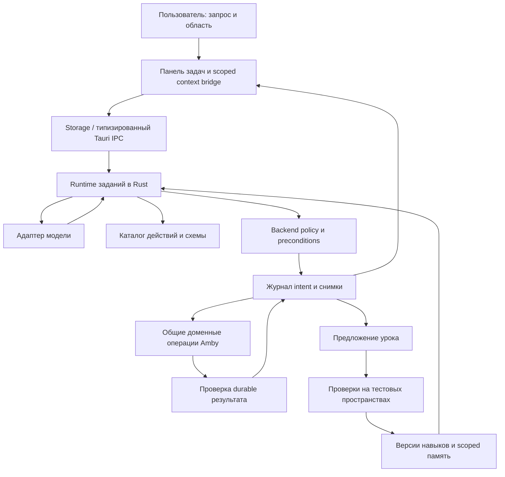

# ИИ: планы

Статус на 2026-11-03 (сверено с кодом). Контракты ИИ-агента: [ai-harness](../ai-harness.md), [состояние и журнал](../ai-state-format.md), [каталог действий](../ai-action-catalog.md), [Codex](../ai-codex-provider.md). Отложенное: [target/ai.md](target/ai.md).

| Часть                      | Что                                                             | Статус                                                        |
| -------------------------- | --------------------------------------------------------------- | ------------------------------------------------------------- |
| 1. Этап 1                  | Панель ИИ, ИИ только читает хранилище                           | сделано                                                       |
| 2. Подключения провайдеров | API, Codex, Claude Code CLI, перенос настроек, каталоги моделей | этапы 1–5 сделаны; вход Claude Code (OAuth) проверит владелец |
| 3. План агента             | Реестр действий, журнал, права, откат (пакеты H)                | не начат                                                      |
| 4. Оркестрация             | Исполнение пакетов H агентами                                   | не начата                                                     |
| 5. Приёмка                 | Сценарии и доказательства для агента                            | спецификация, результатов нет                                 |

---

## Часть 1. ИИ, этап 1: новая панель и ИИ, который только читает

_Бывший файл `ai-stage-1-plan.md`, объединён 2026-11-03._

> **Статус на 2026-11-02:** в работе (ядро ИИ: `src-tauri/src/ai.rs`, `src/lib/ai.ts`). Подключения провайдеров — [ai-provider-connections-plan](ai.md).

Статус: реализация в работе. Дата: 2026-10-30. Версия: 1.

Решения владельца (2026-10-30):

- Первый шаг — новая оболочка панели и ИИ, который **только читает** хранилище.
  Изменять заметки, настройки и файлы ИИ на этом этапе не может.
- Точка входа одна — боковая панель ИИ. Меню над выделением, `/ai` и палитра — следующие этапы.
- Контекст: текущая заметка по умолчанию + `@`-упоминания заметок и папок + самостоятельный
  поиск ИИ по существующему полнотекстовому индексу. Векторного индекса нет.
- Беседы хранятся в `.amby/ai/` хранилища и переживают перезапуск.

Этап 1 — подмножество большого плана агента ([ai-harness-plan.md](ai.md)):
он делает ранние части H-30 (протокол провайдера с вызовами инструментов), H-31
(цикл выполнения в Rust) и H-33 (панель) только для чтения. Реестр действий, журнал,
права на запись и откат (H-10…H-24) этап 1 не затрагивает и не заменяет. Всё, что
пишет на диск от имени ИИ, ждёт этих пакетов.

### 1. Требования

Идентификаторы `AI1-*` используются в тестах (`// AI1-R3`).

#### Беседа и интерфейс

- **AI1-U1** Панель: заголовок с названием беседы, кнопки «Список бесед», «Новая беседа», «Модели».
- **AI1-U2** Ответ показывается как Markdown (markdown-it, `html: false`, ссылки только
  `http(s)` и внутренние). Стриминг сохраняется. Код и списки читаются в узкой панели.
- **AI1-U3** Шаги ИИ видны во время выполнения и сохраняются в беседе: «Искал «…» · N заметок»,
  «Прочитал X, Y». Шаг можно развернуть и увидеть, какие заметки найдены.
- **AI1-U4** Источники: ИИ ссылается на прочитанные заметки как `[n]`. Под ответом —
  чипы источников; нажатие открывает заметку. Ссылка на удалённую или переименованную
  заметку не ломает отображение.
- **AI1-U5** Действия с ответом: копировать, повторить, «Сохранить как заметку» (создание
  новой заметки — действие пользователя через обычный путь создания, не ИИ).
- **AI1-U6** Пустая беседа: подсказки-примеры; при отсутствии моделей — понятный переход к настройке.
- **AI1-U7** Выбор модели внутри поля ввода; метка «локально»/«облако» по адресу провайдера
  (loopback/LAN → «локально»).
- **AI1-U8** Остановка в любой момент, в том числе между шагами инструментов. Ошибки
  показываются по безопасному коду, без текста ответа провайдера.
- **AI1-U9** Все видимые строки — в `src/locales/resources.ts` со всеми переводами.

#### Контекст

- **AI1-C1** Текущая заметка добавляется чипом автоматически при создании беседы и при
  переключении заметки, пока пользователь не убрал её вручную. Берётся текст из открытого
  буфера (несохранённые правки тоже), как сейчас.
- **AI1-C2** `@` в поле ввода открывает выбор заметок и папок (через существующий поиск);
  выбранное становится чипом. Чип можно убрать.
- **AI1-C3** Папка-чип даёт ИИ список её заметок и разрешение их читать, а не весь текст сразу.
- **AI1-C4** Переключатель «Поиск по хранилищу» на беседу. Выключен — ИИ видит только чипы.
- **AI1-C5** Бюджет контекста: общий лимит символов на прикреплённые тексты; превышение
  обрезается с явной пометкой в чипе («обрезано»), а не молча.

#### Чтение хранилища (инструменты)

- **AI1-R1** Инструменты только для чтения, выполняются в Rust над **активным** хранилищем:
  `search_notes(query, limit)`, `read_note(id, offset?, maxChars?)`, `list_folder(path)`,
  `get_links(id)` (исходящие и обратные ссылки).
- **AI1-R2** Ни один инструмент не пишет на диск и не меняет индекс. Тест проверяет, что
  после полного цикла с инструментами файлы хранилища и `.amby/` побайтно не изменились
  (кроме файла беседы).
- **AI1-R3** Пути канонизируются; `..`, абсолютные пути, симлинки наружу, `.amby/` и
  исключённые из индекса папки недоступны. Ответ инструмента об отказе — обычный
  результат для модели, а не падение цикла.
- **AI1-R4** Лимиты: ≤ 8 вызовов инструментов за ответ, ≤ 20 000 символов на одно чтение,
  ≤ 60 000 символов результатов инструментов за ответ, ≤ 10 результатов поиска.
  Исчерпание лимита — финальный запрос к модели без инструментов.
- **AI1-R5** Когда «Поиск по хранилищу» выключен, `search_notes`/`list_folder` модели не
  предлагаются, а `read_note` разрешён только для заметок из чипов. Проверка в Rust, по
  списку, который пришёл с запросом, а не по словам модели.
- **AI1-R6** Если хранилище сменилось во время ответа — ответ прерывается, ничего из
  нового хранилища не читается.
- **AI1-R7** Чтение берёт версию с диска. Для открытой заметки с несохранёнными правками
  это может отставать на интервал автосохранения; текущая заметка из AI1-C1 этого не касается.

#### Провайдеры

- **AI1-P1** Вызовы инструментов для всех четырёх семейств: OpenAI-совместимые (`tools`/
  `tool_calls`), Azure, Anthropic (`tool_use`/`tool_result`), Ollama (`tools`). Стриминг
  текста и вызовов инструментов.
- **AI1-P2** У модели флаг «умеет инструменты» (по умолчанию да для облачных, нет для
  локальных; меняется в настройках модели). Без инструментов работают только чипы
  (AI1-C1…C3), поиск недоступен, переключатель AI1-C4 показывает почему.
- **AI1-P3** Ошибка «модель не поддерживает tools» от провайдера даёт понятное сообщение
  и предложение выключить флаг, а не общий сбой.
- **AI1-P4** Тестовый провайдер (fake) в Rust с заранее записанными сценариями ответов —
  основа всех тестов цикла. Сеть в тестах не используется.

#### Приватность

- **AI1-S1** Первый запрос с облачной моделью и включённым поиском в этом хранилище
  показывает одно понятное подтверждение: «ИИ сможет искать и читать заметки этого
  хранилища и отправлять найденный текст провайдеру X». Ответ запоминается на хранилище
  и провайдера; отказ = беседы этого хранилища с этим провайдером идут без поиска.
- **AI1-S2** В логах и отладке нет текста заметок, запросов и ответов — только коды,
  размеры и id. Ключи провайдеров по-прежнему только через credentials.

#### Хранение бесед

- **AI1-H1** Беседа — файл `.amby/ai/chats/<ULID>.json`, версия формата `1`: id, title,
  createdAt, updatedAt, modelId, вкл/выкл поиска, чипы контекста (id/путь, не текст),
  сообщения, шаги инструментов (запрос, id найденных заметок — без текста результатов).
- **AI1-H2** Запись атомарная через существующие функции Rust; сохраняется после каждого
  завершённого ответа и при остановке. Повреждённый файл не удаляется и не перезаписывается:
  беседа помечается недоступной в списке, файл остаётся как есть.
- **AI1-H3** Неизвестные поля и будущие версии формата сохраняются/открываются только для
  чтения, не теряются при перезаписи.
- **AI1-H4** Удаление беседы перемещает файл в `.amby/trash/` (восстановимо), без окончательного удаления.
- **AI1-H5** `.amby/ai/` **не синхронизируется** (как всё неназванное). Добавить строку в
  таблицу `docs/vault-format.md` и проверить, что тест соответствия правил синхронизации проходит.
- **AI1-H6** Название беседы — первые слова первого вопроса; переименование вручную.
  Список: группы «Сегодня/Вчера/Ранее», поиск по названиям.
- **AI1-H7** Старое поведение (беседа в памяти) уходит без миграции — сохранённых данных нет.

### 2. Архитектура

```text
UI (src/components/workspace/ai/)
  ai-panel.tsx          оболочка, переключение «беседа / список / модели»
  chat-view.tsx         сообщения, шаги, источники
  composer.tsx          поле, @-выбор, чипы, модель, кнопка
  chat-list.tsx         список бесед
  use-ai-chat-store.ts  Zustand: активная беседа, стриминг, чипы
src/lib/ai.ts           клиент: aiRunTurn, события, ошибки
src/lib/storage/…       ai-chat-repository (list/load/save/trash бесед) по правилам storage
Rust
  ai.rs → ai/           mod.rs (как сейчас), providers/*.rs (+tools), fake.rs
  ai/tools.rs           read-only инструменты над VaultContext
  ai/turn.rs            цикл: модель → инструменты → модель, лимиты, отмена
  ai/chats.rs           хранение бесед в .amby/ai/chats/
```

- Новая команда `ai_run_turn(request)`: конфиг модели, сообщения, прикреплённый контекст
  (тексты чипов-заметок из буферов + id разрешённых заметок/папок), флаг поиска, streamId.
  События `ai:event` с номером: `token`, `toolStart`, `toolEnd`, `done`, `error`.
  Существующая `ai_chat` остаётся до перевода всех вызовов, потом удаляется.
- Цикл в Rust, а не в UI: модель не получает доступа к IPC, лимиты и проверки чипов
  (AI1-R5) нельзя обойти из webview. Блокировка индекса берётся только на время
  конкретного инструмента, сетевой запрос к модели — без блокировок.
- Типы и команды — через Specta; `bindings.ts` регенерирует `npm run rust:test`.
- Модуль `amby.ai`: разрешения манифеста сужаются до `ui-panel`, `read-notes`
  (сейчас там `write-notes`, хотя запись не используется).

### 3. Пакеты и порядок

Процесс «сначала тесты» (как в sync-plan §6): заглушки интерфейсов → тесты по этому
плану отдельной сессией, каждый со ссылкой на `AI1-*` → красный прогон → ревью тестов →
отдельный коммит тестов → реализация другой сессией, тесты заморожены.

| Пакет | Что                                                                      | Требования | Модель / усилие |
| ----- | ------------------------------------------------------------------------ | ---------- | --------------- |
| T     | Заглушки + все тесты Rust и Vitest, красный прогон                       | все        | Sonnet medium   |
| A     | Rust: протокол tools для 4 семейств + fake-провайдер                     | P1–P4      | Sonnet medium   |
| B     | Rust: read-only инструменты, канонизация, лимиты                         | R1–R7, S2  | Sonnet medium   |
| C     | Rust: `ai_run_turn`, события, отмена, смена хранилища                    | R4–R6, U8  | Sonnet medium   |
| D     | Rust + storage: беседы в `.amby/ai/`, корзина, vault-format              | H1–H7      | Sonnet medium   |
| E     | UI: панель, Markdown, шаги, источники, список бесед, локали              | U1–U9, H6  | Sonnet low      |
| F     | UI: чипы, `@`-выбор, бюджет контекста, подтверждение приватности         | C1–C5, S1  | Sonnet low      |
| G     | MAP-файлы, `upd_next.md`, нативная проверка с реальными Ollama и облаком | —          | Haiku           |

A → C; B → C; C и D → E → F → G. A, B, D можно делать параллельно.

Ревью: строгое — B, C, D (чтение хранилища и запись бесед на диск); выборочное — E, F.

### 4. Приёмка

- `npm run verify`, `npm run rust:test`, strict Clippy, `npm run docs:check`.
- Нативно: Ollama (локальная модель без tools и с tools), один облачный провайдер;
  сценарии: вопрос по текущей заметке, по `@`-заметке, по папке, поиск по хранилищу,
  остановка во время поиска, перезапуск с сохранённой беседой, смена хранилища во время ответа,
  отказ в подтверждении приватности.
- Проверка AI1-R2: снимок хэшей хранилища до и после сценариев совпадает (кроме `.amby/ai/`).

### 5. Следующие этапы (не входят в этап 1)

1. Меню над выделением и `/ai`: результат как предпросмотр, вставляет пользователь.
2. Векторный поиск (по желанию, локальные эмбеддинги).
3. Запись через план агента H: реестр действий, журнал, откат — затем «Подготовить/Выполнить».

---

## Часть 2. Подключения ИИ: провайдеры, API и CLI

_Бывший файл `ai-provider-connections-plan.md`, объединён 2026-11-03._

Статус на 2026-11-03: этапы 1–5 реализованы (модель подключений, перенос с резервной копией,
каталоги API, Codex и Claude Code CLI, экран провайдеров; подключения лежат в отдельном
`ai-connections.json`). Не проверено: вход Claude Code (OAuth) и настоящий аккаунт — проверка за
владельцем; этап 6 (чат и выпуск) подтвердить по журналу ниже.

### Результат для пользователя

В настройках пользователь добавляет подключение провайдера, выбирает способ
«API» или поддерживаемый «CLI», подключает аккаунт и включает нужные модели
из полученного каталога. В чате появляются только включённые модели.
Ручное добавление моделей доступно только у локальных провайдеров.

Пример: «Добавить провайдера → OpenAI → API → ключ → список моделей» либо
«Добавить провайдера → OpenAI → Codex CLI → проверка установки → вход →
список моделей». Два подключения могут существовать одновременно.

CLI сначала устанавливается пользователем: экран показывает инструкцию,
официальную ссылку, команду для копирования и кнопку повторной проверки.
Команды установки не выполняются при открытии настроек. Установка и вход
являются разными состояниями. Установка CLI не гарантирует доступ к моделям.

### Что есть сейчас — подтверждено кодом

- `app-config.ts`: `AiSettings` хранит `models` и `activeModelId`;
  адрес, провайдер и `credentialId` повторяются в каждой модели.
- `models-manager.tsx`: добавление/редактирование одной модели, включая
  произвольное имя облачной модели. Общей карточки подключения нет.
- `ai-panel.tsx`: модель ищется по `chat.modelId` и `activeModelId`;
  список чата строится из всех `ai.models`.
- `src/lib/ai.ts` и `src-tauri/src/ai.rs`: запросы идут через Rust;
  команд получения каталога моделей пока нет.
- `ai/codex/launch.rs`: уже есть поиск Codex CLI, проверка версии,
  вход, выход, отмена входа и запуск app-server.
- Codex запускается в изолированном окружении Amby. Нельзя обещать
  автоматическое использование входа из пользовательского `~/.codex`.
- Ключи находятся в системном хранилище. Новый формат продолжает ссылаться
  на `credentialId`; перенос ключей в JSON не требуется.

### Решения по устройству

#### Провайдер, подключение и модель

Разделить три сущности:

- **Провайдер** — статическое определение: ID, название, локальный/облачный,
  поддерживаемые способы подключения и адаптеры каталога/запросов.
- **Подключение** — стабильный ID, провайдер, способ API/CLI, название,
  endpoint/версия API или тип CLI, ссылка на ключ и настройки соединения.
  Несколько подключений одного провайдера допустимы.
- **Модель** — стабильный внутренний ID, `connectionId`, ID у провайдера,
  название, флаг включения и происхождение: каталог/локальная пользовательская.
  Ссылки старых чатов продолжают использовать внутренние ID.

Каталог и состояние соединения отделены от пользовательского выбора моделей.
Обновление каталога не должно включать все модели или сбрасывать переключатели.
Новые модели первоначально выключены. При первом подключении пользователь
сам выбирает модели; существующие перенесённые модели сохраняют включение.

Активная модель — отдельный выбор для новых бесед. Если модель текущей беседы
отключена или удалена, историю можно читать, а отправка требует явного выбора
доступной модели. Автоматически отправлять текст другому провайдеру нельзя.
Уже запущенный запрос завершается с конфигурацией, захваченной при старте.

#### Матрица способов подключения

| Провайдер                         | API / локальный HTTP                                                 | CLI                                                                 |
| --------------------------------- | -------------------------------------------------------------------- | ------------------------------------------------------------------- |
| OpenAI                            | существующий API, добавить каталог                                   | Codex, существующий транспорт; добавить каталог                     |
| Anthropic                         | существующий API, добавить каталог                                   | Claude Code CLI (`claude-cli`), отдельный адаптер `ai/claude_code/` |
| OpenRouter, Groq, Mistral         | существующий совместимый API, каталог по адаптеру                    | показывать только при наличии реализованного адаптера               |
| Azure OpenAI                      | существующий API; отдельно проверить получение доступных deployments | отдельного адаптера сейчас нет                                      |
| Ollama, LM Studio, MLX, llama.cpp | локальный endpoint, каталог и ручной ввод                            | локальный сервер не считать CLI-транспортом чата                    |

Выбор CLI не является произвольной командой shell. Каждому CLI нужен адаптер
с проверенным протоколом, авторизацией, каталогом, отменой и границами доступа.
Первый вертикальный сценарий — API + Codex. Следующий CLI — Claude Code:
выпуск адаптера зависит от проверки, что можно сохранить доступ только к
разрешённым заметкам. Добавление Gemini и других новых провайдеров — отдельное
расширение реестра после основных этапов.

Облачные модели не вводятся вручную. Для Azure нужно до выпуска выяснить,
какие права/параметры нужны для перечисления deployments: каталог общих моделей
не заменяет список развёртываний аккаунта. Если список недоступен, интерфейс
объясняет ограничение, сохраняет прежнее подключение и не предлагает неверный
универсальный `/models` как рабочее решение.

#### Каталог и возможности

Rust получает каталог с теми же настройками соединения и ключом, что используются
для отправки. Поддержать пагинацию, дедупликацию, ограничение размера ответа,
таймаут, безопасные ошибки и отмену/игнорирование устаревшего результата.
Endpoint проходит существующую валидацию; ключи и ответы с секретами не попадают
в журнал или текст ошибок. CSP браузера не расширяется.

Не все модели из каталога подходят для текстового чата или текущего транспорта.
Отдельно учитывать возможности транспорта и модели: текстовый чат, инструменты,
нужный API. Не показывать embedding/image/audio-модель как пригодную для чата.
Не переносить облачное правило `supportsTools=true` на весь каталог.
Если достоверных метаданных нет, применить явно описанную политику адаптера и
показать ограничение; не проверять доступ платным запросом без действия пользователя.

Ошибка обновления сохраняет последний каталог и выбор. Исчезнувшая модель
помечается недоступной, её запись и история сохраняются. Кэш каталога имеет
время обновления; пользовательские переключатели не являются кэшем.
Для CLI каталог также не означает подтверждённое право аккаунта на каждую модель.

### Этапы реализации и приёмка

#### 1. Доменная модель и совместимость чтения

Вынести типы и чистые операции подключений из `app-config.ts` в сфокусированный
модуль. Добавить реестр адаптеров и селекторы доступных моделей.
Спроектировать версионированный AI-раздел, сохраняя остальные настройки.
Пока не подключать новую запись на старте приложения.

Готово, когда тесты покрывают несколько подключений одного провайдера, локальные
пользовательские модели, включение/отключение, стабильные ID и чтение старой формы.
Существующий экран и чат продолжают работать.

#### 2. Перенос сохранённых настроек

Перед записью: read-only preflight, неизменяемая резервная копия исходного
`settings.json`, версия переноса, проверка результата, атомарная публикация,
запись исхода и обнаружение завершения при повторном старте. Не объединять
подключения с разными ключами, адресами, версиями API или несовместимыми настройками.
Старые ID моделей, подписи и ссылки на ключи сохраняются.

Миграция не удаляет ключи и облачные модели, даже если их пока нет в каталоге.
Откат восстанавливает резервную копию до нового редактирования; после изменений
нужен отдельный экспорт текущей версии, чтобы откат не стёр новые подключения.
Неизвестная будущая версия блокирует перезапись AI-раздела.

Готово, когда проверены пустые/старые/повреждённые настройки, ошибка записи,
прерывание на границах публикации, повторный запуск и восстановление из копии.
Перенос не затрагивает файлы заметок и чатов.

#### 3. Каталоги API и локальных серверов

Добавить типизированные команды каталога, адаптеры для существующих API-семейств
и локальных серверов; генерировать Specta bindings штатным тестом.
Разделить сетевой ответ, нормализацию каталога и пользовательские переключатели.
Отдельно проверить Azure и различия путей OpenAI-совместимых сервисов.

Готово, когда интеграционные тесты с локальным mock-сервером проверяют авторизацию,
пагинацию, URL, 401/403/429, таймаут, неверный/слишком большой ответ и безопасные
ошибки. Нет запросов к платным сервисам в автоматических тестах.

#### 4. Подключения CLI

Расширить существующий Codex-адаптер получением каталога через app-server.
Использовать существующие проверку версии, изолированное окружение и управление
жизненным циклом процесса. После входа/выхода обновлять состояние и каталог.
Добавить экран установки и повторной проверки с инструкцией для текущей ОС.

Затем исследовать и реализовать Claude Code отдельным адаптером: подтвердить
машинный протокол каталога и чата, поток, отмену, вход и отключение произвольных
инструментов. Зафиксировать результат проверки протокола до подключения UI.
Если CLI не даёт каталога, не подменять его ручным вводом облачной модели.

Готово, когда fake-CLI тесты проверяют отсутствие/неподдерживаемую версию,
отсутствие входа, повреждённый ответ, отмену, таймаут и завершение дочернего
процесса. Реальный native smoke отдельно проверяет установленный Codex.
CLI не получает shell-доступ к хранилищу вместо существующих read-only инструментов.

#### 5. Экран провайдеров

Заменить список редактируемых моделей карточками подключений. Добавление:
провайдер → способ → параметры/проверка CLI → подключение → выбор моделей.
Внутри карточки: состояние, подключение/выход, каталог с поиском и переключателями,
обновление списка. Ключ редактируется один раз на подключение.
Добавление своей модели видно только для локального провайдера по реестру,
а не просто для произвольного URL, который оказался локальным.

Сохранение сериализовано, ошибки видимы, поздние ответы не меняют другое
подключение. Удаление подключения явно описывает удаление настройки и ключа;
общий `credentialId` нельзя удалить, пока на него ссылается другое подключение.
Удаление не стирает историю. Все строки — RU/EN в `resources.ts`.

Готово, когда компонентные и браузерные сценарии проходят подключение API,
отсутствующий CLI, вход, пустой каталог, поиск, переключатели, локальную модель,
сбой сохранения и повторное открытие экрана. Проверить узкое окно и клавиатуру.

#### 6. Чат и выпуск

Подключить единый resolver модели/соединения к отправке, инструментам, согласию
на чтение заметок и выбору модели. В меню учитывать несколько подключений
одного провайдера. Обновление ключа/адреса/аккаунта инвалидирует соответствующее
согласие и каталог по существующему контракту согласий.
Отключённые модели исключены и из меню, и из программного пути отправки.
Отсутствие активных моделей открывает понятный переход в настройки.

Готово, когда проверены старые беседы, отключение текущей модели, изменение
настроек во время потока, отмена, смена хранилища и переключение API/CLI.
Обязательны `npm run build`, `npm run verify`, браузерный smoke, native smoke
и native build для IPC/desktop-изменений. В журнале этапа записать фактически
выполненные команды, ограничения и результаты. Версию без выпуска не повышать.

### Порядок работы

Этапы 1 → 2 → 3 → 4 → 5 → 6, отдельными проверяемыми партиями.
Новый экран включается только после готовности переноса и рабочего вертикального
сценария API + Codex CLI. Перед каждым следующим этапом сверять план с фактическим
diff, сохранять чужие рабочие изменения и отмечать завершение только по проверкам.

### Журнал

- 2026-10-31: проверены текущие владельцы настроек, UI, запросов, ключей,
  выбора моделей и запуска Codex. Составлены этапы и критерии. Продуктовая
  реализация подключений пока не начата.
- Проверки партии планирования: `npm run build` и `docs:check` прошли.
  `npm run verify` прошёл фронтенд, форматирование и Clippy, но завершился
  на Rust-тестах: 1079 прошли, 149 упали, 10 пропущены. В отчёте есть запреты
  окружения на локальные порты и доступ к системной корзине/Finder;
  полный gate не считается пройденным. `bindings:check` в цепочке не выполнялся.
  Native smoke/build для изменений документации не запускались.

- 2026-10-31: начата подготовка этапа 1: добавлена изолированная модель
  подключений, преобразование старого списка в памяти, выбор доступных моделей
  и согласование каталога. Сохранение, миграция и интерфейс не переключены;
  этапы 1–6 остаются незавершёнными.
- Проверки подготовительной партии: целевые тесты прошли (35), `build` и
  `docs:check` прошли. Повторный `verify` прошёл 3041 frontend-тест,
  форматирование, knip и Clippy, но Rust-тесты завершились результатом
  1079 прошли, 149 упали, 10 пропущены; среди ошибок запреты локальных
  портов и системной корзины. `bindings:check` не достигнут. Полный gate
  не пройден; браузерный и native smoke для новой функции не выполнялись,
  поскольку новая функция пока не включена.

- Начата разработка переноса: изолированный Rust-прототип сохраняет точную
  резервную копию, различает подготовленную и завершённую публикацию,
  восстанавливается после прерывания и отказывает в откате при изменениях.
  Есть общий с обычной записью блокировщик и защита от записи устаревшей
  версии. Прототип ещё не подключён на старте: этап 2 не завершён.
  Целевые проверки: 4 теста миграции, тест защиты версии, 5 тестов домена
  и 9 тестов прежнего экрана прошли.

- Подготовлен, но не подключён к интерфейсу, запрос Codex `model/list`:
  [схема ответа](https://github.com/openai/codex/blob/main/codex-rs/app-server-protocol/schema/json/v2/ModelListResponse.json),
  [параметры](https://github.com/openai/codex/blob/main/codex-rs/app-server-protocol/schema/json/v2/ModelListParams.json);
  список не подтверждает права аккаунта. Протокольные тесты проверили
  страницы, повтор курсора, дедупликацию и фильтрацию; fake CLI — завершение
  дочернего процесса. Вывод в интерфейс и IPC пока не реализованы.
- Проверка Azure: [официальный список deployments](https://learn.microsoft.com/en-us/rest/api/aifoundry/accountmanagement/deployments/list?view=rest-aifoundry-accountmanagement-2025-06-01) относится к management API и требует subscription ID, resource group, имя аккаунта и авторизацию управления. Существующих endpoint и inference API key недостаточно для этого маршрута; универсальный `/models` не внедрён, существующие настройки сохраняются.
- Подготовка API-каталогов остаётся тестовой: целевые mock HTTP-тесты авторизации, страниц, 401, неверного и слишком большого ответа прошли вне sandbox; первоначальный bind внутри sandbox получил `EPERM`.
- Текущий срез: при первом открытии экрана ИИ в desktop включён перенос v1 с
  backup и проверяемым rollback. Реализованы API-каталоги и Codex model/list,
  карточки подключений, сохранение выбора, локальные пользовательские модели,
  проверка доступности модели при отправке в frontend и Rust. WebKit smoke и
  изолированный native IPC-контракт прошли на предыдущем состоянии партии;
  после последних изменений обязательные проверки повторяются. Claude Code
  пока не представлен в интерфейсе: протокол и граница доступа ещё проверяются.
- Claude Code 2.1.312: в отдельном `CLAUDE_CONFIG_DIR` машинный initialize
  [Agent SDK](https://code.claude.com/docs/en/agent-sdk/typescript) вернул
  пять моделей без отправки промпта, статус входа — signed out. Документированы
  `--safe-mode`, `--restricted`, `--tools ""` и запрет MCP в
  [CLI reference](https://code.claude.com/docs/en/cli-reference); вход,
  завершение процесса, поток чата и устойчивость этой границы к атакующим
  ответам пока не проверены. Способ не предлагается до этих проверок.
- Политика каталога: для официального OpenAI endpoint показываются семейства
  Chat Completions `gpt-3.5-turbo`, `gpt-4`, `gpt-5`, `chatgpt-4`, `o1`,
  `o3`, `o4`, кроме известных Responses-only Codex/Pro и deep-research;
  остальные совместимые API и локальные серверы фильтруются по признакам
  нетекстовых семейств и доступным метаданным модальностей. Неизвестная
  поддержка инструментов не включается автоматически. Для GPT-5 и o-серии
  используется `max_completion_tokens`.

- 2026-10-31, итог партии: `npm run verify` прошёл полностью (Rust: 1243 прошли,
  0 упали, 10 пропущены; `bindings:check`, knip, Clippy), `npm run build` и
  `docs:check` прошли. Нативный контракт `npm run test:storage:live` прошёл целиком,
  включая «AI catalog and reversible migration use real IPC» и запрет отправки
  через отключённую модель. Ранние 149 падений Rust-тестов были ограничениями
  sandbox (локальные порты, корзина), вне него не воспроизводятся.
  Не проверено: реальный вход Claude (OAuth) — sandbox запретил локальный listener;
  Claude Code остаётся выключенным в интерфейсе до проверки владельцем.

- 2026-10-31, Claude Code CLI (этап 4, вторая часть). Адаптер: `src-tauri/src/ai/claude_code.rs`,
  `claude_code/launch.rs`, `claude_code/home.rs`; в интерфейсе — способ `claude-cli` у Anthropic,
  провайдер `claude-code` на проводе, общая карточка CLI в `connections-manager.tsx`.
  Проверено вручную на Claude Code 2.1.312 в отдельном `CLAUDE_CONFIG_DIR` (без входа):
  - `claude auth status --json` → `{"loggedIn":false,…}`, код выхода 1; `claude auth login
--claudeai` печатает «Opening browser…» и ссылку, сам открывает браузер и слушает
    `localhost`-порт (запись `open` перехвачена подменой в `PATH`); `auth logout` есть.
    Вход до конца **не проходился**: OAuth проверит владелец.
  - Каталог: `-p --input-format stream-json --output-format stream-json` + запрос
    `{"type":"control_request","request_id":…,"request":{"subtype":"initialize"}}` возвращает
    `models[]` (`value`, `displayName`) без промпта и без входа; процесс завершается по EOF stdin.
  - Граница доступа: `--safe-mode` отключает и явный `--mcp-config` (проверено через
    `mcp_status`: список пуст), поэтому мост Amby работает с `--restricted
--strict-mcp-config --disable-slash-commands --tools "" --permission-mode dontAsk
--permission-prompts none --no-session-persistence` и `--allowedTools` только с
    `mcp__amby__*`. Токен моста передаётся переменной `AMBY_MCP_TOKEN` (в `--mcp-config` стоит
    `${AMBY_MCP_TOKEN}`, раскрытие подтверждено), в argv его нет. Строка `init` реального
    потока (`tools`, `mcp_servers`, `skills`) проверяется охранником: любой инструмент не из
    моста, чужой MCP-сервер или навык, как и `tool_use` вне списка, останавливают ответ
    (`agentBoundary`) и убивают процесс. Окружение очищено (`env_clear`, без `ANTHROPIC_API_KEY`
    и токенов), рабочая папка пустая, `DISABLE_AUTOUPDATER`/`DISABLE_TELEMETRY` включены.
  - Без входа реальный поток даёт `assistant` с `error:"authentication_failed"` и `result`
    с `is_error:true` («Please run /login») — это `missingCredential`.
    Не проверено на реальном аккаунте: формы `stream_event`/`tool_use` после входа (разобраны по
    документации Agent SDK и покрыты fake-CLI), работа моста с настоящим MCP-запросом Claude,
    устойчивость границы к атакующему тексту заметки, а также `auth login` в sandbox (локальный
    OAuth-listener там запрещён; вне sandbox вход не запускался по условию задачи).
    Тесты (написаны вместе с кодом, а не до него): Rust `ai::claude_code` — 52 теста: разбор
    потока, охранник, argv, окружение, fake-CLI (отсутствие, неподдерживаемая версия, нет входа,
    битый ответ, отмена, таймаут простоя и общий, завершение дочернего процесса, вход/выход,
    каталог); `consent` — отдельное согласие; vitest — `connections-claude.test.ts`,
    `connections-manager-claude.test.tsx`, `ai-panel-claude.test.tsx`; native IPC —
    `tests/native/ai-contract.ts` (статус, отказ без согласия, ход и каталог при выполненном входе).

---

## Часть 3. ИИ-агент Amby: архитектура и полный план реализации

_Бывший файл `ai-harness-plan.md`, объединён 2026-11-03._

> **Статус на 2026-11-02:** план, не реализован. Из него начат только этап 1 (панель и ИИ, который только читает — [ai-stage-1-plan](ai.md)); реестр действий, журнал, права записи и откат (H-10…H-24) не начаты.

Статус: план, реализация не начата в рамках этого документа.  
Дата: 2026-09-30. Версия плана: 2. Первая редакция: 2026-09-24.

План подготовлен по текущему рабочему дереву, включая незакоммиченные изменения.
Наличие файла или существующего теста не означает, что соответствующая возможность
проверена для агентного использования. Перед реализацией выполняется пакет H-00.

Связанные документы:

- [Оркестрация: пакеты работ, зависимости и задания агентам](ai.md).
- [Приёмка: сценарии, критерии и доказательства](ai.md).
- [Подробный контракт harness: действия, права, runtime, навыки и плагины](../ai-harness.md).
- [Формат журнала, состояния и восстановления](../ai-state-format.md).
- [Начальный каталог действий с привязкой к текущим API](../ai-action-catalog.md).
- [Контракт файлов и сохранения](../vault-format.md).
- [Совместимость Markdown](../markdown-compatibility.md).
- [Нативная проверка storage](../native-storage-contract.md).
- [Базы: система](../database-system.md), [формат](../database-format.md), [runtime](../database-runtime.md).
- [Темы и локализация](../themes-and-localization.md).
- [План модульной архитектуры](modules.md).

Во второй редакции добавлены проекты конкретных контрактов и учтено рабочее
дерево на 2026-09-30. Они уточняют режимы выполнения, field-level permissions,
editor barriers, результаты частичной записи, crash recovery, обучение и
plugin lifecycle. H-00/H-01 остаются запланированными: перед реализацией нужны
актуальный baseline, полная UI-инвентаризация, schemas и исполняемые fixtures.
Действующие форматы данных имеют приоритет перед предлагаемыми агентными
adapters; найденные расхождения зафиксированы в каталоге для разрешения в H-00.

### 1. Цель и границы

ИИ выполняет содержательные действия пользователя через API приложения: работает
с заметками, папками, базами, представлениями, Canvas, Excalidraw, оформлением,
настройками и разрешёнными расширениями. Пользователь может попросить создать
плагин и последовательно дорабатывать его в приложении.

Каждое действие наблюдаемо. Каждое поддерживаемое изменение имеет описанный
способ восстановления. Агент работает только в выданной области пространства
и с разрешёнными ключами настроек. Обучение навыкам подчиняется тем же ограничениям.

Обязательные продуктовые требования:

1. Действия доступны без кликов по интерфейсу и без монтирования редактора.
2. UI и агент используют общую доменную логику, сохраняющую контракты Amby.
3. Журнал охватывает чтение, поиск, попытки изменений, отказы, ошибки,
   проверки, отмену, откат, работу с памятью, навыками и плагинами.
4. Откат отдельного действия и задания целиком сохраняет последующие правки
   пользователя. Конфликт показывается явно.
5. Задание переживает закрытие панели и восстанавливается после перезапуска
   приложения без повторного создания объектов.
6. Агент знает доступные возможности текущей версии и включённых модулей.
7. Навыки версионируются; улучшения проходят проверку и могут быть отменены.
8. Пользователь видит область доступа, ход работы, результат, историю,
   использованные навыки и может остановить выполнение.
9. Облачному провайдеру передаётся только разрешённый контекст. Локальное
   хранение Amby не означает автоматически локальную обработку моделью.
10. Расход модели и фонового обучения ограничен отдельными бюджетами.

Термин «все действия пользователя» означает покрытие инвентаризации H-00.
Каждое действие получает статус `implemented`, `requiresUserInteraction`,
`blockedByPolicy` или `missingImplementation` с причиной и пакетом-владельцем.
Неизвестные возможности и заглушки не считаются поддержкой. Все заявленные
в этом плане сценарии реализуются; намеренные границы отмечаются отдельно.

За пределами обычного агентного доступа: произвольный shell, изменение кода
самого приложения, чтение секретов, изменение политики безопасности и журнала,
самовольное расширение области, публикация наружу, обновление бинарника Amby.
Выбор системной папки и ввод секрета остаются действиями пользователя.
Плагин может расширять функциональность только через проверенный SDK и выданные
права; возможность писать плагин не выдаёт системные полномочия.

### 2. Исходное состояние

| Область    | Наблюдаемая основа                                                                                                                                | Что требуется                                                                               |
| ---------- | ------------------------------------------------------------------------------------------------------------------------------------------------- | ------------------------------------------------------------------------------------------- |
| ИИ         | `src/components/workspace/ai-panel.tsx`, `src/lib/ai.ts`, `src-tauri/src/ai.rs`: текстовый чат, streaming, отмена, несколько семейств провайдеров | Структурированные tool calls, долговечные задания, проверенный контекст, журнал             |
| Данные     | `src/lib/storage/port.ts`, `database-port.ts`, Rust `commands/`, `bundle/`, `database/`                                                           | Общий контракт операций с происхождением, scope, preconditions и receipt                    |
| Редакторы  | `use-doc-store.ts`, `autosave/autosave-coordinator.ts`, recovery, serialization lifecycle                                                         | Координация агентных изменений с открытыми буферами и несколькими окнами                    |
| Схемы      | `src/lib/canvas-format.ts`, `sketch-format.ts`, редакторы Canvas/Excalidraw                                                                       | Операции над элементами без UI, layout, сохранение неизвестных полей и проверка изображения |
| Настройки  | `app-config.ts`, `use-settings-store.ts`, `settings-repository.ts`, `src/themes/`                                                                 | Узкие типизированные операции, backend allowlist ключей, CAS и откат отдельных значений     |
| Расширения | `src/lib/modules/`, Rust `package_manager.rs`, `commands/modules.rs`                                                                              | Аудит реального исполнения, единая политика, изоляция SDK, мастерская                       |
| Проверки   | Vitest, Rust tests, native contract/UI runners                                                                                                    | Детерминированный fake provider с настоящими mutations, failure injection, eval corpus      |

`CommunityPluginSandbox` и Worker runtime существуют, но отсутствие DOM в Worker
само по себе не доказывает изоляцию сети, IPC и host API. H-70 проверяет обходы
реальным исполняемым кодом в production runtime. Прошлые аудиты и release notes
содержат сведения о разных состояниях дерева; H-00 проверяет актуальные факты.

Текущий `package.json` задаёт `verify -> verify:full`, включая форматирование,
Knip, Clippy, Rust tests и проверку bindings. Описание старого сокращённого
`verify` в документах не уменьшает этот gate. В `vitest.config.ts` сейчас
включены также `tests/**/*.test.{ts,tsx}`; существующие component tests учитывать,
но не принимать за доказательство поведения нативного приложения.

### 3. Архитектура



#### 3.1 Размещение ответственности

- Rust владеет политикой, run lifecycle, журналом, очередью действий,
  credentials, inference transport, восстановлением и durable mutations.
- UI передаёт выбранные пользователем объекты/область и наблюдения редактора,
  отображает состояние, запрашивает действия через storage. Закрытие панели
  не является владельцем жизненного цикла задания.
- Открытые буферы остаются в существующих stores и autosave coordinator.
  Новый bridge согласует их с runtime, не создавая вторую модель документов.
- Каталог действий принадлежит приложению. Модель получает только разрешённые
  дескрипторы и не регистрирует новые привилегированные обработчики.
- Доменная операция не вызывает LLM и не зависит от открытой вкладки. Сетевой
  вызов модели никогда не выполняется под блокировкой записи vault.
- События выполнения имеют последовательные номера. UI восстанавливает
  пропущенные события из журнала, а не только слушает transient events.

Предлагаемые новые границы, окончательное разбиение фиксируется в H-01:

```text
src-tauri/src/app_actions/    # registry, policy, executor, receipts, domain adapters
src-tauri/src/agent/          # runtime, context, providers, journal, recovery,
                             # skills, learning, evaluation, plugin authoring
src-tauri/src/commands/agent.rs
src/lib/storage/agent-port.ts # через существующий StoragePort / adapters
src/lib/agent/               # чистые UI-facing модели и helpers
src/components/workspace/ai/ # tasks, scope, changes, history, skills, workbench
tests/fixtures/agent/        # только synthetic fixtures
```

Это целевые каталоги, а не свидетельство существующей реализации. Большие модули
разделять по ответственности; `lib.rs` и `workspace.tsx` остаются точками сборки.

#### 3.2 Контракт действия

`ActionDescriptor` содержит стабильный `id`, версию, описание, схемы входа/выхода,
module dependency, effect class, требования к правам, доступность preview,
тип проверки результата, класс отмены и лимиты размеров.

`ActionRequest` содержит `runId`, `operationId`, параметры и preconditions.
Actor, действующая grant и проверенные resource references назначаются host,
а не доверяются полям, присланным моделью или плагином.

`ActionReceipt` содержит реальный исход, созданные IDs, before/after revisions,
перечень затронутых ресурсов, journal references, verification result,
состояние индекса и возможность отката. `succeeded` с cache status `pending`
отличается от `failedBeforePublish`; восстановление индекса не повторяет уже
выполненную запись. Точная таблица outcomes находится в подробном контракте.

Общие ошибки: `permissionDenied`, `scopeChanged`, `moduleUnavailable`,
`revisionConflict`, `dirtyBufferConflict`, `validationFailed`,
`journalUnavailable`, `quotaExceeded`, `cancelled`, `outcomeUnknown`,
`unsupportedCapability`, `idempotencyConflict`. Transport errors остаются
отдельно от domain errors.

Видимые изменения интерфейса, например открытие вкладки, могут иметь session-only
undo. Durable изменения должны иметь durable inverse. Внешние необратимые
эффекты не включаются в общий обещанный откат; по умолчанию они недоступны.

#### 3.3 Каталог покрытия

H-00 расширяет следующую таблицу до каждой реальной пользовательской операции.
H-46 закрывает пробелы; ограничение модулем не превращает реализацию в `done`.

| Домен         | Минимальное покрытие                                                                                    | Основные пакеты  |
| ------------- | ------------------------------------------------------------------------------------------------------- | ---------------- |
| Заметки       | Поиск/чтение, создание, точечные правки body/source, заголовки, списки, таблицы, ссылки, колонки        | H-11, H-32, H-40 |
| Структура     | Папки, rename/move, bundles/layers, archive/trash/restore, согласованные backlinks                      | H-40             |
| Метаданные    | Теги, иконки, разрешённый frontmatter, custom properties, закрепления                                   | H-40, H-45       |
| Базы          | Attached/standalone, schema, options, rows/values, relation, formula, templates, assets, YAML sync      | H-41             |
| Представления | Поддерживаемые layout, фильтры, сортировка, группировка, видимость свойств, linked views                | H-41             |
| Canvas        | Карточки заметок/текста/локальных вложений, связи, группы, координаты и layout                          | H-42             |
| Excalidraw    | Наброски из редактируемых элементов, текст, стрелки, группы, изображения из разрешённых assets, заметки | H-43             |
| Внешний вид   | Валидные темы, отдельные токены, доступные шрифты/масштаб, preview и откат                              | H-44             |
| Настройки     | Зарегистрированные ключи workspace/global, панели, раскладка, доступные shortcuts                       | H-44, H-45       |
| Модули        | Список, состояние, разрешённое включение/выключение, зависимости и пресеты                              | H-45             |
| История       | Scoped просмотр своих действий, diff, отмена, восстановление после сбоя                                 | H-23, H-24, H-33 |
| Навыки/память | Просмотр, создание, изменение, version pinning, disable/revert/forget                                   | H-50—H-63        |
| Плагины       | Создание проекта, изменение кода, тест, preview, локальная установка, обновление, rollback              | H-70—H-74        |

Неподдерживаемые приложением типы представлений, произвольные системные шрифты,
новые форматы схем и незарегистрированные настройки не выдумываются агентом.
Расширение продукта проводится отдельным явным пакетом, если оно необходимо
для обязательного сценария. Генерация растровых изображений внешним сервисом
не требуется для редактируемых набросков Excalidraw.

### 4. Политика области доступа

Grant выдаётся backend после явного выбора в доверенном UI и содержит:

- persistent workspace identity, canonical root и текущую vault generation;
- отдельные read/write roots и при необходимости разрешённые object IDs;
- allowlist действий и ключей настроек с `workspace`/`global` scope;
- доступные namespace памяти, навыков, plugin project и журнала;
- выбранный provider profile, допустимость передачи контента этому provider;
- срок действия/ревизию grant, бюджеты и правила подтверждений.

По умолчанию задание принадлежит одному workspace. Работа только с глобальными
настройками возможна с отдельной grant. Смешанное задание «заметки + глобальная
тема» явно показывает обе области и применяет права к каждой операции.

Policy проверяется до чтения, до передачи контекста модели и непосредственно
перед публикацией изменений. Смена vault, отзыв прав, выключение модуля и
изменение policy revision останавливают дальнейшие действия. Старый receipt
или подтверждение не выдаёт право работать в новом контексте.

Обязательные пограничные случаи:

- Canonical containment, symlinks/junctions, drive/UNC, case-only rename,
  Unicode paths, несуществующий leaf с проверенным родителем, TOCTOU.
- Все затронутые ресурсы rename/move/refactor/batch входят в write scope.
  Backlink за пределами scope блокирует общий refactor до нового решения
  пользователя. Агент не получает текст или имя недоступной заметки.
- Relation, transclusion, preview, counts и aggregates не раскрывают данные
  соседнего раздела. Фильтрация scope выполняется до выдачи результатов и лимита.
- Схема базы может лежать за пределами разрешённой папки со строками: доступ
  к строкам не даёт автоматически право менять manifest всей базы.
- Scope ограничивает также историю, старые snapshots, embeddings, память,
  исходники навыков, вывод тестов и renderer previews. Контекст, накопленный до
  сужения прав, пересобирается; старые кеши и provider conversation IDs не
  переиспользуются для закрытых данных.
- Содержимое заметки/импортированного навыка является данными. Оно не становится
  системной инструкцией и не может изменять policy. Текущий chat prompt,
  вставляющий заметку в system text, заменить в H-32.
- API keys остаются в credential storage. Настройка внешнего вида не даёт права
  менять endpoint модели, сеть, credentials, sandbox или правила логирования.
- Внутренние операции с журналом разрешены host, но raw доступ к этим каталогам
  через файловые инструменты агента отсутствует.

### 5. Журнал, данные для отмены и crash recovery

#### 5.1 Durable формат

Предлагаемый формат v1: приложение хранит AI state в выделенном подкаталоге
app data, `ai/v1/workspaces/<opaque-workspace-id>/`; глобальные задачи используют
отдельный `ai/v1/global/`. Путь не выдаётся модели как writable directory.
Workspace identity не основана только на basename папки и не меняет note IDs.
Перемещение/копирование vault требует явной проверки привязки журнала к root;
по совпадению имён старые grants не восстанавливаются.

Источник истины — версионированные immutable event/operation records и
content-addressed blobs исходных данных. SQLite-проекция для поиска по журналу
перестраивается из этих записей и не смешивается с `.amby/notes.db`.
Проект точного файлового контракта и схемы публикации описан в
[ai-state-format](../ai-state-format.md). H-01 закрепляет его schemas; H-21 доказывает
crash consistency. Новые версии формата имеют preflight, backup, migration
outcome и документированный rollback.

Запись содержит event sequence, timestamps, run/step/operation ID, actor,
scope reference, action/schema version, redacted parameters, resource IDs,
expected/actual revisions, outcome, verification и inverse references.
Learning proposals ссылаются на evidence events. История не хранит скрытые
рассуждения модели; пользователь получает краткое объяснение действия.

Отдельные события фиксируют запрос/завершение модели с разрешёнными references
контекста и usage, изменение плана, запрос/решение подтверждения, смену grant,
pause/resume, старт/результат фоновой проверки. Это позволяет восстановить
последовательность работы, даже если модель не вызвала ни одного инструмента.

Credentials, заголовки авторизации, секреты из transport errors не попадают
в журнал. Полный raw prompt не логируется по умолчанию. Текст заметок в снимках
для отмены защищён тем же scope и хранится локально; его не отправляют модели
целиком ради перечисления истории. Provider usage при отсутствии данных
помечается `unknown`, а не нулём.

#### 5.2 Порядок изменения

1. Разрешить action, определить полный набор ресурсов, проверить grant,
   module state, редакторские буферы и expected revisions.
2. Взять существующий механизм serialization/locks в стабильном порядке;
   повторить preconditions на актуальном состоянии.
3. Надёжно сохранить необходимые before blobs, inverse plan и `prepared` intent.
   Неудача журнала/снимка запрещает mutation.
4. Выполнить доменную операцию через существующие atomic/no-replace helpers.
5. Перечитать результат, сохранить receipt/outcome и verification. Опубликовать
   события UI и обновить derived state без повторной записи источника.
6. При сбое между шагами recovery сопоставляет intent, before/after fingerprints
   и domain recovery records. Неоднозначность даёт `needsRecovery`, не blind retry.

JSON events публикуются атомарно со sync файла/каталога по возможностям платформы;
связанные blobs durable до публикации intent. Одновременное изменение файла и
журнала не объявляется единой filesystem-транзакцией. Окна сбоя между ними
покрываются reconciliation и failure injection.

`operationId` создаётся executor и сохраняется до первого side effect. Повтор
той же операции с тем же digest возвращает receipt; другие параметры с этим ID
отклоняются. Повтор пользовательского сообщения получает submission ID,
предотвращающий повторный запуск при transport retry.

#### 5.3 Откат и сроки хранения

- Изменение текста восстанавливает bytes снимка при совпадении after revision.
  Для разрешённого field-level merge проверяются именно изменённые поля.
- Созданный объект можно убрать, только если его содержимое и новые зависимые
  объекты не изменены пользователем; undo перемещает его во внутренний архив
  Amby с manifest восстановления. Системная корзина имеет отдельный manual
  contract и не включается в обещанный автоматический откат.
- Rename/move восстанавливает контейнер, слои, пути и переписанные ссылки.
- Настройки откатываются по затронутым ключам; чужие изменения других ключей
  сохраняются. Изменение того же ключа вызывает конфликт.
- База восстанавливает durable metadata/values и затем перестраивает projection.
- Задача из нескольких шагов откатывается в обратном порядке зависимостей.
  Частичный откат имеет отдельный статус и перечень оставшихся эффектов.
- Ручной откат и автоматическая компенсация проходят policy и журналирование.
  Stop запрещает новые шаги, но не обещает мгновенно прервать atomic publication.
  Завершённые шаги остаются видимыми; Stop и Undo — разные операции.
- Каждое восстановление — новая запись. Агент не стирает аудит своего действия.
- Активные/неразрешённые задачи и обещанные пользователю точки отката защищены
  от pruning. Лимит диска приостанавливает новые изменения вместо удаления
  необходимых snapshots. Срок хранения и утрата возможности старого отката
  видны пользователю; очистка — отдельная пользовательская операция.
- Удаление заметки по обычной команде не равно полному удалению её исторических
  копий. Явное forget/purge учитывает snapshots, память, skills evidence и кеши;
  после очистки UI не обещает восстановление удалённых данных.

### 6. Runtime, контекст и редактирование

#### 6.1 Жизненный цикл

Run: `queued → running → waitingForUser / pausedConflict / needsRecovery →
running → succeeded / failed / cancelled`. Отдельно хранятся завершённые
операции и `undoAvailable / partiallyUndone / undone`. Остановка процесса
оставляет interrupted run для recovery; завершение stream ответа не означает
завершение всей задачи.

Долгие задачи имеют checkpoints: цель, выполненные шаги, receipts, открытые
вопросы, текущий scope, версии модели/API/навыков. Продолжение повторно проверяет
права и revisions. После перезапуска новые writes не начинаются до reconciliation
и пользовательского продолжения задачи. Смена модели записывается в checkpoint.

Начальные инженерные лимиты для проверки в H-01: 40 model requests,
200 tool calls, 10 минут активного исполнения на один run; одна операция имеет
собственный timeout. Бюджет ожидания пользователя учитывается отдельно, при
ожидании нет polling модели. Фоновый разбор — не более одного предложения за
задание, 8 model requests и 2 минут. Значения конфигурируемы пользователем;
агент не увеличивает их сам. Повтор одинаковой ошибки после двух попыток
восстановления завершает шаг с диагностикой. Это проектные defaults, не
описание нынешних настроек приложения.

#### 6.2 Провайдеры

Ввести общий stream protocol: text delta, tool-call begin/arguments/end,
tool result, usage, completion, error/cancel. Частичные JSON arguments не
исполняются. Проверять schema, размер и action availability перед вызовом.
Разные tools из одного ответа проходят собственные preconditions; конкурентное
чтение допустимо, конфликтующие writes сериализуются.

H-30 сначала доказывает один end-to-end provider adapter, затем реализует
контракт для текущих семейств Ollama/OpenAI-compatible/Anthropic/Azure.
Capability probe определяет поддержку инструментов конкретным endpoint/model.
Несовместимая модель остаётся доступной для обсуждения и получает понятный
статус отсутствия режима действий. Модель не обязана быть одной марки.
Structured tool calling не подменяется исполнением кода из текстового ответа.

#### 6.3 Контекст и открытые буферы

Context содержит явные ссылки на выбранные объекты, scoped search results,
прочитанные fragments с revisions, доступные actions и нужные skills.
Truncation обозначается явно; агент может запросить следующий фрагмент.
Сводка длинного диалога хранит receipts и нерешённые ограничения, а не
используется как источник истинных revision/permissions.

На каждом окне bridge регистрирует владельца открытого документа и dirty state.
Перед mutation executor запрашивает сериализацию/flush затронутого буфера через
существующий lifecycle и autosave coordinator. Snapshot для агентного undo
берётся после успешного сохранения предшествующих пользовательских правок.
Если пользователь редактирует параллельно или flush не подтверждён, mutation
останавливается с конфликтом. Нельзя молча заменить in-memory buffer дисковой
версией. Потеря окна/lease требует recovery, а не предположения «документ чистый».
Закрытые документы обрабатываются тем же доменным API без editor instance.

### 7. Навыки и обучение

#### 7.1 Разные виды долговременных данных

| Вид              | Содержание                                            | Правила изменения                                     |
| ---------------- | ----------------------------------------------------- | ----------------------------------------------------- |
| Контракты Amby   | Каталог действий, schemas, ограничения хранения       | Версионируются с приложением; агент не переписывает   |
| Предпочтения     | Явные пользовательские предпочтения в заданном scope  | Видимы, редактируемы, можно забыть/отключить          |
| Навыки           | Повторяемые процедуры и способы проверки              | Версии, evidence, тесты, disable/revert               |
| Журнал           | Факты действий и результатов                          | Пишет host; исторические события не редактирует агент |
| Рабочий контекст | План конкретного задания, receipts, выбранные ресурсы | Ограничен run и пересобирается при смене прав         |

Skill package: `SKILL.md`, references/templates и при необходимости resources.
Тело совместимо с форматом Agent Skills в пределах поддерживаемых полей;
собственные version/provenance/eval records хранятся рядом. Импортируемый
`scripts/` не становится разрешением на исполнение. Код проходит правила
плагинов H-70—H-74. Отсутствующие capabilities показываются до запуска навыка.

Skill revision содержит immutable hash, автора/источник, parent revision,
scope, required actions/modules и версии, evidence references, проверки,
статус `draft / proposed / verified / active / disabled / archived`.
Пользовательские и bundled навыки имеют владельцев; автономный curator
обрабатывает только явно выделенную ему коллекцию. Запущенная задача использует
фиксированный snapshot версий до checkpoint/restart.

#### 7.2 Цикл обучения

1. Выбрать законченную задачу с надёжными receipts или явным исправлением.
2. Найти существующий навык и определить повторяемый урок. Разовая просьба,
   временный сбой и отсутствие проверки не становятся общей инструкцией.
3. Создать proposal с diff, evidence, scope, parent hash и заявленным улучшением.
4. Проверить schemas, ссылки, размеры, запрещённые возможности, отсутствие
   секретов/частных значений за пределами исходного scope.
5. Выполнить старую и новую версию на свежих fixtures с одинаковым model config;
   отдельный holdout corpus не передаётся автору proposal.
6. Сравнить correctness, scope violations, целостность данных, undo,
   interventions, tool calls, latency и tokens. LLM judge применим к оформлению,
   но не заменяет механическую проверку файлов, прав и revisions.
7. В начальном `propose` режиме показать пользователю результат. `autoVerified`
   включается отдельно и применим только к проверенным классам text-only
   изменений внутри agent-owned collection, без новых прав и executable code.
8. Активировать revision через журнал; ухудшения ведут к disable/revert с
   сохранением результатов. «Предложение создано» не означает «обучение успешно».

Learning jobs не имеют обычного write-доступа к vault. Eval запускается на
копиях synthetic fixtures через те же domain actions и изолированный test state.
Replay не повторяет реальные пользовательские mutations и внешние эффекты.
Урок из ограниченной папки остаётся ограниченным. Публикация в общий skill
namespace — отдельная операция с очисткой контента и явным пользовательским
выбором; сводка сама по себе не снимает исходный scope.

Curator объединяет дубликаты по содержанию и результатам, показывает diff,
сохраняет ссылки/support files и архивирует с возможностью восстановления.
Один лишь возраст или малое число запусков не доказывают бесполезность навыка.
Обновление API Amby помечает несовместимые навыки и запускает их проверки.

### 8. Мастерская плагинов

Результат этапа: пользователь просит сделать плагин, видит проект и preview,
просит доработку, получает новую проверенную версию и может локально установить
или откатить её внутри приложения.

- Plugin project хранится в отдельном разрешённом namespace, связанном с run.
- Агент получает узкие инструменты scaffold/read/patch/build/test/preview;
  сборка выполняется доверенным runner с фиксированным toolchain. Произвольные
  shell-команды и install scripts зависимостей не выдаются модели.
- Первая версия использует поддерживаемое SDK и разрешённые bundled dependencies.
  Добавление внешних зависимостей требует отдельного проверяемого механизма.
- Preview использует изолированные данные. Доступ к живому vault выдаётся
  отдельно. SDK использует тот же action executor и журнал, включая действия
  установленного AI-created плагина вне исходного диалога.
- Плагин работает с пересечением собственных разрешений, текущей grant и
  пользовательской policy. Callback, background task или новый skill не расширяют его.
- Worker без DOM не считается достаточным security boundary. Выбор runtime
  подтверждается escape/network/IPC/resource-limit тестами на desktop.
- Изменение прав между версиями показывается до установки. Локальный плагин
  помечается как локальный; ему не присваивается подпись официального издателя.
- Установка, активная версия, crash quarantine и rollback переживают restart.
  Uninstall сохраняет пользовательские данные. Data migration плагина имеет
  версию, preflight, backup и проверенный путь восстановления.

### 9. Этапы и готовность

| Этап                | Пакеты    | Результат и gate                                                 |
| ------------------- | --------- | ---------------------------------------------------------------- |
| Подготовка          | H-00—H-01 | Проверенная инвентаризация, baseline и замороженные контракты G0 |
| 1. Действия         | H-10—H-12 | Общий API, renderer bridge и truthful capability catalog G1      |
| 2. Защита и история | H-20—H-24 | Policy, журнал, recovery и конфликтобезопасный undo G2           |
| 3. Агент заметок    | H-30—H-34 | Настоящий tool loop, context, task UI, полный note scenario G3   |
| 4. Возможности Amby | H-40—H-46 | Заметка + база + схема + настройки, закрытая карта покрытия G4   |
| 5. Навыки           | H-50—H-52 | Проверенные навыки, версии, подбор и управление G5               |
| 6. Обучение         | H-60—H-63 | Предложения на evidence, eval, bounded curator, rollback G6      |
| 7. Плагины          | H-70—H-74 | Мастерская, реальная изоляция, установка и полная приёмка G7     |

Первые работающие вертикальные сценарии появляются на G3, полноценная работа
с контентом — на G4. G3 и G4 не означают завершение всего плана. Обучение и
создание плагинов закрываются только своими gates. Скорость выполнения этапов
оценивается после H-00; календарные обещания без baseline не требуются.

### 10. Заимствования и источники

Материалы просмотрены 2026-09-24. Это архитектурные ориентиры. До переноса кода
H-00 фиксирует конкретный upstream commit/tag, нужные файлы, лицензию и условия
атрибуции. Ссылка на `main` не является воспроизводимой зависимостью.

- [Hermes Skills](https://hermes-agent.nousresearch.com/docs/user-guide/features/skills):
  progressive disclosure, skill creation/update, процедуры отдельно от краткой памяти.
- [Hermes Curator](https://hermes-agent.nousresearch.com/docs/user-guide/features/curator)
  и [исходник](https://github.com/NousResearch/hermes-agent/blob/main/agent/curator.py):
  обслуживание коллекции, evidence, archive/restore, версии и per-mutation ledger.
  Документация допускает mutation при сбое ledger; Amby требует durable intent
  до изменения и не переносит эту best-effort семантику.
- [OpenClaw Skill Workshop](https://docs.openclaw.ai/tools/skill-workshop/how-it-works):
  staged proposal, target hash, stale detection, rollback metadata до apply.
- [OpenClaw Self-learning](https://docs.openclaw.ai/tools/self-learning):
  критерии полезного урока и режимы. Его direct-edit auto maintenance отличается
  от proposal path; для Amby все изменения обучения проходят общий журнал.
- [OpenClaw Agent loop](https://docs.openclaw.ai/concepts/agent-loop):
  session queues, lifecycle events, durable ownership и отмена.
- [Hermes Self-Evolution](https://github.com/NousResearch/hermes-agent-self-evolution):
  варианты навыков и сравнение на eval. В просмотренном README оптимизация
  skills реализована, более широкое самоизменение кода описано как будущее.

Первое внедрение использует управляемый proposal/eval процесс. DSPy/GEPA или
другой оптимизатор можно подключить позже через тот же интерфейс proposals,
не выдавая ему права изменять policy, gates и контрольные ожидания.

### 11. Как запускать реализацию

Точка входа для будущего исполнителя — этот план; предметные контракты находятся
в `docs/ai-harness.md`, `docs/ai-state-format.md` и `docs/ai-action-catalog.md`.
Новые планы [единой доски](boards.md),
[баз](../archive/README.md) и
[творческого модуля](../archive/README.md) согласуются через общие
domain APIs. Их наличие не считается реализацией возможностей для агента.

Оркестратор начинает с [инструкции запуска](ai.md#инструкция-для-оркестратора),
ведёт статусы пакетов и не перескакивает через gates. Проверки и evidence
определены в [документе приёмки](ai.md).
Этот план разрешает описанные работы только после отдельной команды пользователя
начать реализацию; текущая задача — подготовка документов.

#### Проверка документационной редакции от 2026-09-30

Добавлены три предметные спецификации, обновлены план/оркестрация/приёмка и
публичный changelog. Код приложения, зависимости и конфигурация в этой работе
не изменялись; исходное дерево уже содержало отдельные пользовательские изменения.

- Проверены существование относительных ссылок и ссылки на заголовки, уникальность
  34 H-пакетов, 70 Q-семейств и 16 дополнительных именованных вариантов.
- Форматирование изменённой документации и `git diff --check` прошли.
- `npm run build` прошёл; Vite сообщает о большом chunk и неэффективном dynamic
  import существующего `src/lib/debug/health.ts`.
- `npm run verify` прошёл: 892 frontend-теста, 401 Rust-тест, 2 Rust-теста
  проигнорированы согласно существующей конфигурации; проверка generated bindings
  прошла. ESLint сообщает одно предупреждение о зависимости React hook в
  `settings-modules.tsx`.
- Native packaging и интерактивные сценарии нового агента не запускались:
  агент ещё не реализован, desktop code/IPC/permissions в этой работе не менялись.

Это проверка состояния репозитория при подготовке документов. Она не является
PASS для G0–G7 или подтверждением будущего harness. H-00 повторяет baseline checks
при старте реализации; результаты от другого состояния дерева не наследуются.

---

## Часть 4. ИИ-агент Amby: исполнение через оркестрацию

_Бывший файл `ai-harness-orchestration.md`, объединён 2026-11-03._

> **Статус на 2026-11-02:** план, не реализован. Из него начат только этап 1 (панель и ИИ, который только читает — [ai-stage-1-plan](ai.md)); реестр действий, журнал, права записи и откат (H-10…H-24) не начаты.

Статус: все пакеты запланированы. Дата: 2026-09-30. Версия: 2.

Контракт: [архитектурный план](ai.md).  
Проверки: [приёмка](ai.md).

Подготовлены проекты [контракта](../ai-harness.md),
[формата состояния](../ai-state-format.md) и [каталога действий](../ai-action-catalog.md).
Исполнители уточняют их в H-00/H-01 относительно фактического baseline.
Эти документы не закрывают пакеты: schemas, fixtures и implementation evidence
ещё не созданы. Текущий этап работы ограничен документацией.

### Правила координации

Один оркестратор отвечает за общий результат, контракты, integration и gates.
Работа может выполняться последовательно либо независимыми агентами после
явной команды пользователя на реализацию с оркестрацией. Для четырёх доступных
слотов использовать максимум трёх исполнителей плюс оркестратора. Новые
пользовательские задачи в sidebar для технических подзадач не создавать.

Каждый пакет имеет одного владельца. Независимый проверяющий получает diff,
контракт и сценарии приёмки, а не только итоговое сообщение исполнителя.
Проверяющий может быть отдельным агентом после завершения автора; постоянного
свободного слота для него не требуется. Число агентов не является критерием качества.

Правила рабочего дерева:

1. В H-00 записать HEAD, текущую ветку и список уже изменённых файлов. Сейчас
   дерево содержит существенные пользовательские изменения в модулях, данных,
   настройках и документации. Они не являются работой этого плана.
2. Продолжать от `dev` или согласованного пользователем состояния; новые ветки
   именовать `codex/...`. Не переключать и не сбрасывать чужие изменения.
3. Git worktree не переносит незакоммиченные файлы. Изолированное выполнение
   допустимо только из baseline, содержащего нужное состояние. При отсутствии
   такого baseline работать в общем checkout с эксклюзивным владением файлами;
   не делать скрытый commit/stash ради запуска агентов.
4. В общем checkout перед редактированием назначать владельцев пересекающихся
   файлов. Параллельные агенты не запускают форматирование всего репозитория,
   git clean/reset или массовые генераторы.
5. Общие generated bindings и полные проверки запускает интегратор последовательно.
   При смене baseline все затронутые контракты перепроверяются.
6. Реальные vault, API keys и пользовательские настройки не становятся fixtures.

Оркестратор единолично интегрирует изменения `src-tauri/src/lib.rs`,
`src-tauri/src/commands/mod.rs`, общих storage ports/adapters,
`src/lib/bindings.ts`, `src/locales/resources.ts`, `package.json`,
Tauri capabilities/config и `updates/upd_next.md`. Исполнитель передаёт точный
integration patch или отдельно согласованное владение. Bindings генерируются
через Specta, вручную не редактируются. Другие shared files назначаются в H-00.

### Состояния и отчётность

Допустимые состояния пакета: `planned`, `ready`, `running`, `needsIntegration`,
`needsReview`, `blocked`, `done`. Причина `blocked` включает конкретную отсутствующую
зависимость, доказательство и следующий возможный шаг. Gate имеет состояние
`notRun`, `failed`, `passed`; «код написан» не равен `passed`.

При запуске реализации создать `docs/road/ai-harness-progress.md` с таблицей:

```text
package | owner | status | baseline | touched files | checks | evidence | blockers
```

Отчёт исполнителя:

```text
Пакет:
Baseline / branch:
Изменено и зачем:
Файлы:
Контракт / migrations / generated bindings:
Проверки: команда, exit code, путь к synthetic evidence:
Не проверено и почему:
Integration patch для общих файлов:
Оставшиеся риски / следующие зависимости:
```

`done` выставляет оркестратор после integration и review. Unavailable native
runner, provider credentials или целевая ОС фиксируются как `notRun/blocked`,
а не как условный PASS. Можно продолжать независимые пакеты, но нельзя объявлять
соответствующий продуктовый gate завершённым.

Каждый завершённый integration batch обновляет русский changelog, проходит
`npm run build` и применимые проверки из документа приёмки. Версию приложения
не повышать до отдельного запроса commit-and-push. Теги, GitHub Release и
продвижение dev → beta → main требуют отдельной команды.

### Волны и зависимости

Волна задаёт максимум возможной параллельности, а не требование одновременно
редактировать все перечисленные файлы. Реальные `Depends` обязательны.

| Волна | Пакеты                  | Условие начала / gate                                           |
| ----- | ----------------------- | --------------------------------------------------------------- |
| W0    | H-00 → H-01             | Инвентаризация, baseline, contract freeze; G0                   |
| W1    | H-10; затем H-11 + H-12 | Общие action types; G1                                          |
| W2    | H-20 + H-21             | Зафиксирован G1; независимые policy и journal                   |
| W3    | H-22 → H-23 → H-24      | Исполнение с журналом, восстановление, read API; G2             |
| W4    | H-30 + H-32; затем H-31 | G2; runtime зависит от provider/context                         |
| W5    | H-33 → H-34             | Runtime интегрирован; G3                                        |
| W6    | H-40 + H-41 + H-44      | G3; отдельные domain adapters                                   |
| W7    | H-42 + H-43 + H-45      | H-40; H-45 также требует H-44                                   |
| W8    | H-46                    | Все adapters этапа 4; G4                                        |
| W9    | H-50 → H-51 → H-52      | Реальные domain workflows; G5                                   |
| W10   | H-60 + H-61             | G5; extraction и evaluator имеют общий frozen proposal contract |
| W11   | H-62 → H-63             | H-60/H-61; G6                                                   |
| W12   | H-70 → H-71             | G4/G5; допустимо параллельно W10/W11 при свободных слотах       |
| W13   | H-72 + H-73             | H-71, замороженный workbench API                                |
| W14   | H-74                    | G6 и H-70—H-73; G7                                              |

Граф критического пути: G0 → G1 → G2 → G3 → G4 → G5 → G6 → G7.
Мастерская может частично разрабатываться после G5, но финальная приёмка требует
завершения обучения и проверки общей policy. Если два пакета требуют одного
store/adapter, интегратор сериализует изменения независимо от номера волны.

### Подготовка

#### H-00. Инвентаризация и фактический baseline

- **Depends:** нет. **Владелец:** интегратор/архитектор.
- **Читать:** AGENTS.md, package scripts, storage ports, commands, все UI actions,
  stores, native runners, модульный план/аудит, текущие database format/mutations.
- **Сделать:** каталог всех пользовательских действий с input/output, owner,
  UI-only dependencies, source-of-truth, текущим undo и тестами. Проверить
  module runtime, пути данных и различия документации/кода. Зафиксировать
  исходные проверки; несвязанные ошибки отделить от блокирующих зависимостей.
  Зафиксировать версии/лицензии upstream материалов для планируемых заимствований.
- **Артефакт:** `docs/ai-action-catalog.md`, progress baseline и integration ownership.
- **Уточнение второй редакции:** каталог уже содержит стартовые API references,
  но не полную UI coverage. Разрешить расхождение system trash/internal archive,
  проверить границы shared sidecars, доступные database layouts и зависимости
  от планов единой доски/творческого модуля; сохранить честные M/U/B статусы.
- **Готово:** каждая группа из каталога плана имеет реальные code references;
  строки `missingImplementation` имеют владельца; существующие проблемы storage
  и plugin isolation не скрыты release notes. Проверки Q01.

#### H-01. Контракты и каркас приёмки

- **Depends:** H-00. **Владелец:** архитектор с проверкой data-safety reviewer.
- **Сделать:** закрепить Action/Receipt/Grant/Run/Event/Skill/Proposal schemas,
  revisions, operation IDs, lock ordering и storage layout v1. Описать модель
  undo, границы атомарности, quotas, scope на derived data и привязку vault.
  Подготовить synthetic fixtures и общий test driver interface без LLM-зависимости.
- **Артефакт:** `docs/ai-harness.md`, `docs/ai-state-format.md`, schemas и начальный
  `tests/fixtures/agent/` с expected invariants. Отдельно решить transport/context
  для открытых документов и безопасный typed settings patch.
- **Уточнение второй редакции:** взять подготовленные проекты как исходный
  контракт; закрепить canonical request digest, resource/effect closure,
  mixed workspace/global journal ownership, lock order, orphan receipt recovery,
  privacy purge и именованные варианты Q-сценариев. Не считать Markdown schema
  заменой исполняемого validator или crash fixture.
- **Готово:** policy, persistence и UI owners могут реализовывать контракты без
  несовместимых предположений; Q01, Q02; G0. Изменения контрактов далее требуют
  review всех downstream owners и обновления fixtures.

### Этап 1. Общие действия

#### H-10. Registry и типизированная граница

- **Depends:** G0. **Владелец:** backend actions.
- **Основные файлы:** новый `src-tauri/src/app_actions/`, generated types через интегратора.
- **Сделать:** descriptors, schema validation, executor interface, availability,
  stable errors, preview/verify/undo interfaces. Actor/grant выдаёт host.
  Имена инструментов являются адаптером к registry, а не отдельным набором mutations.
- **Готово:** invalid/unknown/version-mismatched actions отвергаются до побочных
  эффектов; UI/AI адаптеры используют одинаковые domain semantics; Q02.
  Публичные agent writes пока не включены.

#### H-11. Вертикальная операция заметки и bridge редактора

- **Depends:** H-10. **Владелец:** notes/editor integration.
- **Основные файлы:** notes/mutations services, `use-doc-store.ts`, autosave coordinator,
  serialization lifecycle, новый focused bridge hook.
- **Сделать:** create/read/patch note через общие services; flush/lease протокол
  открытых буферов, stale draft rejection, события всех окон. Snapshot после
  предшествующего пользовательского save; закрытый документ не требует mount.
  UI и agent adapter не вызывают Tauri commands друг через друга.
- **Готово:** реальные версии/IDs проходят весь путь; BOM/YAML/Source-only
  сохраняются; текущая заметка не затирается stale AI ответом; Q04, Q08, Q11.
  Fault/undo подключаются к этому adapter в H-22/H-23.

#### H-12. Каталог доступных возможностей

- **Depends:** H-10. **Владелец:** module/context integration.
- **Основные файлы:** registry, module host/registries, storage API.
- **Сделать:** machine-readable catalog и компактные описания; фильтрация по
  module state/API version; события enable/disable. Выделить server policy
  checking point H-20, не считать скрытие tool достаточной защитой.
- **Готово:** disabled/missing module не рекламируется как доступный;
  stale cached tool выдаёт `moduleUnavailable`; Q02, Q12; G1 после H-11.

### Этап 2. Права, журнал и восстановление

#### H-20. Backend grants и scoped чтение

- **Depends:** G1. **Владелец:** security/backend.
- **Основные файлы:** policy, `paths.rs`, vault context integration, scoped query adapters.
- **Сделать:** read/write roots, object IDs, keys настроек, provider consent,
  revocation, generation check; фильтрация поиска/агрегатов до выдачи данных.
  Проверить indirect reads и все ресурсы multi-file operations. Grant issuance
  доступен только доверенному пользовательскому действию, не tool arguments.
- **Готово:** чтение/изменение/metadata leakage за scope блокируются, включая
  symlink и vault switch; Q03—Q07. Negative tests вызывают executor напрямую.

#### H-21. Durable журнал и snapshots

- **Depends:** G1. **Владелец:** persistence.
- **Основные файлы:** новый agent journal/storage, `app_data.rs` integration.
- **Сделать:** versioned event records, sequence, immutable before blobs,
  reconstruction index, atomic publication, redaction, quotas, retention/pinning,
  migration/backup/recovery. Журналирование всех tool attempts и отказов.
- **Готово:** crash в каждой фазе записи не создаёт фиктивный success; удаление
  derived index восстанавливает журнал; нет секретов; snapshots не исчезают
  от фонового pruning; Q09, Q10, Q19, Q20.

#### H-22. Executor с идемпотентностью и recovery

- **Depends:** H-20, H-21, H-11. **Владелец:** backend integration.
- **Основные файлы:** action executor, notes adapter, agent recovery.
- **Сделать:** соединить policy → preconditions → durable intent → domain mutation
  → receipt → verification; lock ordering, idempotency, commit/index separation.
  Добавить failure-injection seams и startup reconciliation. Journal unavailable
  блокирует новые side effects; уже выполненный, но неподтверждённый шаг остаётся
  uncertain до восстановления.
- **Готово:** retries не дублируют заметки; падения до/после publication и receipt
  проверены настоящими файлами; Q09, Q13, Q14, Q16, Q17.

#### H-23. Откат действий и групп

- **Depends:** H-22. **Владелец:** recovery/undo.
- **Сделать:** inverse registry, dependency graph, group preview, revision checks,
  compensation receipts, partiallyUndone и повторный откат. Доступность undo
  учитывает текущие права, snapshots и зависимые пользовательские изменения.
  Сначала note actions; новые adapters обязаны подключать свой inverse contract.
- **Готово:** полный/частичный откат, новый пользовательский edit и concurrent undo
  проверены; audit не переписывается; Q15, Q16, Q18, Q19.

#### H-24. API истории и управления областью

- **Depends:** H-20, H-21, H-23. **Владелец:** integration/storage.
- **Сделать:** scoped list/get/diff/undo-preview/undo, cursor pagination,
  event catch-up, safe grant selection API и журнал доступов. Tools получают
  только разрешённые события/фрагменты. Synthetic browser adapter поддерживает
  contract tests; native-only возможности честно сообщают unavailable.
- **Готово:** журнал чужой папки/старой grant не читается косвенно; подготовлена
  typed UI boundary; Q06, Q18, Q20; G2 после native executor smoke.

### Этап 3. Runtime и первый агент

#### H-30. Provider protocol и contract fixtures

- **Depends:** G2. **Владелец:** inference/backend.
- **Основные файлы:** `ai.rs`, новые provider adapters и fixtures.
- **Сделать:** normalize streaming text/tool calls/results, cancel, usage,
  capability detection и limits. Сначала один live provider, затем все текущие
  transport families по единому contract. URL/credentials protections сохраняются.
  Fake provider детерминированно выдаёт сценарии tools/errors для всей приёмки.
- **Готово:** partial JSON, malformed calls, multiple calls, truncation, retry,
  rate limit, disconnect и cancellation проверены; Q21, Q22, Q28.

#### H-31. Долговечный цикл выполнения

- **Depends:** H-30, H-32, H-22, H-24. **Владелец:** runtime/backend.
- **Сделать:** state machine, task queue, checkpoints, bounded retries, budgets,
  Stop, user-wait, resume и sequence events. Host исполняет tools только после
  schema/policy checks. Завершение сообщения модели не обходится как success
  задачи, пока обязательные verification не выполнены.
- **Готово:** двойная отправка не создаёт второй run; панель можно закрыть;
  restart/смена vault/провайдера не повторяют effects; Q13, Q23—Q26, Q28.

#### H-32. Контекст и scoped сессии

- **Depends:** H-20, H-24, H-11, H-12. **Владелец:** context/retrieval.
- **Сделать:** active selection references, chunked reads, scoped search,
  revision-bound context, clear truncation, persistent conversation/checkpoint.
  Content из notes/tool outputs отделить от policy instructions. Compaction
  сохраняет unresolved requirements и receipts. Отзыв scope удаляет недоступный
  контент из дальнейших model requests и invalidate provider caches.
- **Готово:** «здесь» привязано к конкретному объекту; ambiguous target уточняется;
  injection и cross-scope retrieval не расширяют доступ; Q04—Q08, Q27, Q29.

#### H-33. Панель задач и прозрачное выполнение

- **Depends:** H-31, H-24. **Владелец:** frontend.
- **Основные файлы:** `ai-panel.tsx`, `workspace/ai/`, focused Zustand store;
  локализацию и theme tokens интегрирует назначенный владелец.
- **Сделать:** режимы обсуждения/подготовки/выполнения, scope picker, plan/progress,
  change previews, exact pending approvals, Stop/Resume/Undo, history/filter/diff,
  budget indicators. Обсуждение технически лишено mutating tools. Preview approval
  связан с конкретным plan hash и revisions; stale preview применяется заново
  только после обновления. Существующее разрешение не спрашивается на каждом шаге.
- **Готово:** readable keyboard-accessible RU/EN flow, reconnect восстанавливает
  состояние; pending dialog не разрешает другую версию действия; Q18, Q26, Q29, Q30.

#### H-34. Приёмка первого агента

- **Depends:** H-30—H-33. **Владелец:** интегратор + независимый reviewer.
- **Сделать:** notes vertical workflow в browser harness и реальном Tauri,
  fresh/reopened vault, editor dirty state, multi-window, cancel/restart,
  network/provider failures. Проверить production build с AI module disabled.
- **Готово:** Q01—Q30 применимы и проходят; один live model выполняет note scenario,
  fake provider проходит все fault cases; G3. Никаких заявлений о полноте
  остальных доменов на этом этапе.

### Этап 4. Полное покрытие прикладных сценариев

#### H-40. Заметки, структура, свойства и слои

- **Depends:** G3. **Владелец:** note domain.
- **Сделать:** закрыть каталог заметок/папок/tags/properties/icons и source edits;
  rename/move с backlinks, bundle/layer lifecycle, trash/restore, attachments.
  Preview перечисляет все effects; наружные links и shared assets учитываются
  policy. Стабильные IDs и opaque YAML не переписываются автоматически.
  Internal archive, system trash и archive отдельного слоя имеют разные actions.
  Автоматический undo не вызывает current `deleteItem`/`deleteLayer`, отправляющие
  данные в OS trash; manual исключения остаются видимыми в coverage.
- **Готово:** Q04, Q08, Q11, Q15—Q17, Q31, Q32; операции доступны без открытого
  редактора и отменяются через общий журнал.

#### H-41. Базы и представления

- **Depends:** G3. **Владелец:** database domain.
- **Сделать:** registry adapters для всех поддерживаемых database operations,
  включая schema/options/values/relations, layouts/filters/grouping/linked views,
  templates/assets и YAML sync. Для пробелов H-00 реализовать требуемый общий
  domain API отдельными внутренними подзадачами; direct JSON/SQL writes модели
  не выдавать. Совместить domain history и agent inverse через один receipt.
- **Готово:** проект с attached базой и несколькими views работает после restart,
  locked schema и scope границы проверяются, undo не удаляет пользовательские
  значения; Q33—Q36. Формулы вычисляются после сохранения, ошибки видны.

#### H-42. Canvas без UI-автоматизации

- **Depends:** H-40. **Владелец:** Canvas.
- **Сделать:** create/read/patch scene, note/text/image cards, edges/groups,
  reusable layout, bounds validation, stable IDs и сохранение unknown fields.
  Выделить editor-independent scene transformations; persist только через executor.
  Согласовать общий `board` command service с H-43 и планом единой доски:
  один владелец shared contracts, отдельные format adapters, без двух моделей
  документа и конкурирующих history stacks.
- **Готово:** карточки открывают настоящие заметки, внешние ссылки не обогащают
  scope, round-trip и undo сохраняют неизвестные данные; Q37, Q39.

#### H-43. Excalidraw: наброски и схемы

- **Depends:** H-40. **Владелец:** Sketch.
- **Сделать:** semantic scene builder для текста/фигур/стрелок/групп/embeddables,
  deterministic layout и patch по IDs; renderer preview как результат проверки.
  Использовать существующий format/serializer и совместимые Excalidraw helpers;
  не хранить editor runtime fields в документе.
  Использовать согласованный с H-42 `board` contract; Excalidraw-only возможности
  не включать для `.canvas`. Shared files закрепить до параллельных работ.
- **Готово:** заметки встроены и кликабельны, редактирование одного элемента
  сохраняет остальные, переносимость/visual/undo checks проходят; Q38, Q39.

#### H-44. Темы и типографика

- **Depends:** G3. **Владелец:** appearance/settings.
- **Сделать:** typed backend allowlist, validated theme creation/patch/select,
  preview, existing font choices/scale и field-level settings inverse. Согласовать
  с очередью пользовательских settings patches, чтобы два writer не теряли ключи.
  Новая тема получает свой ID и не заменяет built-in.
- **Готово:** видимый эффект и restart persistence, запрет remote/CSS/JS payload,
  конфликт того же ключа и сохранение соседних ключей; Q40—Q42.

#### H-45. Workspace, остальные настройки и модули

- **Depends:** H-40, H-44, H-12. **Владелец:** workspace/modules.
- **Сделать:** закрыть remaining settings/action catalog: tabs, panels/layout,
  favorites/view-state, shortcuts, presets, enable/disable modules. Для transient
  операций обозначить session undo; для durable — versioned inverse. Missing
  package не скачивается молча; установка проходит выделенный разрешённый flow.
- **Готово:** runtime правдив после module changes, глобальные настройки явно
  отделены от workspace, policy/credentials недоступны, Q12, Q41, Q42, Q44.

#### H-46. Составные задачи и закрытие карты покрытия

- **Depends:** H-40—H-45. **Владелец:** интегратор + reviewer.
- **Сделать:** scenario «заметка + база + views + Excalidraw + тема», task DAG,
  verification всех артефактов, group undo и recovery на каждом шаге. Дополнить
  каталог всеми actions из UI. Каждую missingImplementation закрыть owner patch
  либо вынести на явное продуктовое решение, не помечать как готовую.
- **Готово:** Q31—Q44, G4; все обязательные действия каталога реализованы,
  намеренные исключения обоснованы и видны пользователю.

### Этап 5. Навыки

#### H-50. Версии и хранилище навыков

- **Depends:** G4, H-21, H-24. **Владелец:** skills/backend.
- **Сделать:** package parser, immutable revisions, manifests, owned namespaces,
  required capabilities, source attribution, install/disable/archive/revert и
  frozen run snapshot. Все skill writes идут через journal/executor.
- **Готово:** broken imports/paths/duplicate names/version conflicts определены,
  active run не переключает revision посреди шага, Q45, Q46, Q48, Q49.

#### H-51. Подбор и начальная библиотека

- **Depends:** H-50, H-32. **Владелец:** skills/context + workflow author.
- **Сделать:** компактный catalog, загрузку нужных instructions/resources,
  explicit invocation и conservative automatic matching. Подготовить skills
  для project/database/diagram/theme на работающих actions с verification steps.
  Каждому навыку дать positive/negative triggers и tests на лишнюю активацию.
- **Готово:** skill экономит повторный поиск процедуры, не дублирует schema;
  hidden scope/disabled module фильтруются до catalog; Q45—Q47.

#### H-52. UI навыков и явное обучение

- **Depends:** H-50, H-51. **Владелец:** frontend/skills.
- **Сделать:** список, текст, версии/diff/evidence, enable/disable/revert,
  команда «запомни этот способ» и preview proposal. Импорт локального источника
  подчиняется scope; внешние skill scripts остаются неисполняемыми до H-70.
- **Готово:** пользователь понимает, чему агент научен и какая версия используется;
  replay не активирует навыки скрытно; Q48—Q50; G5.

### Этап 6. Обучение, eval и память

#### H-60. Извлечение уроков и proposals

- **Depends:** G5. **Владелец:** learning/runtime.
- **Сделать:** bounded post-run job с отделённым context, positive/negative
  evidence, prior-skill lookup, candidate diff и parent hash. Run statuses и
  receipts отделяют проверенный успех от утверждения модели. `off/propose`
  работают без фоновых writes в vault; явные corrections имеют источник.
- **Готово:** одна процедура не размножается на каждый run; temporary failures,
  неизвестный outcome и private data не превращаются в global skills; Q51, Q52, Q55.

#### H-61. Evaluator и применение проверенных версий

- **Depends:** G5, H-50. **Владелец:** evaluation/backend, независимый от автора урока.
- **Сделать:** evaluator interface, isolated fixture runner, baseline/candidate
  comparison, holdout suite, statistical repeat protocol, policy/data-integrity
  gates, budgets. Proposal contract согласован с H-60 до параллельной работы.
  Promotion применяет exact tested revision; drift требует reevaluation.
- **Готово:** вредное/бесполезное улучшение отклоняется; оценщик не изменяет criteria;
  нет replay реальных mutations; Q53, Q54, Q56, Q57.

#### H-62. Scoped память и обслуживание библиотеки

- **Depends:** H-60, H-61. **Владелец:** memory/curator.
- **Сделать:** явно управляемые preferences/facts, provenance и scope propagation,
  deduplication, expiry, forget и зависимые caches/proposals. Curator предлагает
  consolidation/archival только для agent-owned collection, сохраняет support
  files и не повторяется бесконечно. Редкие навыки не удаляются только из-за возраста.
- **Готово:** чужой namespace не меняется, пользовательский pin соблюдается,
  forget прекращает retrieval удалённого урока, Q55, Q58, Q59.

#### H-63. Управление обучением и приёмка

- **Depends:** H-60—H-62. **Владелец:** frontend + reviewer.
- **Сделать:** экран предложений, evidence/diff/eval, accept/reject/revert,
  off/propose/autoVerified, отдельный бюджет и kill switch. Переключение mode
  не подтверждает задним числом старые proposals. Отзыв прав прекращает pending jobs.
- **Готово:** пользователь видит действительное изменение навыка, стоимость и
  основания; Q51—Q59, G6. AutoVerified не является обязательным default.

### Этап 7. Плагины внутри приложения

#### H-70. SDK и настоящая изоляция

- **Depends:** G4, G5. **Владелец:** security/modules.
- **Сделать:** проверить текущий Worker с hostile plugin fixtures: globals,
  network, direct IPC, filesystem, resource exhaustion, callback lifetime.
  Выбрать/доработать runtime по результату; все доступные host methods проходят
  schemas, grant intersection, revocation и executor. Ограничить UI contributions.
- **Готово:** production native tests доказывают scope и отсутствие обходов;
  Q60—Q62. Без этого package installation generated code заблокирован.

#### H-71. Проект плагина и доверенный build runner

- **Depends:** H-70, H-50. **Владелец:** plugin toolchain.
- **Сделать:** versioned plugin project, templates/examples SDK, source patch,
  compile diagnostics, test/preview manifests. Выделить trusted compiler runtime
  и доступные dependencies; run без общего shell/host filesystem. Все исходники,
  artifacts и логи имеют quotas, ownership и revisions.
- **Готово:** простой плагин собирается на поддерживаемых desktop platforms,
  исправление compiler error через агента воспроизводимо; Q63, Q64.

#### H-72. Интерфейс мастерской и итерации

- **Depends:** H-71. **Владелец:** frontend/workbench.
- **Сделать:** source/project view, diff, diagnostics, isolated preview,
  conversation с привязкой к project revision, test results и возврат версии.
  Простой UI плагина использует SDK contribution model, не получает DOM приложения.
- **Готово:** пользователь просит новую функцию, видит изменения и работающий
  preview; manual edits кода не перезаписываются stale generation; Q63—Q65.

#### H-73. Установка, происхождение и lifecycle

- **Depends:** H-71, H-45. **Владелец:** package-manager integration.
- **Сделать:** installation exact tested artifact hash, permission diff,
  local-generated provenance, staged activation, old version rollback,
  persistent quarantine и restart recovery. Plugin migrations имеют свой
  preflight/backup/outcome и не смешиваются с заменой package files.
- **Готово:** grant не расширяется при update, previous version живёт после crash,
  uninstall сохраняет данные; Q62, Q65—Q67.

#### H-74. Полная приёмка и готовность к выпуску

- **Depends:** G6, H-70—H-73. **Владелец:** интегратор + независимый reviewer.
- **Сделать:** пройти всю матрицу Q01—Q70 на итоговом diff; fresh/existing state,
  migration rollback, module off, fake/live providers, packaged desktop, три ОС.
  Закрыть action catalog, docs, RU/EN и changelog. Повторить только затронутые
  проверки после исправлений; весь required gate выполнить на финальном состоянии.
- **Готово:** G7 с evidence и без скрытых NOT RUN. Подготовить итоговый handoff:
  что работает, ограничения, проверки, native packaging evidence. Commit/push,
  patch release и публикация выполняются только по отдельной команде пользователя.

### Шаблон задания исполнителю

```text
Выполни пакет H-XX из docs/road/ai-harness-orchestration.md.
Прочитай AGENTS.md, архитектурный контракт, пакет и связанные Q-сценарии.
Baseline: <HEAD + сведения о рабочем дереве>.
Зависимости уже приняты: <ID и evidence>.
Твоё эксклюзивное владение: <файлы/каталоги>.
Общие integration files редактирует <owner>; передай ему integration patch.

Реализуй полный контракт пакета, включая failure/rollback paths и применимые
проверки. Пользовательские изменения сохраняй. Не меняй версию приложения.
Не объявляй mocked тест доказательством native поведения. Если зависимость
не реализована, сообщи конкретный blocker и продолжи независимую часть.
Не расширяй scope и не выполняй соседние пакеты без назначения оркестратора.
Заверши отчётом по установленной форме с командами, exit codes и evidence.
```

### Шаблон независимой проверки

```text
Проверь пакет H-XX на baseline <...> по архитектурному контракту и Q-сценариям.
Сначала прочитай итоговый diff и реальные call sites, затем targeted tests.
Проверь обходы policy, failure windows, stale revisions, scopes, undo, module
lifecycle, headless execution и сохранность исходных данных по применимости.
Отдели подтверждённые дефекты от непроверенных гипотез. Для каждого дефекта дай
воспроизведение, затронутый контракт и минимальный способ исправления.
Отдельно перечисли пропущенные evidence и заявленные, но отсутствующие paths.
Не исправляй несвязанный код. Не ставь PASS при незапущенной обязательной проверке.
```

### Инструкция для оркестратора

Следующий текст предназначен для будущего запуска реализации:

```text
Реализуй полный план ИИ-агента Amby из:
- docs/road/ai-harness-plan.md;
- docs/road/ai-harness-orchestration.md;
- docs/road/ai-harness-acceptance.md.

Используй оркестрацию агентов для независимых пакетов. Начни с H-00 и H-01,
сохрани текущее пользовательское рабочее дерево и создай progress ledger.
Не считай наличие прототипа или старую запись в changelog доказательством
готовности. Назначай владельцев файлов, проверяй dependencies и integration.
Веди статусы H-00—H-74, перечисленные в документе, и gates G0—G7.

Продвигайся до полной реализации всех обязательных этапов. После каждого
batch выполняй build и применимые проверки; перед review — npm run verify.
Сгенерированные bindings обновляй только через Rust/Specta. При backend/IPC/
permissions изменениях выполняй native проверки и соответствующую сборку.
Используй synthetic vault и test profiles; не трогай личные данные и credentials.

Обеспечь фактическое исполнение через общие actions, серверную policy,
durable журнал до записи, recovery и конфликтобезопасный undo. Навыки,
память, обучение и плагины подчиняются тем же scope. Данные из заметок не
могут менять права или системные инструкции. Каждое заявление об успехе
подтверждай receipts, проверками и повторным открытием результата.

Не сокращай план до chat-only MVP, одного провайдера, mocked undo или UI
демонстрации. G3 — промежуточный результат, полный результат — G7.
Не меняй версию, не коммить, не пушь, не создавай теги и релизы без отдельного
запроса. При объективном blocker укажи причину и продолжай доступные пакеты.
Финальный отчёт должен честно отделять выполненное от blocked/notRun.
```

---

## Часть 5. ИИ-агент Amby: приёмка и доказательства

_Бывший файл `ai-harness-acceptance.md`, объединён 2026-11-03._

> **Статус на 2026-11-02:** план, не реализован. Из него начат только этап 1 (панель и ИИ, который только читает — [ai-stage-1-plan](ai.md)); реестр действий, журнал, права записи и откат (H-10…H-24) не начаты.

Статус: спецификация проверок; результаты реализации ещё не получены.  
Дата: 2026-09-30. Версия: 2.

[Архитектура](ai.md) · [Пакеты и оркестрация](ai.md)

Подробные основания проверок: [контракт](../ai-harness.md),
[формат состояния](../ai-state-format.md), [каталог](../ai-action-catalog.md).
Статусы всех новых сценариев — `notRun`; документация не является evidence PASS.

### 1. Уровни проверки

- **U — unit/contract:** чистая логика, schemas, policy, transforms, state machine.
- **I — integration:** настоящий executor/domain services, temporary filesystem,
  journal и recovery; fake provider допустим, mocked mutations недопустимы.
- **N — native:** production IPC, StoragePort/DesktopAdapter, Tauri runtime,
  реальные events/files/restart и по применимости несколько окон.
- **V — visual/manual:** native UI, сцены и настройки, клавиатура, RU/EN.
- **L — live provider:** реальная модель и transport; отдельные synthetic data,
  явный бюджет и настроенный test credential profile.

Unit PASS не заменяет I/N/V/L там, где этот уровень указан. Browser localStorage
fallback подтверждает свой контракт, но не нативные grants, credentials или
атомарность файлов. Скриншот подтверждает отображение; сохранение проверяется
повторным чтением и открытием в новом процессе.

### 2. Среда и evidence

Все сценарии используют отдельные временные vault и app-data profiles, не
пользовательские настройки. В corpus нужны `Allowed/`, `Restricted/`, вложенные
папки, ссылки между областями, существующие user edits, BOM/CRLF/opaque Markdown,
bundles, attached/standalone базы, Canvas и Excalidraw с неизвестными полями.

Test driver умеет заранее задавать tool calls модели, задержки, malformed
ответы, потерю связи, exact crash points, fs write errors и заполнение quotas.
Сбой процесса проверяется завершением процесса/перезапуском там, где проверяется
durability; исключение внутри mock-функции не эквивалентно crash.

Артефакт каждого прогона содержит:

```text
scenarioId / packageId / baseline / build mode / OS
fixture version / provider+model mode / seed or run configuration
commands / exit codes / startedAt / finishedAt
expected invariants / observed receipts / before-after fingerprints
journal event references / screenshot or native report when applicable
status: PASS | FAIL | NOT RUN | BLOCKED
reason / retained synthetic reproduction path
```

Во время реализации локальные отчёты хранить в существующем ignored evidence
каталоге или временной директории; большие логи и vault не коммитить. В progress
документе остаются компактные результаты и ссылки. Credentials и content реальных
пользовательских vault в evidence недопустимы.

### 3. Контракты, права и сохранность

| ID  | Сценарий и проверяемый результат                                                                                                                                                                   | Уровень   |
| --- | -------------------------------------------------------------------------------------------------------------------------------------------------------------------------------------------------- | --------- |
| Q01 | Инвентаризация сопоставлена с production UI/commands; baseline содержит список предшествующих изменений и реальные результаты required checks. Ни один обязательный action не потерян из каталога. | U, review |
| Q02 | Неизвестный action, неправильная schema/version и поддельный actor/grant отклоняются до domain call. UI и agent path имеют одинаковый source-data результат.                                       | U, I      |
| Q03 | Чтение/запись соседнего root, traversal, absolute/UNC path и подмена object ID заблокированы через прямой вызов executor. После отказа файловых изменений нет.                                     | U, I, N   |
| Q04 | Symlink/junction, case-only path, Unicode и подмена родителя между preview/write не выводят action за canonical root. Rename затрагивает весь bundle согласованно.                                 | I, N      |
| Q05 | Vault A → B и A → A с новой generation во время LLM/tool await не позволяют завершить старый write. Отзыв grant действует на уже запланированные вызовы.                                           | I, N      |
| Q06 | Search snippets, counts, aggregates, graph/backlinks, history и diff не раскрывают соседний scope; ограничения применены до ranking/limit.                                                         | U, I, N   |
| Q07 | Заметка/skill/tool output с инструкцией расширить права, прочитать credentials или отключить журнал не изменяет policy и не получает результат запрещённого вызова.                                | I, L      |
| Q08 | Dirty editor, выделение устаревшей revision и второй редактор не теряют пользовательские правки. Bridge flush подтверждён; конфликт виден вместо silent overwrite.                                 | I, N, V   |
| Q09 | Ошибка snapshot/intent publication блокирует mutation. Crash после durable file write до receipt оставляет recoverable uncertain operation, а не фиктивный success/отсутствие действия.            | I, N      |
| Q10 | Новый пустой journal, migration старой версии, unknown future version и повреждённый record имеют безопасный исход. Rebuild derived journal index не меняет записи и blobs.                        | I         |
| Q11 | BOM, CRLF, неизвестный YAML/HTML, source-only Markdown, маркеры `amby:columns` и пустые блоки сохраняются по существующему контракту; допустимость Live Preview не расширена без fixtures.         | U, I, N   |
| Q12 | Module disable/uninstall между plan и execute отзывает capability. Повторное включение в другом vault не использует старый context/grant.                                                          | U, I, N   |
| Q13 | Повтор submission/operation после transport retry возвращает тот же результат без duplicate note/row. Тот же operation ID с другими arguments отвергается.                                         | I, N      |
| Q14 | Durable save при ошибке SQLite projection остаётся одним save; index rebuild исправляет только derived state. UI видит сохранение и отдельную проблему индекса.                                    | I, N      |
| Q15 | Undo одной операции восстанавливает исходные bytes/keys/IDs. Повтор Undo не вносит новых изменений. Изменения других ресурсов не затронуты.                                                        | I, N      |
| Q16 | Multi-step task: сбой на каждом шаге, reverse dependency undo и частичный rollback сохраняют точный список эффектов. Нет заявления «полностью отменено» при конфликте.                             | I, N      |
| Q17 | Rename/move с backlink за write scope и schema базы за scope строки останавливаются до первой записи; скрытые имена/содержимое не выдаются в diagnostic.                                           | I, N      |
| Q18 | List/get/diff/undo работают через scoped журнал. Удаление/подмена события агентом недоступны; undo создаёт новое событие с actor и source operation.                                               | I, N, V   |
| Q19 | Quota и retention не удаляют необходимые snapshots активного/обещанного undo. Новые writes при нехватке места приостановлены. После user purge старый undo обозначен unavailable.                  | I, N      |
| Q20 | Secrets в auth/header/provider error и module config редактируются до логирования/выдачи. Export истории сохраняет scope. Reconnect получает события без пропусков/двойных эффектов.               | U, I, N   |

В Q11 под `amby:columns` понимаются точные существующие HTML-маркеры колонок;
fixture должен проверять их реальные bytes, widths, порядок и пустые блоки.

### 4. Runtime и взаимодействие

| ID  | Сценарий и проверяемый результат                                                                                                                                                                    | Уровень |
| --- | --------------------------------------------------------------------------------------------------------------------------------------------------------------------------------------------------- | ------- |
| Q21 | Каждый provider adapter разбирает text/tool/result/usage/completion fixtures; broken/partial JSON, большой ответ и неизвестный tool не запускают mutation.                                          | U, I    |
| Q22 | Реальная capability probe и live tool call для каждой заявленной совместимой конфигурации. Модель без tools явно остаётся discussion-only. Непроверенная конфигурация не помечена certified.        | I, L    |
| Q23 | Stop до tool, внутри atomic publication и после publication прекращает последующие шаги; завершённый эффект имеет receipt и undo. Поздний stream не оживляет cancelled run.                         | I, N    |
| Q24 | Закрытие панели, reload окна и restart приложения сохраняют run/checkpoint. Resume проверяет grants/revisions и не повторяет completed effects.                                                     | I, N, V |
| Q25 | Два run меняют один документ или setting: expected revision и очередь предотвращают lost update. Независимые reads не блокируются ожиданием provider.                                               | I, N    |
| Q26 | Budgets и loop detector прекращают бесконечные model/tool retry. User wait не расходует model calls. Продление бюджета задаёт пользователь; stale approval не подтверждает новый plan.              | U, I, N |
| Q27 | Большая заметка и длинный диалог: truncation видима, chunks имеют revisions, compaction сохраняет нерешённые требования и receipts. Отзыв scope удаляет прежний контент из новых provider requests. | U, I, L |
| Q28 | Disconnect, rate limit, timeout, credential failure и fallback модели не повторяют effects и не выдают секреты. Usage missing обозначен unknown. Unknown execution outcome проходит reconcile.      | U, I, L |
| Q29 | Discussion не имеет mutating tools; Prepare создаёт только preview в служебном state. Выполнение применяет exact reviewed plan; изменение цели/revision требует нового preview.                     | I, N, V |
| Q30 | Note scenario: поиск → создание → правка → verification → restart → undo. Проверены RU/EN, keyboard focus, progress/error/recovery UI и production build с выключенным AI.                          | N, V, L |

### 5. Доменные возможности

| ID  | Сценарий и проверяемый результат                                                                                                                                                              | Уровень    |
| --- | --------------------------------------------------------------------------------------------------------------------------------------------------------------------------------------------- | ---------- |
| Q31 | Заметки/папки создаются, переименовываются, перемещаются, архивируются, удаляются и восстанавливаются через штатные semantics; identity conflicts не обходятся агентом.                       | I, N       |
| Q32 | Note properties/tags/icons/layers/attachments изменяются с проверкой формата и undo. UI синхронизирован; пользовательские unknown fields и shared assets не удалены.                          | U, I, N    |
| Q33 | Attached и standalone database: schema, typed values, options/status и все поддерживаемые layouts сохраняются и перечитываются. Empty database корректна.                                     | I, N, V    |
| Q34 | Filters/sorts/groups/visible fields/default/linked views дают ожидаемые строки. Счётчики не включают недоступные данные. Formula/relation ошибки диагностируются без потери исходных values.  | U, I, N    |
| Q35 | Schema lock, YAML sync conflict, invalid values и concurrency отвергаются до опасной записи; relation targets валидируются в пределах разрешённой области.                                    | I, N       |
| Q36 | Undo database batch восстанавливает durable данные, templates/assets и projection. Пользовательская новая строка или изменённая ячейка вызывает соответствующий конфликт.                     | I, N       |
| Q37 | Canvas builder создаёт редактируемые cards/edges/groups, открывающие настоящие заметки. Patch одного элемента сохраняет unknown JSON и прочие элементы.                                       | U, I, N, V |
| Q38 | Excalidraw sketch содержит редактируемые figures/text/arrows/note embeds, корректные bindings и IDs. Перезапуск и открытие вне Amby проверяют переносимость supported JSON.                   | U, I, N, V |
| Q39 | Scene verification проверяет bounds, finite coordinates, отсутствующие targets, overlap и читаемость подписей. Visual feedback не означает разрешение читать скрытые note embeds.             | U, I, V    |
| Q40 | Создание и изменение темы проходит token validator. JS/CSS/remote resource payload отвергается. Built-in theme не перезаписана; выбранный font/scale поддерживается приложением.              | U, I, N, V |
| Q41 | Global и workspace settings scopes различаются. Undo одного ключа сохраняет соседние пользовательские изменения, конфликт того же ключа не затирается.                                        | I, N       |
| Q42 | Settings policy запрещает credentials/provider endpoints/security/logging settings без отдельного предусмотренного пользовательского flow. Imported preset не увеличивает grant.              | U, I, N    |
| Q43 | Составной проект создаёт note + database + два view + Excalidraw + разрешённую настройку; все IDs связаны, результат переживает restart, task undo учитывает зависимости.                     | I, N, V, L |
| Q44 | Итоговая action coverage matrix сопоставлена с реальным UI. Нет обязательных missingImplementation, скрытых заглушек и «успешных» no-op операций. Transient actions имеют честный undo class. | review, N  |

### 6. Навыки и обучение

| ID  | Сценарий и проверяемый результат                                                                                                                                                   | Уровень |
| --- | ---------------------------------------------------------------------------------------------------------------------------------------------------------------------------------- | ------- |
| Q45 | Skill package parser проверяет manifest, support paths, required actions/API/modules, размер и scope. Неизвестные executable resources не исполняются при чтении.                  | U, I    |
| Q46 | Run использует закреплённые skill revisions. Изменение/disable коллекции не подменяет уже проверенные instructions; revoked permissions всё равно действуют немедленно.            | I, N    |
| Q47 | Positive/negative triggers выбирают подходящий навык без переполнения контекста; нерелевантные и закрытые namespaces не попадают в catalog/search.                                 | U, I, L |
| Q48 | Пользователь видит содержимое, источник, version diff и evidence; skill revert возвращает точный package, включая support files.                                                   | I, N, V |
| Q49 | Handwritten/bundled/pinned skills не меняются автономно. Duplicate name не подменяет доверенный skill незаметно. Explicit revision conflict останавливает apply.                   | I       |
| Q50 | «Запомни этот способ» создаёт предложение на текущем workflow, показывает scope и не разрешает executable code или глобальную публикацию.                                          | I, N, L |
| Q51 | Проверенная сложная процедура/явное исправление создаёт bounded proposal. Обычный успех, временная ошибка и неподтверждённый итог допускают abstain.                               | U, I, L |
| Q52 | Повторный урок обновляет подходящее предложение/навык; one-off имена, частные пути и chat narrative не копируются в global procedure.                                              | I, L    |
| Q53 | Baseline/candidate eval выполняется в свежих fixtures тем же executor, не касается реального vault и не вызывает внешние side effects. Candidate не меняет expected results.       | I       |
| Q54 | Заведомо плохой candidate проигрывает/reject; полезный проходит только exact tested hash. Изменившийся parent или candidate требует нового сравнения.                              | I, L    |
| Q55 | Evidence из Restricted не появляется в Allowed/global skills, памяти, embeddings или summaries. Scope narrowing и source deletion invalidate dependent retrieval.                  | I, N    |
| Q56 | Safety/data-loss/undo нарушения всегда блокируют promotion, даже при хорошей текстовой оценке. Улучшение одного сценария не скрывает регрессию контрольного набора.                | I, L    |
| Q57 | Learning budgets, offline mode и отмена действуют на фоновые jobs. Mode change не применяет старые pending proposals автоматически.                                                | I, N    |
| Q58 | Curator consolidation сохраняет template/support references и rollback. Rare/pinned/user-owned skill не исчезает только из-за счётчика или возраста.                               | I       |
| Q59 | Off/propose/autoVerified, evidence/eval UI и forget/revert проверены. Forget удаляет доступные copies/caches и предотвращает повторное извлечение из сохранённых learning records. | I, N, V |

### 7. Плагины и итоговая приёмка

| ID  | Сценарий и проверяемый результат                                                                                                                                                                                           | Уровень |
| --- | -------------------------------------------------------------------------------------------------------------------------------------------------------------------------------------------------------------------------- | ------- |
| Q60 | Реальный hostile plugin пытается вызвать host globals, Node APIs, filesystem, direct Tauri IPC и сеть вне broker. Native runtime блокирует обходы. Проверка наличия/отсутствия строки в коде не считается тестом изоляции. | I, N    |
| Q61 | CPU loop, memory pressure, oversized messages и callbacks после revoke/terminate не вызывают зависания приложения и не исполняют новые actions. Resource limits проверены.                                                 | I, N    |
| Q62 | SDK action действует с пересечением plugin rights/user policy/current scope. Подмена actor, вызов legacy writeFile и фоновые задачи не обходят журнал или scope.                                                           | I, N    |
| Q63 | По запросу создаётся рабочий plugin project; агент исправляет реальную compiler/test ошибку и добавляет функцию. Manual source edit между read/patch не потерян.                                                           | I, N, L |
| Q64 | Build runner использует допустимые toolchain/dependencies и не исполняет произвольные install hooks. Preview получает synthetic data и имеет отдельные network/filesystem limits.                                          | I, N    |
| Q65 | Пользователь устанавливает exact tested artifact, видит permission diff и local provenance. Preview success не считается installation; restart загружает выбранную версию.                                                 | I, N, V |
| Q66 | Crash activation, permission expansion и migration failure сохраняют рабочую предыдущую версию/данные; rollback и quarantine переживают restart.                                                                           | I, N    |
| Q67 | Update/uninstall generated plugin не удаляет заметки и user data; продолженные plugin actions журналируются с plugin/version/run provenance.                                                                               | I, N    |
| Q68 | Fresh install и upgrade существующего AI state: versioned preflight/backup/migration/outcome/recovery; downgrade неизвестного формата не переписывает данные.                                                              | I, N    |
| Q69 | Итоговый packaged app проверен на macOS/Windows/Linux по применимым storage/path/runtime различиям; ограничения платформ честно перечислены. UI/module off не оставляет скрытые jobs.                                      | N, V    |
| Q70 | Финальный diff, action catalog, docs, generated bindings, RU/EN, theme boundary и release notes согласованы. Все required commands имеют результаты; ни один обязательный FAIL/NOT RUN не превращён в PASS.                | review  |

### 8. Gates

| Gate | Обязательный результат                             | Доказательство                                                           |
| ---- | -------------------------------------------------- | ------------------------------------------------------------------------ |
| G0   | H-00/H-01 завершены, contracts и ownership приняты | Q01/Q02, baseline, fixture/schema review                                 |
| G1   | Headless action contract и editor bridge работают  | Q02/Q08/Q11/Q12 на соответствующем наборе, без публичных agent writes    |
| G2   | Writes ограничены, journal/recovery/undo работают  | Q03—Q20 через integration и note native smoke                            |
| G3   | Первый агент заметок                               | Q01—Q30, один проверенный live provider, contract fixtures всех adapters |
| G4   | Все прикладные сценарии                            | Q31—Q44 плюс regression Q03—Q30, составная задача и undo                 |
| G5   | Версии и применение навыков                        | Q45—Q50 и прогон domain workflows с навыками                             |
| G6   | Управляемое обучение                               | Q51—Q59, baseline/candidate reports и negative promotion tests           |
| G7   | Полный план выполнен                               | Q60—Q70, полная regression matrix и native packaging                     |

Q-номера обозначают семейства сценариев. H-01 фиксирует подварианты и их gate
в машинном manifest: например, `Q04.paths` нужен к G2, `Q04.bundleRename`
и `Q17.backlinkRefactor` — к G4, `Q06.skillEvidence` — к G5/G6. G0 проверяет
Q02 на уровне schema/контракта, G1 — через registry. G2/G3 проверяют семейства
на поставляемом наборе note actions; новые adapters обязаны повторно пройти
общие policy/journal/undo сценарии в своём gate. Подвариант будущего этапа
остаётся planned с конкретным gate, а не получает фиктивный PASS. G7 включает
все обязательные подварианты. Менять назначенный gate ради скрытия failure нельзя.

G3 разрешает один live adapter как промежуточный результат. К G7 каждая
заявленная поддерживаемой provider family имеет live smoke хотя бы на одной
доступной совместимой модели. Остальные models имеют capability status и не
считаются автоматически проверенными. Нет credentials/ОС — соответствующий
пункт остаётся BLOCKED; функционально готовые независимые пакеты можно принять.

#### 8.1 Уточнённые варианты второй редакции

Ниже закреплены дополнительные обязательные варианты существующих Q-семейств.
Они не заменяют основные сценарии. H-01 переносит IDs в исполняемый manifest;
до реализации каждый имеет статус `notRun`.

| Вариант                 | Что доказать                                                                                                                                               | Gate; уровень                            |
| ----------------------- | ---------------------------------------------------------------------------------------------------------------------------------------------------------- | ---------------------------------------- |
| `Q02.legacyBypass`      | Модель/плагин не может обойти policy через legacy IPC, поддельный actor или raw storage; privileged UI channel не делегируется tool output                 | G2 executor, G3 runtime, G7 plugin; I, N |
| `Q06.mixedJournal`      | Global setting effect workspace run виден без раскрытия приватных соседних events; query после revoke фильтрует backlog и projection                       | G4; I, N                                 |
| `Q08.expiredBarrier`    | Timeout/закрытие второго окна не разрешает затереть dirty buffer; snapshot агента следует после согласованного пользовательского save                      | G2; I, N, V                              |
| `Q09.orphanRecords`     | Intent без event и receipt без event обнаруживаются после restart; нет blind retry или удаления recovery как мусора                                        | G2; I, N                                 |
| `Q09.auditDisclosure`   | Отказ записи audit останавливает новый read disclosure/provider request; сбой после публикации остаётся recoverable, не failedBeforePublish                | G3; I, N                                 |
| `Q10.corruptRecovery`   | Подмена target/backup paths, chain gap и неизвестный version не вызывают data writes; запись не восстанавливается из недоверенного указателя без проверки  | G2; I, N                                 |
| `Q13.providerDuplicate` | Новый provider tool-call ID при transport replay не создаёт новую operation; отличие arguments при прежнем operation ID даёт idempotencyConflict           | G3; I, L                                 |
| `Q15.sharedSidecar`     | Field undo note property/settings сохраняет соседние изменения в общем физическом JSON; whole-file snapshot не даёт права затирать их                      | G4; I, N                                 |
| `Q16.undoDependencies`  | Новая пользовательская связь/строка блокирует удаление созданного объекта; partial undo сохраняет точный остаток graph effects                             | G4; I, N                                 |
| `Q19.provenanceForget`  | User forget учитывает payloads, summaries, embeddings, skills, proposals и plugin artifacts; обычная очистка индекса не удаляет durable данные             | G6 для learning, G7 для plugins; I, N    |
| `Q29.reviewedPlan`      | Preview с заранее резервируемыми IDs применяет точные content/schema/scene bytes; новый model-generated content не проходит по старому plan digest         | G3 для note, G4 для composite; I, N      |
| `Q31.trashDistinction`  | Internal archive восстанавливается в Amby; system trash обозначен manualExternal и не выдаётся за автоматический undo; layer archive не вызывает OS delete | G4; I, N, V                              |
| `Q38.boardAdapters`     | Общие board commands сохраняют исходный `.canvas`/`.excalidraw`; drawing-only action отвергается для Canvas, unknown envelope переживает patch/undo        | G4; U, I, N                              |
| `Q41.typedSettings`     | Patch только allowlisted keys, не raw JSON; prefs.fontFamily принимает лишь поддерживаемые families; global effect виден пользователю                      | G4; U, I, N, V                           |
| `Q55.staleCandidate`    | Изменившийся base/candidate/corpus digest аннулирует promotion; scope-derived skill не попадает в global library автоматически                             | G6; I                                    |
| `Q65.artifactBinding`   | Смена source/dependency lock/compiler/artifact permissions сбрасывает approval; backend publication и frontend registry согласуются после restart          | G7; I, N                                 |

### 9. Протокол оценки навыков

Начальный корпус — не менее 30 прикладных задач: заметки/структура, базы/views,
схемы, оформление/settings и составные задания. Не менее 10 задач отдельно
зарезервированы как holdout; их ожидаемые результаты недоступны автору proposal.
Корпус policy/crash/undo дополняет эти задачи и всегда исполняется детерминированно.

Для каждого candidate:

1. Записать baseline skill hash, candidate hash, action schema versions,
   model/provider parameters, fixtures и бюджет до начала сравнения.
2. Выполнить baseline и candidate на независимых чистых копиях. Для модельных
   сценариев минимум три парных прогона; при неоднозначном результате оставить
   proposal pending или расширить выборку в пределах бюджета. Три запуска
   сами по себе не доказывают статистическую значимость.
3. Проверить механически filenames/IDs/relations/views, expected content,
   preservation bytes, scope, receipts и undo. Нормализовать только заранее
   объявленные volatile IDs/timestamps, не скрывать форматные изменения.
4. Отдельным reviewer оценить читаемость/композицию при необходимости.
   Его вывод не может отменить механический safety failure. Оценщик получает
   результат как данные; instructions из candidate не становятся его правилами.
5. Сравнить success rate и обязательные invariants, число ручных исправлений,
   tool calls, model requests/tokens и latency. Стоимость в деньгах показывать
   только при известном актуальном тарифе; иначе оставить tokens/unknown cost.
6. Для autoVerified требовать отсутствие любых safety/data/undo failures на
   контрольном корпусе, отсутствие correctness regression и подтверждённую
   пользу по заранее выбранному критерию. Допустимое увеличение стоимости
   задаёт пользователь; default tolerance для automation — 0% без доказанного
   выигрыша в correctness. При равном качестве/стоимости новая версия не
   принимается лишь из-за отличающегося текста.

Порог на corpus является инженерным gate для проверенных сценариев. Он не
означает гарантированную безошибочность модели на любых новых задачах.

### 10. Команды и границы проверки

Существующие команды, использовать актуальный `package.json`:

```bash
npm run build
npm run verify
npm run rust:test
npm run rust:clippy
npm run test:storage:live
npm run test:native:ui
npm run tauri build
```

- После каждого integration batch обязательно `npm run build`.
- Перед review — `npm run verify`; текущий `verify:full` включает version check,
  typecheck, lint, Vitest, format check, Knip, Rustfmt, Clippy, Rust tests и bindings.
- После Rust/IPC изменений — Rust tests с генерацией Specta; bindings не менять
  вручную. Если `bindings:check` видит незакоммиченный правильный generated diff,
  это отдельно описывается: сравнить повторную генерацию с подготовленным файлом
  и зафиксировать отсутствие drift, не подменять исходный exit code PASS.
- Backend-heavy этапы проходят strict Clippy. Изменение IPC, capabilities,
  plugins или packaging требует соответствующей native build, помимо web build.
- Нативные runners не заменяют ручную проверку editor lifecycle и packaging.
  Использовать отдельные test app-data profiles; не запускать disruptive tests
  в пользовательском desktop профиле.
- Предлагаемые новые `test:agent:contract`, `test:agent:native` и `eval:agent`
  команды вводятся реализацией H-01/H-34/H-61. Пока их нет, они не являются
  доступными командами и не могут фигурировать в отчёте как выполненные.
- Feature flags для агентных writes, learning и plugin authoring сначала
  выключены; включение для проверки явно относится к synthetic test profile.
- При неизвестной платформенной возможности runner завершает сценарий как
  BLOCKED/NOT RUN с причиной. Нельзя исключить его без следа из итогового gate.

### 11. Финальный handoff реализации

Отчёт содержит закрытые H-пакеты и G-gates, ссылки на evidence, фактическую
coverage matrix, migrations и rollback, native packaging, provider coverage,
известные ограничения, непроверенные сценарии и точный итог required checks.
Отдельно показать полный пользовательский сценарий и пример сохранённых
чужих правок при отказе от автоматического отката.

Полная реализация закончена при G7. Подготовленные документы, passing unit
suite, демонстрационный чат и промежуточный G3 не являются выполнением G7.
